## November 2 — inactive native visible-checking integration candidate

`CaptureNativeRecoveryModel` now connects explicit result checking to the native
reservation/status/settlement owners. Local discovery, selection and foreground
remain read-only and never start a result check. The existing sheet separates
local discovery from result-checking presentation; an available result is not
imported or selected. Availability is bound to the exact displayed candidate.

Only the DEBUG disposable-store factory in `CaptureNativeRecoveryComposition`
can construct presentation persistence access. Ordinary app composition still
supplies no status access and remains disabled. No production store, hosted
request, feature activation or result-consumption authority is added.

After the original reserve save is acknowledged, the model starts a
`ContinuousClock` interval with that proof's remaining allowance. It freezes
elapsed time synchronously at Pause, Close, inactive scene, response or expiry,
cancels the status task, then retains cleanup until the original task drains and
settlement completes. A late reservation acknowledgement cannot start a hidden
clock: the same cleanup can settle zero visible time from that original attempt.
An uncertain acknowledgement retains the conservative full charge. Reopening
waits for cleanup; foreground does not restart checking. Losing the model after
Close does not drop its self-retaining cleanup task.

A subsequent reserve consumes only the initially acknowledged settlement's
one-use continuation. It requires the exact successor header and persisted
proof, full graph audits, unchanged 512-byte liability, free-space guard and
finite transition/runway checks. It receives the remaining allowance rather than
another 30 seconds. Reconciliation cannot upgrade acknowledgement, renew a spent
continuation, rebase inventory, or reconstruct cold reservation authority.
Failed/uncertain attempts remain retained in the existing access for the life of
the presentation. Explicit status without a renewed spinner does not authorize
another execution. Positive allocation/release/cleanup gates remain closed.

The model offers `closeAndWait`; native account shutdown independently drains
its active dispatch grants and denies a stale cleanup settlement. The ordinary
host does not yet await the entire model cleanup task during account teardown.
That explicit quiescence wiring remains required before activation or claiming
complete recovery lifecycle qualification. Native result import, full
photo/audio/video recovery journeys, visual/device qualification and the wider
RUX acceptance remain open.

Managed app/test compilation passed in 300.340 seconds. Focused execution
reconciled 14 methods / 25 actual cases, zero failures/skips, in 878.685
seconds. The affected existing host regressions separately passed four methods /
ten cases in 42.686 seconds. All 6,826 pinned inputs remained unchanged through
each run. Evidence is retained under `rux-clock-` in
`.artifacts/native-app-capture-handoff-20261020`.

Coverage includes actual intercepted status checks with subsequent reservations,
remaining-time exhaustion, uncertain acknowledgements/continuations,
Pause/Close/ inactive scene versus drain and reopen, dropped host references,
account shutdown, the real 30-second expiry/pause race and existing
host/selection fences. Engine's source review caught a stale
availability-to-candidate display binding; the corrected binding and A-available
→ reopen/select-B regression passed. Its timing review replaced an invalid
drain-delay comparison with the actual monotonic duration frozen before drain.
The close-before-acknowledgement case proves no hidden clock/stale delivery and
permits conservative full charging; it does not independently force the
zero-time refund branch. No Release, device, hosted or full recovery-journey
qualification is claimed.

## November 2 — exact native received-status candidate

The retained native owner now has an inactive explicit status-check action for a
selected `SharedMediaNativeReceivedCandidate`. The repository resolves the full
profile, package, draft, operation, revision and prepared/received digests
against the existing clean graph. The server scan ID comes from the saved
Prepared observation, never the package ID or current selection. Discovery and
resolution share the same received/allocated projection; prepared and release
states cannot be promoted to received status authority.

`checkAppReceivedStatus` retains the existing account dispatch lease across the
request and task drain. It audits before dispatch and after the response, checks
fresh exact graph facts after Auth awaits, and rejects cancellation, deletion or
changed account/identity before delivering the result. It does not save queue,
inventory, allocation or presentation state. Unrelated allocation progress may
preserve the same candidate; this status read creates no replacement inventory
proof for an earlier presentation attempt.

`NativeReceivedStatusTransport` uses the existing `check-scan-status` route,
explicit expected account and pinned dispatcher. The body contains only the
saved `scan_id`: no `recovery_scan`, upload, provider or replacement request.
One transport task has a five-second deadline and streamed 4 KiB response cap;
the owner retains its lease through task drain. No generic retry, Auth recovery
or redirect is introduced. The endpoint's existing stranded-attempt
reconciliation can still mutate its narrowly proven server ledger; this is a
client status-only action, not a claim that the server endpoint is read-only.

A found response means only that the existing endpoint reports a result. It does
not hydrate the library, change selection, import a native result, settle
funding or delete media/queues. Ordinary inference/hydration cannot be reused as
the native result consumer: its promotion and deletion would violate the held
native graph. Positive allocation/release closures and ordinary activation
remain closed. Capture's local discovery `.checking` remains distinct from
result checking; no visible clock or new UI action is installed by this
checkpoint.

Managed compilation passed in 298.566 seconds. Focused execution reconciled nine
methods / 20 actual cases, zero failures/skips, in 555.852 seconds; all 6,826
pinned inputs remained unchanged through both runs. Evidence is
`rux-status-runtime01-reconciled.json` under
`.artifacts/native-app-capture-handoff-20261020`. Coverage includes actual
received/allocated reservation → intercepted status check → original-attempt
settlement, exact candidate fields, release-stage rejection, deletion and
cancellation, foreign response identity, outstanding transport during account
shutdown, transport failure without retries, owner/attempt fences, MIME/byte
bounds, the network source-size gate and existing discovery phase restrictions.
Delayed collector callback internals retain their separate joined-task evidence;
no wall-clock UI qualification is claimed.

Independent source reviews (49.191 and 40.787 seconds) cleared the candidate;
the first review requested the added shutdown and release-stage regressions.
Cheap preflight first refused noncanonical project spelling, then caught sealed
owner size limits and missing network policy coverage. Closed descriptive query
constructors now share the existing repository read boundary without exposing
arbitrary callbacks or private grants. The owner body uses its existing
AppReceiving extension. No size ceiling was raised. Corrected preflight, scoped
lint and preflight tooling checks passed; lint warnings remain retained.

Tests use disposable stores and intercepted synthetic transport only; no hosted
request or production qualification is authorized or claimed. The prior 17-case
settlement evidence remains separate. Further reservation and monotonic visible
ownership, reanalysis persistence and the exact native result consumer remain
pending; no full-journey or Release qualification is claimed.

## October 31 — bounded database-read checkpoints for photo status audits

The photo allocation operation still completes its inventory audit before any
allocation or transfer status request. Allocation status can terminalize expired
server work, so it is not treated as a side-effect-free lookup. The operation's
ordinary authority header remains fully validating before dispatch, settlement
and mutation.

Within the audit's synchronous database-only traversal, every existing nested
checkpoint still checks cancellation, the coordinator lock, account-session
equality and retained lease ownership, repository owner and writer epoch, clean
main context, live store admission fence, bound directory/SQLite identities and
the fresh exact database header/revision.
`SharedMediaStorageFileOwner.checkAuditReadIdentity` supplies only the physical
database-read fence; it grants no media, control-file, save or network
authority. `appPhotoAllocation` supplies this restricted callback only to
`SharedMediaNativeAppPhotoAllocationOperations.audited`; it is not retained in
the returned operation.

Full filesystem, bootstrap-control, namespace and profile validation brackets
audit construction and initial reads, synchronous pending work, every page
suspension (including receiving pages), final exit and operation construction.
`SharedMediaNativeScopedAudit` keeps autosave disabled and releases page
contexts before awaiting. Other audit callers retain their existing full-check
behavior. A persistent media-root or bootstrap-control replacement fails the
next full boundary before an effect. A replacement restored entirely within a
synchronous database-only segment need not be observed: that segment consumes no
media or control-file authority. Physical store replacement remains subject to
every nested checkpoint and cannot use that exception.

The candidate adds Debug-only fault injection for nested reads and page
suspensions, with regressions for persistent and temporarily restored media or
control paths, store replacement, revision/account/cancellation changes, invalid
liability and receiving records, suspension changes and final operation minting.
The original four-second status-entry deadlines and real allocation expiry are
unchanged. Compilation, runtime and final qualification results are recorded
separately; this design description does not claim that the original failures
have passed.

The upload fixture correction now separates allocation setup from upload
timeout. Sampling the allocation receipt at fake response issuance alone did not
solve HQ-030: `hq030-receipt-clock-runtime01-reconciled.json` executed two
methods / nine cases, with eight passed, the timeout failed and no skips. The
timeout still reported `invalidResponse` before PUT construction. All 6,816
inputs stayed unchanged during the 1,106.448-second run; its failure remains
retained.

The timeout fixture now admits an immutable allocation with the unchanged
1,800,000 ms TTL and sufficient remaining setup time. At ticket response it
models a delayed ticket created 590,000 ms earlier, leaving the same 10,000 ms
capability window under the exact `min(allocationExpiry, created + 600000)`
rule, with signed expiry rounded down to seconds. Each clock is sampled once.
Tests assert the original receipt, non-clipping allocation interval, exact
expiry, actual PUT start and paused completion without explicit timeout-branch
cancellation. No saved receipt is refreshed, and post-response work that
consumes the remaining capability lifetime still fails. A separate deterministic
decoder case checks allocation-clipped validity immediately before expiry,
rejection at and after expiry, and rejection of ticket creation at or after
allocation expiry. Production expiry rules, parser checks and clocks are
unchanged. Exact-source review and compilation passed. The November 1 focused
run below records execution; full integration qualification remains pending.

### November 1 — original failures and corrected account fault qualified

`hq028-audit-read-runtime01-reconciled.json` reconciles 29 selected methods / 49
parameter cases: 48 passed, one failed, zero skipped. The four original
allocation/photo-status cancellation and account-transition cases passed with
the unchanged four-second entry deadline. All three upload-lifetime siblings,
including actual started-upload timeout, passed. The four selected ticket and
pre-start expiry cases also passed. Compilation took 194.869 seconds and the
runtime took 1,449.951 seconds; all 6,816 inputs remained unchanged.

The new audit fault test failed only its `account` parameter, with three
assertions: recovery succeeded, one status request was sent, and nested reads
continued after `advanceSessionGeneration()`. The failure is retained and the
independent trace found that this counter does not invalidate an account-work
lease. The shared synthetic account supplies the same immutable session as
published and SDK session. Production checks live published/SDK sessions and
retained lease ownership and registers the native Auth drain; a generation-only
invalidation is not this lease contract.

The corrected test reopens its account case with a mutable published session and
the existing runtime lease predicate. It clears that session at nested read two,
asserts that the previously valid lease is now stale, and retains the lease
until normal cleanup. No-send, no-save and read-two rejection assertions remain.
Production authority and the shared synthetic helper are unchanged.

`hq028-account-fixture-runtime01-reconciled.json` then passed that complete
13-case method with zero failures/skips in 630.658 seconds, after a
136.475-second compile. All 6,816 inputs remained unchanged; final free space
was 31.855 GiB. The corrected account case proves immediate rejection at read
two, no send/save and normal lease cleanup. Source review passed before the run.
The other 36 selected cases retain the prior run's applicable evidence because
production and their test inputs did not change. Together these runs qualify 49
distinct selected cases; the first run's failure remains retained, and this is
not described as one all-green 49-case run. HQ-029's original status failures
and HQ-030's original timeout scenario are resolved within this focused scope.
HQ-028's broader resource/performance qualification remains open.

The retained probe measured sender entry at 2.470 seconds. This is one Debug
simulator sample; overlapping component timings are not additive and do not
qualify Release/device performance or complete initial/reanalysis journeys.

Earlier diagnostic paragraphs preserve their checkpoint facts; they do not
supersede the current implementation and qualification statements above.

## October 31 — simulator qualification after component repair

The user completed Xcode setup. CoreSimulator 1174.21 now matches Xcode 27.2;
HQ-019's component mismatch is resolved by actual execution on the existing
arm64 iPhone 18 Pro simulator running iOS 27.0. Earlier dated compile-only and
HQ-019-blocked statements below describe their original checkpoints. This
qualification update supersedes that environment blocker only within the tested
scope; it does not establish device, Release-performance or full journey
acceptance.

| Selected scope                                                                                                          | Executed evidence                    | Outcome                                                                                                            |
| ----------------------------------------------------------------------------------------------------------------------- | ------------------------------------ | ------------------------------------------------------------------------------------------------------------------ |
| Bounded recovery presentation value                                                                                     | 8 methods / 26 cases                 | Passed; no skips. No persistence or UI consumer is installed.                                                      |
| Migration, startup recovery and model architecture                                                                      | 152 methods / 156 cases              | Passed; both populated V67→V68 full/recent plans and cold reopen executed.                                         |
| Network batch                                                                                                           | 103 methods / 280 cases              | First attempt failed the Auth size and stale TLS inventory checks; failed evidence is retained.                    |
| Corrected network architecture, audio transport and task termination                                                    | 40 methods / 87 cases                | Passed; no skips or live-SQLite unlink warnings. Reuses unchanged passing consumers from the first network batch.  |
| Native receiving, allocation, enrichment, reservation, discovery, release, reanalysis persistence and data architecture | 161 methods / 370 cases in 24 suites | Passed; exact selected suites verified, no skips. The five fixture-dependent suites are reported separately below. |

The corrected source removes an unused Auth facade accessor, preserves its
3,792-line ceiling and all Auth/Purchase aggregate limits, and verifies
rejection paths separately for the TLS delegate, immutable PUT owner and bounded
response collector. Audio transport fixtures retain their unique temporary
stores through process teardown instead of unlinking SQLite/WAL files while
descriptors are live. Production transport and persistence behavior are
unchanged. The four-value test fixture is now a named value and compiled. Its
five consumer suites executed 42 methods / 173 cases: 168 cases passed, five
failed and none skipped. Ticket-request and reserved-role-readback suites
passed. Both allocation-status cancellation parameters and both photo-status
cancellation parameters failed their sender-entry waits before exercising the
intended cancellation/drain assertions (HQ-029). The upload timeout parameter
also failed before the test observed upload start; its stream-completion error
masked the child failure (HQ-030). The upload cancel/account parameters passed.
These failures block qualification of the affected scenarios.

The narrow diagnostic follow-up preserves the four-second entry limit, real
receipt/capability expiry, ownership assertions and cleanup joins. It reports
entry timing and the original already-completed upload failure instead of the
test stream's generic error. This is diagnostic work, not a performance fix or
acceptance. The existing bounded inspection trace remains the intended seam for
separating audit phase cost from checkpoint validation before optimization.

The diagnostic candidate compiled and its three selected methods executed all
seven cases with no skips: the same five failed and the upload cancel/account
cases passed. All four status failures observed `entered=false` and
`returned=false`; allocation polling gaps reached 1.679 and 1.738 seconds while
requesting five-millisecond sleeps. This supports investigating MainActor audit
cost; it does not isolate the cause of each interval. The upload child reported
`invalidResponse` in the ticket-response phase before upload construction.
Elapsed 112.486 seconds includes fixture setup and cleanup. These are
report-only Debug observations, not performance acceptance or fixed cancellation
behavior. Evidence: `hq029-diagnostic-runtime01-reconciled.json`; managed
compilation 181.769 seconds and diagnostic execution 884.056 seconds, each with
all 6,816 inputs unchanged. The original failures remain retained.

The measurement candidate connects allocation/status auditing to the existing
opt-in `SharedMediaNativeDebugHooks.InspectionTrace`. The ready/idle metadata
test-hook setter installs it; allocation audits report bounded phase and
checkpoint timing, and the test clears it after the retained operation returns.
The probe uses the real status owner and validates that an injected lost
response leaves the saved attempt unchanged. It adds no audit, await, network
call, cache or mutation authority. Release builds cannot enable the trace.
Initial/final header calls and fixture setup are outside its per-phase
checkpoint totals; sender validation is measured separately. Independent review
cleared the candidate after a test cleanup correction. Compilation passed, and
all 11 selected methods/cases passed without skips: the one measurement probe,
eight Core Data integration architecture checks and two iOS hygiene checks. All
6,816 inputs remained unchanged during the 228.003-second managed run.

The single Debug simulator probe measured 8.536 seconds to sender entry. Its 12
audit phases totaled 8.232 seconds; 669 authority-header checkpoints consumed
5.719 seconds, or 69.48% of those reported phases. Sender validation took
another 0.140 seconds within the entry interval. The saved attempt remained
unchanged after the injected lost response and the trace was cleared. These
measurements identify repeated checkpoint validation as a material cost; they do
not isolate individual filesystem/database checks, qualify device or Release
performance, or resolve the original five failures. No performance remediation
is installed. Exact selections, raw XCResult and phase totals are retained in
`hq028-measurement-runtime01-reconciled.json`.

The first correction removes one duplicate bootstrap fetch per synchronous
header snapshot. Both projections use the same freshly validated inventory and
bootstrap pair; all predicates, uniqueness checks, validation order, fresh
contexts and audit checkpoints remain. Independent source review cleared it, and
compilation passed in 472.682 seconds. The focused regression run executed all
21 selected methods / 50 cases: 45 passed, the same five failed, none skipped.
New snapshot commit/deletion and invalid-authority cases passed, together with
selected account-drain, bootstrap-revision, foreign-evidence, stale-store,
pre-save and architecture checks. All 6,816 inputs remained unchanged during the
1,183.454-second managed run.

The identical probe still performed 669 checkpoints: phases totaled 8.042
seconds, checkpoints 5.565 seconds and sender entry 8.293 seconds. Comparing
these single Debug samples does not establish a performance improvement. All
four status cases again failed before sender entry; the upload timeout again
reported `invalidResponse` in the ticket-response phase. The duplicate-read
correction therefore does not resolve HQ-028, HQ-029 or HQ-030. Evidence:
`hq028-header-runtime01-reconciled.json`, including the exact selection mapping,
raw failed XCResult and timing comparison. Further decomposition of authority
checkpoint cost is required before a broader optimization.

The bounded component measurement then passed all 20 selected methods/cases
without skips (272.088-second managed run; all 6,816 inputs unchanged).
Exactly-once execution, optional results, original thrown errors, owner boundary
and architecture checks passed. Compilation took 746.919 seconds; independent
source review cleared the three instrumented files. The same status probe
measured 8.029 seconds to sender entry. Whole-operation totals each covered 675
calls: root validation 0.677 seconds, store binding 3.441 seconds, photo
identity 0.038 seconds, inbox identity 0.201 seconds, profile matching 0.417
seconds and fresh database headers 0.584 seconds. These totals include outer and
sender checks; they are distinct from the 669 audit checkpoints, which consumed
5.336 seconds inside 7.759 seconds of measured phases.

Store binding is the largest measured component. Its implementation brackets the
marker read with fresh file-owner checks, including bootstrap control-byte
validation and synchronization. The aggregate measurement does not yet separate
those substeps or justify removing any durability or identity check. All five
original failure cases remain open. Evidence and scope limits are in
`hq028-components-runtime01-reconciled.json`; this is Debug simulator diagnosis,
not a production performance qualification.

The subsequent control-read/sync measurement passed 22 selected methods / 41
cases with zero skips (391.990 seconds, all 6,816 inputs unchanged), including
12 interruption/recovery and nine incomplete/foreign-control cases. The initial
compile failed on an actor-isolated initializer in a default argument; the
corrected optional-nil argument constructs the measurement handle inside the
existing actor-isolated body. That failure is retained. Corrected compilation
passed in 2,220.790 seconds, with independent source review clear.

This single Debug sample measured 30.046 seconds to sender entry, with 669 audit
checkpoints taking 19.559 seconds inside 29.241 seconds of phases. The 675
whole-operation store-binding checks consumed 12.803 seconds. Nested control
reads/validation/sync consumed 1.688 seconds across 10,800 calls; file sync
consumed 0.046 seconds across 9,450 calls, and the final parent sync consumed
0.012 seconds across 1,350 calls. Read totals include file sync and must not be
summed with it; missing controls may count a read without a sync. Parent timing
covers only the final bootstrap check flush. The measurement handle retains no
authority and changes no read, identity predicate, sync, error or ordering.

These observations do not support removing synchronization to resolve the
measured delay. Remaining binding validation cost needs investigation;
differences between individual Debug runs are not comparative performance
qualification. The original five failed scenarios and HQ-028/029/030 remain
open. Exact selection counts, raw XCResult exports and timing scopes are
retained in `hq028-sync-runtime01-reconciled.json`. No durability witness,
cached authority, page-only validation or deadline change has been introduced.

The subsequent directory/backup timing candidate passed the same 22 methods / 41
cases without skips (473.599 seconds, all 6,816 inputs unchanged), after a
513.706-second compilation and clear independent source review. Its fixed
counters preserve every existing operation and measure enumeration, directory
identity, backup exclusion and the remaining file-owner checks separately.
`fileOwnerIdentity` excludes bootstrap validation; all these measurements remain
nested within broader operation totals.

This sample measured 17.388 seconds to sender entry. Store binding consumed
7.499 seconds: 8,100 bootstrap directory-identity calls consumed 4.081 seconds,
1,350 enumerations 0.189 seconds, 6,750 backup-property reads 0.560 seconds and
1,350 remaining file-owner checks 1.316 seconds. Control reads/validation/sync
consumed 0.911 seconds, including 0.026 seconds of file sync; final parent sync
consumed 0.004 seconds. Separately, 669 audit checkpoints consumed 11.344
seconds inside 16.706 seconds of phases. Directory traversal is the largest
measured binding substep, but this sample does not establish a comparative
improvement or justify dropping fresh named-path, identity, backup or fence
validation. Exact coverage and timing are retained in
`hq028-paths-runtime01-reconciled.json`. HQ-028/029/030 and the original five
failed cases remain open; no production performance qualification follows.

The invocation-local path parsing correction passed 26 methods / 53 cases with
zero skips (200.926 seconds, all 6,816 inputs unchanged). `openDirectory`
computes immutable path components once after file-URL/absolute-path checks,
rejects lexical `..`, and preserves a fresh root open and every component open,
`O_NOFOLLOW` flag, error and descriptor close. It retains no path authority
between calls. Direct tests cover actual lexical components, non-file URLs,
valid traversal, intermediate/final symlinks and fresh replacement identity;
existing physical digest, replaced-root and unproven-parent cases also passed.
Compilation took 1,723.057 seconds; independent candidate review was clear.

The 8,100 measured bootstrap directory calls spent 0.052 seconds in lexical
validation and 2.052 seconds in descriptor traversal (2.129 seconds total).
Final descriptor `fstat` and close are outside traversal timing. Store binding
consumed 3.886 seconds; 669 phase checkpoints consumed 5.943 seconds inside
8.334 seconds of phases. Sender entry was 8.610 seconds, still beyond the
original four-second entry window. No comparative improvement or resolution of
the five earlier failures is established. Exact coverage and timing scopes are
in `hq028-lexical-runtime01-reconciled.json`; filesystem traversal remains the
larger measured substep. Any further remediation must retain fresh named-path,
identity, account, deletion and durable-control validation.

Before this build, storage preflight refused at 20.3 GiB. With builds idle and
the preceding runtime complete, managed cleanup removed only the simulator and
temporary build outputs; retained evidence and dependencies were preserved. Free
space measured 33.758 GiB afterward, and fresh admission passed without lowering
limits. Cleanup receipts are `hq028-lexical-clean-apply01.log` and
`hq028-lexical-clean-space01.json`.

Retained receipts under `.artifacts/native-app-capture-handoff-20261020/`
include `hq019-environment-repaired01.json`,
`hq019-migration-startup-qualified01.json`, `hq019-network01-results/`,
`hq019-remediation-validation01.json` and
`hq019-native-unaffected01-qualified.json`,
`hq019-fixture-runtime01-reconciled.json` and the retained failing XCResult
`9774d20eaa234123b8303614a169ce06.xcresult`. The corrected candidate passed
managed compilation (249.241 seconds), full affected tooling (366.470 seconds),
Swift/Python preflight parity and bounded independent source review. All 6,812
working inputs remained pinned through each run, including unrelated edits; this
is not a clean commit-only checkout. In the subsequent five-suite run, ten
unrelated agent-guidance/tooling files changed; native source and project pins
remained unchanged. Its terminal parent disappeared while Xcode continued, so no
wrapper exit/duration receipt is claimed. The completed XCResult records
17,150.632 seconds. Original logs, failed cases and exact source comparisons are
retained. Expected-case reconciliation also identified an older two-case
collector record superseded by four passing cases covering both allocation and
ticket response-size limits; that expansion is not missing coverage.

**Performance remains unqualified (HQ-028).** The 24-suite native batch took
20,847.355 seconds. Its two-photo allocation test took 385.098 seconds across
two cases. Samples show active MainActor work in repeated full graph, accounting
and filesystem audits, with progress between phases. Passing these assertions
does not resolve the cost or prove UI responsiveness/cancellation latency.
Investigate this normal integration path without weakening account, deletion,
ownership, byte or revision fences. This is distinct from HQ-002's historical
PostgreSQL deadlock/deadline evidence; no native lock cycle was established.

Remaining acceptance includes remediation and qualification of the five failed
cases, the supported runtime matrix, complete affected final gates, measured
memory/disk/cancellation behavior, RUX-1–RUX-6 and actual photo/audio/video
initial and reanalysis journeys. Presentation sidecar admission/persistence and
real UI wiring remain open. The ordinary factory stays disabled; PR116,
deployment holds and external operation approvals remain unchanged.

## November 1 — recovery presentation liability projection

`AnalysisRecoveryPresentation.storageLiability` is a strict, read-only
projection for the separate queue field. A nil value contributes zero bytes and
zero transitions, preserving legacy accounting. Canonical bytes must match the
exact account, observation and operation. A valid value contributes its
materialized size plus reserved bytes up to the existing 512-byte maximum, even
after visible time or transition exhaustion. Remaining value transitions are
reported separately; this does not reserve inventory revisions or authorize a
save.

The next native integration must add this companion charge exactly once in
ordinary received, allocation, staged and releasing package/global totals while
leaving accepted receiving bytes and historical release funding unchanged.
`receivedLiabilityByPackage`, `historicalReceived.liability` and staged funding
retain their legacy basis. Exact optional presentation bytes must participate in
peer, stage/start, cleanup and write-seal comparisons. Cleanup cannot release
the charge until its queue deletion commits. Presentation writes must stop once
release staging begins. The native nil-only guard remains in force until all
accounting, revision-runway and transaction checks are connected.

The November 1 native projection candidate carries exact optional presentation
bytes through receiving/allocation peers, staged origins and release snapshots.
Survivor memo keys include those bytes, even when their lengths match. Package
and global accounting add the companion outside the legacy receiving/funding
basis; release accounting keeps it until queue removal. Clean aggregate runway
retains its remaining transitions alongside allocation and cleanup advances.
This descriptive integration compiled, but its first focused integration run
passed 26 of 27 cases: the short-window PUT timeout failed before observed task
start. The four original status/cancellation cases remained passing. The
follow-up candidate narrows repeated presentation freshness reads to the exact
queue lookup, including pending canonical/uppercase aliases and reverse-binding
collisions; complete graph validation remains at construction and linkage
boundaries. Managed compilation passed in 330.878 seconds. Two subsequent
focused runs passed 17 distinct cases, zero failures/skips, with all 6,819
inputs unchanged (`rux-native-projection-runtime02-reconciled.json` and
`rux-native-projection-runtime03-reconciled.json`, 340.203 and 917.755 seconds).
The unchanged short-window timeout observed PUT start 7,945 ms after ticket
issuance and passed callback-drain/lease/lock assertions; 1,748 ms remained at
the task-creation hook. The four original status/cancellation cases also passed.
This qualifies the narrowed freshness fix and selected integration checks, not
all native persistence states or broader performance. The prior 26/27 failure
remains retained; it is not rewritten as a passing full-suite run. The nil-only
live-reader guard remains closed: write-seal/CAS admission, transaction failure
and race qualification, reanalysis persistence and UI wiring remain required
before presentation writes can be enabled.

The native revision-budget integration retains the own queue's presentation
advances when allocation, release-start or pair-retirement admission substitutes
a successor execution budget. The shared clean-graph calculation requires the
exact own package witness and counts save advances, replacement execution, own
presentation, all peers and terminal receipt consumption once. Full prestate
checks and fresh pre-save repetitions remain in their existing owners. Release
staging already includes all witnesses; adding presentation separately there
would double-count it. Only committed atomic queue deletion releases this
presentation obligation. Managed compilation passed in 367.757 seconds; the
focused run passed 8 methods / 10 cases, zero failures/skips, in 1,110.819
seconds (`rux-native-runway-runtime01-reconciled.json`), with all 6,819 inputs
unchanged. Coverage includes replacement arithmetic at exact revision
boundaries, existing allocation exhaustion, release-start and pair-retirement
owners, and continued nil-only admission. Separate fixture roots establish
descriptive arithmetic, not same-inventory positive presentation admission. The
earlier missing-`try` compile/review failures are retained. Positive
presentation persistence, pre-save mutation races, queue-deletion
rollback/uncertainty and app timer/UI qualification remain required; this does
not open presentation admission.

The transaction-facts implementation preserves a package-keyed presentation
liability for every ordinary received or allocating queue, distinguishing a
present queue with nil bytes from no receiving queue. Generic metadata,
preparation, pair-plan, acquisition, staging and receiving comparisons preserve
unchanged peer values; a newly received queue expects an explicit nil entry.
Allocation poststate captures the transaction-bound presentation predecessor and
checks it with the bounded queue lookup during dirty validation and the fresh
pre-save check. Its two-row write restriction remains. Release snapshot
comparisons already compare exact bytes through their projections, and terminal
deletions already include the field in their raw seal; those guarantees remain.
Managed compilation and eight selected methods / eleven runtime cases passed
with zero failures or skips and unchanged source pins
(`rux-native-facts-compile02` and `rux-native-facts-runtime01-reconciled` in the
retained October 20 artifact root). The cases cover exact descriptive peer
drift, separate-context allocation predecessor changes, ordinary metadata edits,
receiving/cold recovery, queue identity collisions, allocation integrity and all
three PUT lifetime modes. The unchanged timeout case observed actual PUT start
with 2,161 ms remaining at task creation. The earlier test-fixture
actor-isolation compile failure is retained; immutable image bytes are now
created before the loader closure. This does not install presentation
persistence, qualify positive writer/CAS or terminal rollback races, or open the
native nil-only admission guard.

The reserve/settle integration also needs the inverse runway calculation:
replace the own presentation obligation while retaining its execution advances,
every peer and terminal consumption. The scoped arithmetic candidate exposes
that calculation without changing existing execution-replacement callers. It
validates the predecessor presentation even when replacing its obligation and
checks the save plus successor at the inventory limit. Managed compilation
passed in 247.491 seconds; three selected methods / three cases passed with zero
failures/skips in 272.010 seconds, retaining all 6,819 input hashes
(`rux-native-presentation-runway-runtime01-reconciled.json`). Tests use separate
fixture roots to qualify descriptive arithmetic and preserve the existing
execution-replacement and aggregate calculations. The helper now participates in
the first-reserve proof and qualification owner below; it grants no independent
positive-state or release-phase mutation authority. Ordinary owner admission
still requires positive audit/cleanup and settlement qualification before a
visible clock.

The transaction-proof component starts from an exact validated nil
received/allocating set and retains its canonical quartet fields, slot and
inventory identity. It permits only presentation bytes plus one inventory
revision in the dirty write set. A scoped positive reader checks the same
collision joins and accepts only the proof's exact predecessor/successor; the
ordinary nil-only reader is unchanged. Subsequent settlement retains the
original in-memory reservation; cold positive bytes cannot mint that proof. This
is a write-seal/readback component, not owner save authority or an acknowledged
visible budget. Chaining requires the exact inventory successor and unchanged
slot; intervening execution or unrelated inventory progress rejects settlement
rather than refreshing its proof. The raw scoped quartet reader alone does not
establish current slot/inventory/account authority; only the proof's checked
entry points compare those persisted slot/inventory values. Managed compilation
passed in 333.042 seconds after correcting a missing inner try in a test
assertion (the 186.762-second failed build is retained). Four selected methods /
four cases passed with zero failures/skips in 175.753 seconds, with all 6,821
input hashes unchanged (`rux-native-proof-runtime01-reconciled.json`). Coverage
includes consecutive fixture-only reserve/settle/re-reserve, cold-proof refusal,
exact write/predecessor and queue-collision checks, deletion/release-marker
rejection and rejection after intervening inventory progress. This does not
qualify live owner/account authority, capacity admission, uncertain saves or UI.
The first-reserve qualification owner below supplies account/lock authority,
512-byte admission, fresh peer auditing and acknowledgement handling. Ordinary
positive-state persistence, settlement and cleanup remain closed.

The next owner checkpoint adds a DEBUG-only first-reserve transaction through
`SharedMediaNativeOriginalOwner`'s existing canonical locks and account dispatch
lease. Its actual container must be an on-disk disposable database beneath the
process temporary directory in a test host. Ordinary Application Support stores
are rejected. Both complete nil-state audits, the final current authority check,
capacity/runway admission and exact predecessor check precede the single save.
The extra 512 bytes are charged once to package/global durable storage and free
space, outside immutable legacy receiving funding. The write set remains only
the queue presentation and inventory successor.

A failed acknowledgement retains the original opaque in-memory attempt. Explicit
reconciliation reacquires locks/account authority and only reads the exact
successor; it cannot save, replace the reservation or recreate a missing queue.
The attempt is bound to the original container/profile/writer epoch and holds no
idle lease or clock. Before-save failure leaves the predecessor; after-save
failure can acknowledge only an exact fresh read under current authority;
unreadable/divergent state remains unacknowledged. Managed compile04 passed in
75.678 seconds after compile03 passed in 200.264 seconds; the final test-only
change uses a weak owner capture in the active-guard assertion. Runtime01
reconciled nine methods / 13 cases passed with zero failures/skips in 449.575
seconds, all 6,823 source inputs unchanged
(`rux-native-owner-runtime01-reconciled.json`). Cases cover received/allocated
first reserve, duplicate refusal, read-only reconciliation, before/after-save
and unreadable-acknowledgement faults, exact/+1 free-space admission,
same-header peer corruption, deleted queue and ordinary-store refusal. Existing
V1/V2 lost-save-acknowledgement and proof interleaving regressions passed.

Retained failures: cheap preflight caught file-size limits; source review found
an escaping mutable DEBUG hooks accessor, replaced with closed typed
configuration through the original idle guard (HQ-031). Compilation caught a
missed V1 callback reference (31.549 seconds) and a test image-loader isolation
issue (178.141 seconds). The latter source-review finding was missed before that
build; it was corrected on the test actor afterward. The moved diagnostic
callback preserves the same owner hooks and Release no-op; active-operation
setters and both callback families have focused regression evidence.

These cases do not inject failure inside `ModelContext.save()`, account loss
during a save/acknowledgement, populated package/global byte-limit edges,
release races or production cleanup. At that checkpoint owner settlement was
unimplemented: a retained header alone cannot prove unchanged peers. Positive
fixture state cannot use ordinary cleanup and must never enter a user store. UI,
visible clocks, positive cleanup and reanalysis wiring remain unqualified and
inactive.

The next integration candidate connects the existing complete native graph to
`SharedMediaNativeReceivingRows.readObserved`. It shares every quartet scalar
check with ordinary `read/validate`, which remain nil-only, and additionally
requires canonical bounded presentation bytes bound to the accepted
transaction's account, observation and operation. It creates no live reservation
or clock and adds no second store fingerprint. This shared seam also affects
mutation owners: allocation discovery explicitly rejects positive state before
authorizing or sending requests; allocation acknowledgement and
live-continuation readback repeat that denial. Release
discovery/admission/pre-save checks reject it before saving a stage. Staged
positive origins remain closed. Exact receiving replay may return its historical
acknowledgement without another save.

Complete audits and existing peer facts/accounting can now observe positive
received/allocated state, preserving its separate 512-byte liability and exact
raw bytes across independent package mutations. Cold active bytes still mean
Needs attention. The previous nil-only descriptions record the earlier
checkpoints. The production presentation writer, owner settlement and positive
cleanup remain unavailable.

Managed compilation passed in 341.990 seconds; the test-only correction rebuild
passed in 128.617 seconds. The initial focused run executed nine methods / 16
cases in 820.605 seconds, with 12 passing and four failing cases across two
methods. Three fixture mistakes caused those failures: using the generic slot
decoder for allocated state, omitting the ticket's required remote-attempt
reservation, and injecting before an earlier receiving read rather than the
allocation's saved boundary. After correcting those tests, the affected two
methods / six cases passed with zero failures/skips in 364.335 seconds. The
unchanged seven methods / ten passing cases remain applicable; the original
16-case run remains recorded as failed. Evidence is
`rux-native-observed-runtime01-reconciled.json` and
`rux-native-observed-runtime02-scoped-reconciled.json`.

Independent source review caught an additional allocation readback admission gap
(HQ-032), fixed before these runs. Four cases now inject positive bytes after
allocation save or at its readback, proving that neither create nor ticket send
occurs and the single committed allocation remains held. Other cases cover cold
received/allocated audit and exact 512-byte accounting, malformed/foreign and
noncanonical state, unchanged ordinary nil-only validation, no-save receiving
replay, positive-peer acquisition, release pre-save rejection, and prior owner
acknowledgement regressions. Compile01's wrong raw queue adapter failure
(158.429 seconds) is retained. Unrelated web edits occurred during the final
build/test: the standard whole-repository freeze assertion correctly refused
them. Scoped reconciliation verified unchanged candidate/iOS inputs and actual
selected coverage, retaining the web differences and original receipts. No
whole-repository freeze, full journey or release qualification is claimed.

The DEBUG/disposable-store settlement owner now settles an initially
acknowledged reservation through the same native owner locks and account
dispatch lease. Both complete positive-state audits, current authority, exact
predecessor, 512-byte existing funding and replacement-runway checks precede its
queue plus inventory save. A shorter successor requires free-space headroom for
the larger reserved remainder; it does not assume SQLite immediately reclaims
old bytes or add another logical 512-byte charge. It retains the original
in-memory reservation and rejects intervening inventory progress rather than
rebasing. The original attempt's settlement right is consumed immediately before
the single save; failures before that point may retry all checks, while an
attempted save never repeats.

The result is a distinct settlement attempt with the settlement predecessor's
header and exact successor proof. It supports only read-only reconciliation.
Successful reconciliation of an initially unacknowledged reserve does not grant
refund authority. The original attempt cannot settle twice, and the settlement
result cannot settle again. Caller-supplied elapsed time remains a test-only
input; a production monotonic-clock owner, further reservations, UI and positive
cleanup are not admitted.

Managed compilation passed in 320.207 seconds. The selected eight methods / 17
cases passed with zero failures/skips in 805.898 seconds, with all 6,823 pinned
inputs unchanged through both runs
(`rux-native-settlement-runtime01-reconciled.json`). Coverage includes actual
received/allocated settlement and unchanged 512-byte funding; before-save,
after-save and unreadable-acknowledgement faults; unacknowledged reserve
recovery without refund authority; duplicate/result settlement denial;
cold-owner rejection; peer corruption, queue deletion, cancellation and
inventory progress before saving; exact and one-byte-short successor reservation
headroom; and the existing reserve acknowledgement regressions. The headroom gap
(HQ-033) was caught and independently corrected before compilation. These fault
hooks do not inject an error inside `ModelContext.save()`, a mid-save account
transition or measure SQLite/WAL physical reclamation. No production clock,
positive cleanup, UI, full-journey or Release qualification is claimed.

The intended first admission atomically saves the first reserved value at
revision one: its inventory save consumes one advance and the value retains 59
future transitions, in addition to existing execution/peer/cleanup obligations.
Native identity comes from the accepted receiving operation; reanalysis identity
comes from its exact child analysis. Reanalysis uses its own queue owner and
requires separate accounting integration. Neither may infer identity from the
current selection. No ordinary writer, timer, UI action or activation is
installed here; the disposable-store first-reserve qualification entry is
described above. The focused suite passed 10 methods / 28 cases with zero
failures/skips in `rux-liability-runtime01-reconciled.json` (70.385 seconds),
following managed compilation in 342.006 seconds and independent source review
in 12.775 seconds. All 6,816 inputs remained unchanged. This qualifies the value
projection only; the native companion-accounting and persistence integration
remains open.

## October 31 — bounded recovery presentation value

`AnalysisRecoveryPresentation` now defines the local, versioned value intended
for the V68 queue field. Its canonical encoding is capped at 512 bytes and binds
account, observation and exact operation. It has no persistence, networking or
execution authority. Native receiving still rejects populated presentation data;
no writer, visible timer or UI action is installed by this value checkpoint.

A reservation conservatively charges the entire remaining 30-second visible
budget. The existing operation owner must compare the predecessor and durably
save that reservation before acknowledging a visible monotonic-clock start. A
clean pause can settle only its exact reservation, rounding elapsed fractions up
to a millisecond. Reopening an active reservation shows Needs attention: a
decoded value cannot recreate the in-memory settlement receipt. Revision checks
prevent a late pause from refunding a later check, even if a token is reused.
The value also caps the lifetime at 30 reservations / 60 transitions so rapid
zero-duration open/close cycles cannot consume unbounded inventory revisions.
Reaching either limit offers Needs attention; explicit status-only recovery may
still run without another Checking presentation. No timer tick needs a save.

**Persistence integration remains open.** The current receiving reservation did
not reserve these queue bytes. Preserve its legacy calculation and exact saved
bytes. The new sidecar must be admitted separately, charging its versioned
maximum, materialized bytes and reserved remainder, plus finite transition
headroom through the existing receiving owner. Carry that liability through
allocation and cleanup projections until the queue is durably removed. A
capacity refusal must preserve accepted legacy work and offer Needs attention
without granting a spinner budget. The reanalysis owner needs the same exact
identity, queue, account/container and deletion fences. Do not loosen the native
nil-only guard before those accounting and transaction invariants are installed.

Focused value tests cover cold active recovery, cumulative clean pauses,
boundaries/rounding, foreign identities, malformed canonical bytes, stale
settlement and finite zero-duration cycles. Managed app/test-target compilation
passed in 617.101s; the full affected iOS tooling suite passed in 586.416s. All
6,812 pinned working inputs remained unchanged through both runs, including
unrelated edits; this is not a clean commit-only build. Independent source
review verified all seven candidate hashes with no blocking finding. Scoped lint
passed without warnings. Evidence is retained under
`.artifacts/native-app-capture-handoff-20261020/rux-presentation-value-compile-qualified01.json`.
**Zero runtime cases executed:** all 26 new cases and affected architecture
runtime remain unrun under HQ-019. This value alone does not qualify
RUX-1–RUX-6, real app wiring or either analysis journey. Ordinary activation and
all release controls remain unchanged.

## October 31 — recovery presentation storage prerequisite

RUX-1 requires the total visible checking budget to survive navigation and
restart. The
[V68 queue field](04-database-schema.md#october-31--v68-recovery-presentation-storage-candidate)
provides separate nullable storage under the existing operation row; immutable
submitted media/text and execution metadata are unchanged. The initial storage
checkpoint passed app/test-target compilation, bounded independent source review
and the affected tooling suite. It installs no writer or timer and remains
runtime-unqualified under HQ-019. Existing native readers reject unexpected
populated presentation bytes.

The next typed owner must bind account, observation and exact operation, reserve
checking presentation durably before displaying it, use monotonic elapsed time
while visible, and settle clean pauses against the same reservation. An
interrupted active reservation must become Needs attention on restart rather
than grant a fresh spinner budget. Presentation timeout never terminates network
ownership, releases funding or authorizes execution. Initial and reanalysis UI
wiring and all RUX-1–RUX-6 acceptance remain open; the ordinary factory remains
disabled. No feature activation or external operation is authorized.

## October 31 — allocation recovery cannot create a claim

The existing allocation owner now has a dedicated `recoverAllocationStatus`
operation, exposed through `recoverAppPhotoAllocationStatus` and the existing
access object's `recover`. It requires a saved claim and its original V1 legacy,
V2 role or V6 bound-role response projection. Missing claims, mismatched formats
and transfer-reserved phases refuse before sending. This path never calls the
create authorizer, `claim`, projection reservation or a create request. No write
precedes the query. Exact saved-state checks surround the await; only the
existing receipt settlement/enrichment can save a matching response. Negative
and exact repeated replies preserve all saved facts without writes. Caller
presentation validation runs after the sender returns, before persistence, even
if an injected sender omits its response callback.

The existing receiving/account owners stay retained across this status exchange
and observation. The allocation create/status transport now joins actual task
termination using the existing bounded collector, closing HQ-024's early lease
release gap. Its 2 KiB response budget, five-second response deadline, exact
account validation, no-refresh/no-retry policy and pinned TLS remain unchanged.
Actual task drainage can outlast the response deadline; neither cancellation nor
a UI timer fabricates termination. Transfer requests already use that join.

Tests cover missing claims, all three saved projections, unchanged/negative and
cold replies, projection refusal, caller/store/account changes, cancellation and
interrupted saves. The existing collector cancellation/timeout test now covers
both allocation and ticket budgets. Bounded independent source review passed,
and managed app/test-target compilation passed in 416.488s with all 3,222 pinned
inputs unchanged. This compiled the full existing working tree, including
unrelated inputs, rather than a clean commit-only checkout. Focused preflight,
transport-security and scoped lint passed; lint retains 21 inherited warnings
and no errors. Evidence is retained under
`.artifacts/native-app-capture-handoff-20261020/native-allocation-status-compile-qualified01.json`.
**Zero runtime cases executed:** 34 new owner cases and four collector cases
(two additional variants) remain unrun under HQ-019. Injected sender and
collector tests do not establish production Auth shutdown or an end-to-end
allocation exchange. This does not install a recovery UI caller or enable an
endpoint. A remote action still needs exact selected-identity routing and RUX's
30-second, restart-stable presentation contract; a transient spinner or transfer
observation cannot stand in for an analysis result. All RUX and journey
acceptance remains open.

## October 31 — allocated submissions remain visible in recovery

Pending-submission discovery now includes the existing clean graph's validated
allocation snapshots. Previously it selected only generic received rows, so a
saved claim hid a still-held submission from the recovery list (HQ-023). The
projection keeps the same profile/package/draft/operation identity, receiving
revision and Prepared/Received hashes; it exposes no allocation, role, file,
ticket or capability. Complete audit and exact current-header checks still
precede discovery. Prepared, staged and releasing work remains excluded, and
malformed sidecars fail the read rather than disappear behind filtering.

Allocation/status saves advance the **inventory** revision but preserve the
receiving row revision and hashes. Existing explicit selection, exact refresh
and Close behavior therefore continue to work across those saves and cold
recovery without replacing the selected identity. Generic receiving/mutation
APIs still reject allocation sidecars. This fixes local visibility only: remote
result checking, retry, editable reconstruction, media access and release are
not granted by the candidate list. The ordinary factory remains disabled.

Contributor entry points are
`SharedMediaNativeRepositoryFacts.receivedCandidates`,
`SharedMediaNativePhotoAllocationSnapshot.read` and
`CaptureNativeRecoveryModel`. Tests cover unresolved/settled legacy, role and
bound claims, mixed generic and allocated packages, corrupt sidecars, cold
selection, and preserved visibility through transfer/status V3–V12. Bounded
independent source review passed, and app/test-target compilation passed in
329.923s with all 3,221 pinned inputs unchanged. This compiled the full existing
working tree, including unrelated inputs, rather than a clean commit-only
checkout. Focused preflight and scoped lint passed with two inherited warnings
and no errors. Evidence is retained under
`.artifacts/native-app-capture-handoff-20261020/native-recovery-visibility-compile-qualified01.json`.
**Zero runtime cases executed:** seven new and 27 extended cases remain unrun
under HQ-019, alongside prior affected recovery suites. All earlier evidence
retains its named scope; full RUX, installed UI and journey acceptance remain
open.

## October 31 — same-operation photo status recovery

The inactive retained owner now exposes `recoverAppPhotoTransferStatus`. It
keeps the existing receiving locks and account-work lease through one injected
status exchange and its actual network-task drain. A fresh audited allocation
operation reads the exact saved state, builds only `.status`, checks the same
saved identity before and after the await, decodes against its original selected
object and receipt, and calls the existing `observeRemoteAttempt` writer. The
private post-save readback is not reused as a pre-request validator: status does
not increment revision before requesting an observation.

V4/V5/V8–V12 recover without a signing catalog, new ticket, PUT constructor or
clock renewal. Unreserved states cannot dispatch. Null status before an attempt
and exact repeated observations do not save; once an attempt is recorded, null,
changed identity/clocks, backward state and reopened closure are rejected.
Monotonic progress uses the existing one-save boundary, whole-graph revision
runway, capacity admission and exact readback. An ambiguous save can recover the
same persisted observation but never grants capability or release authority. The
original media/text, role reservation and full copy liability remain held,
including when a server observation says the write is closed.

A changed owner, inventory revision, deleted receiving record or cancelled
operation across the await prevents response application. A cancelled sender
must finish its actual task drain before returning; the existing authenticated
adapter provides that guarantee. No loop, automatic issuance, execution,
settlement or media cleanup is added. Contributor entry points are
`SharedMediaNativeOriginalOwner+AppReceiving.recoverAppPhotoTransferStatus`,
`SharedMediaNativeAppPhotoAllocationOperations.recoverTransferStatus` and
`InitialPhotoAllocationTransport.performTransfer`.

The candidate's new retained-owner tests cover legacy/current phases, all photo
roles, unchanged cold replies, progress, invalid or lost responses, both save
failure orders, stale ownership and account/caller cancellation. Existing V12
upload tests now continue through reopened status and unchanged replay using the
actual intercepted adapter. The first build caught HQ-022, a throwing read
inside a Swift Testing assertion, after 271.032s; its failure evidence is
retained. The test-only correction preserves that assertion, and Engine
independently verified it. Corrected app/test-target compilation passed in
99.000s with all 3,220 pinned inputs unchanged; this compiled the existing
working tree, including unrelated inputs, rather than a clean commit-only
checkout. Bounded independent source review and focused
preflight/project/transport/Markdown checks passed. Scoped lint retains 17
existing warnings and zero errors; the corrected test file has no lint findings.
Unchanged tooling and wire-contract evidence retains its original scope.
Evidence is under
`.artifacts/native-app-capture-handoff-20261020/native-status-recovery-compile-qualified02.json`.
**Zero runtime cases executed:** six new methods/36 cases and six extended V12
cases remain unrun, alongside earlier affected suites. HQ-019 still blocks
native runtime. Injected paused-sender and intercepted transport tests do not
establish live authentication or production account shutdown, even once
executed. Earlier accepted evidence applies only to its named inputs. No
ordinary factory, deployed endpoint, feature activation or external operation is
added. Full initial/reanalysis journeys, all media, RUX1–6 and cumulative
acceptance remain outstanding before later milestones.

## October 31 — inactive native ticket transport

`InitialPhotoAllocationTransport.performTransfer` is the injected sender for the
existing retained photo owner. It posts the exact saved request to the fixed
`initial-photo-transfer` route, with exact-account admission and owner
validation after authentication and again after response. Fresh issue accepts
only V11; legacy V9 remains readable but cannot use this adapter for issuance.
Status is a separate action and cannot sign, execute, renew clocks or release
retained bytes. No ordinary app registration or serving backend endpoint is
installed.

The existing bounded JSON collector now exposes an actual termination join.
`AuthenticatedTransportDispatcher` awaits that join inside dispatch, before its
account lease can finish. The transfer response is bounded to 8 KiB and five
seconds; actual termination can take longer and has no manufactured timeout; its
absolute monotonic deadline includes task creation/resume gaps. Redirects and
non-TLS authentication challenges are rejected. Cancellation, timeout, MIME
rejection and overflow cancel the task, but cannot manufacture a termination
acknowledgement. Existing ordinary bounded-response consumers keep prompt caller
completion and retain task state until the callback. The shared collector was
extracted to `Transport/PinnedBoundedJSONDataTask.swift`; the existing
certificate policy remains its only TLS delegate, private behind the pinned
owner’s stateless server-trust forwarding method. The shared fast preflight now
names this collector and the existing authenticated dispatcher under the
unchanged 600-physical-line ceiling; unrelated network files still require their
own coverage.

A lost or unavailable issue reply remains uncertain. Preserve the saved V11
marker and original allocation clocks for same-operation status recovery; never
repeat issue automatically. A successful ticket response still requires the
fresh continuation and acknowledged V12 save described in the handoff contract
below. HTTP success alone is neither upload authority nor settlement.

The candidate adds collector lifetime/deadline and adapter refusal regressions,
and routes the retained-owner three-role upload tests through the actual
intercepted authenticated adapter. The first app/test compilation passed in
658.241s with all 3,217 pinned inputs unchanged, but a follow-up source check
caught HQ-021: extraction widened the private TLS delegate and omitted the new
exact inventory entry. The correction restores privacy and updates the inventory
without weakening assertions or ceilings. Engine independently verified the
correction; corrected app/test compilation passed in 601.221s with all 3,218
pinned inputs unchanged. Complete iOS tooling, focused preflight/Swift parity,
project, transport security, Markdown and backend formatting gates passed.
Scoped lint retains one parameter-alignment warning and zero errors. Prior wire
parity was reused after unchanged dependency checks. Evidence is retained under
`.artifacts/native-app-capture-handoff-20261020/native-transfer-transport-compile-qualified02.json`.
Nine new methods/27 cases and six changed retained-owner cases remain unrun,
along with prior reservation/handoff and affected consumer/architecture suites.
**Runtime qualification remains pending.** HQ-019 still blocks simulator
execution; previous compilation and runtime evidence applies only to its named
candidates. Production account leases are bypassed by the established
intercepted-test seam, so those tests do not prove live authentication or
account shutdown. Full journeys, cumulative/Release/resource qualification and
external operation authorization remain outstanding. No provider request or
activation occurred.

## October 30 — fresh ticket to durable PUT handoff candidate

The inactive native composition now retains one receiving lock grant and one
account-work lease from V10 through ticket response, acknowledged V12 save,
sealed-file upload and actual task termination. Each save uses a fresh audited
operation under that same grant. Only the fresh consumed V11 response can mint
one-use upload authority after exact V12 persistence/readback; ambiguous saves,
held/malformed replies, recovered records and status observations cannot.

The ticket must match its exact V11 predecessor and V12 successor, including
server attempt identity and original clocks. Capability extraction spends the
volatile grant before fallible checks. Both continuation and upload authority
close on every exit. The file owner verifies sealed bytes before task creation;
the pinned task checks signed expiry immediately before creating its task and
bounds its absolute monotonic deadline by remaining signed lifetime and 300
seconds. It schedules against that original deadline and rechecks signed expiry
before resuming; an expired suspended task is cancelled and joined. Every
started task is joined before the lease and coordinator locks release. HTTP
success is not settlement: success, failure, cancellation and timeout all retain
V12 and its full copy/metadata liability for later status recovery.

Contributor entry points are `transferAppPhoto`, `appPhotoAllocationWorkflow`,
`withPutTicket`, `persistPut`, and `SharedMediaNativePhotoUpload.authorized` in
the existing shared-media owners; `PinnedPhotoUploadTask` owns task lifetime.
The injected send/task seams have no endpoint, ordinary app registration or
activation. V9 decoding compatibility remains isolated; fresh upload
construction requires V11→V12. Provider enforcement remains unqualified.

The first handoff candidate compiled app and test targets in 704.879s with all
3,211 pins unchanged. Independent review found HQ-020: relative deadline
scheduling after task creation could extend signed lifetime. The absolute
deadline correction and added expiry-gap, owner/deletion-fence and fresh timeout
regressions passed independent source review. Review also caught a timeout
fixture that violated the unchanged ticket-expiry contract; the corrected
fixture uses a consistent near-expiry receipt. The final app/test-target
build-for-testing passed in 370.134s with all 3,211 pinned inputs unchanged.
Earlier compile/review candidates remain retained, including the invalid
fixture. This is a **compiled, source-reviewed coding checkpoint only**; no
runtime acceptance is implied. Added runtime cases cover three roles with
successful/failed HTTP responses, both save boundaries and acknowledgement
failure orders, unusable tickets, expiry and cancel/account task drain. These
cases and the prior 42 reservation cases remain **unrun**, blocked by HQ-019.
Existing compilation evidence below applies only to its earlier candidate. Full
journeys, Release, cumulative acceptance and all external/release holds remain
open. Seven new methods/22 cases plus the prior 42 reservation cases and
affected legacy dispatch/termination suites remain unrun. Preflight, wire
parity, transport security, Markdown and diff checks passed; scoped lint retains
32 warnings and one preexisting fixture tuple error (HQ-003). Evidence:
`native-put-handoff-compile-qualified03.json`,
`native-put-handoff-engine-clearance05.json` and
`native-put-handoff-expected05.json` under the retained artifact root. No
endpoint registration, provider experiment, device installation, deployment or
activation occurred.

## October 30 — pre-ticket PUT persistence reservation candidate

The inactive native sidecar now proposes V8→V10 to reserve the complete later
PUT-state footprint and revision runway before ticket issuance. V10 permits five
future advances; V11 records ticket-request uncertainty and retains four; V12
permanently records PUT-started with the exact server attempt UUID and original
clocks. V12 creation requires possibly-issued, not-closed state and leaves one
closure observation. These are encoded sidecar versions, not SwiftData schema
versions. V1–V9 encoding and legacy recovery remain unchanged; old V9 cannot
upgrade into this branch.

The reservation charge uses maximum-width receipt/attempt clocks and the longest
remote state across all V10–V12 encodings, including the saved backend identity,
marker and separate digest. Status cannot shrink metadata or transfer-copy
liability. Any observed attempt forbids fresh ticket/PUT transitions; unused
advances in V10/V11 remain conservatively reserved. The existing owner checks
the immediate save, peers and terminal obligations before saving and at the
final persistence boundary. Exact restart replay grants no dispatch permission.

At the preceding reservation checkpoint, the candidate implemented the codec,
real-owner V10 reservation, status recovery and tests. At that checkpoint the
V11/V12 value transitions did not authorize HTTP or construct PUT; fresh ticket
consumption, acknowledged atomic V12 persistence/readback and one-use upload
construction still required integration through the existing retained owner. The
fresh handoff above supersedes that integration gap. Status projection supported
V10–V12; issue projection was V9 only and inactive. Design and source review
found no concrete blockers. Managed Debug build-for-testing passed for the app
and test targets in 460.724s with all 3,211 pinned inputs unchanged. This is
**compile-only evidence**: none of the planned ten methods / 42 runtime cases
has executed for this candidate.

The installed Xcode 27.2 requires CoreSimulator 1174.21.0; the installed
component remains 1174.9.2. The runtime attempt failed before compilation/tests
(75.554s). Xcode additional-components setup requires administrator
authorization; no component installation or simulator/app data deletion was
performed. HQ-019 tracks this environment gap. An intervening compile-only
attempt failed on a new test fixture's actor isolation (734.165s); adding
`@MainActor` to that test method corrected it, with the failed run retained. The
passing build is not a runtime substitute. Evidence is
`native-put-reservation-compile-qualified03.json` under
`.artifacts/native-app-capture-handoff-20261020/`.

DTO/Markdown/parity and static preflight passed. Scoped Swift lint reports 19
warnings and no errors; broader historical gaps remain open. Final evidence
review cleared a local coding checkpoint only, explicitly runtime-unqualified.
Full journeys, Release and all external/release holds remain open. Continue
local work while runtime qualification awaits component setup.

## October 30 — native destination and request boundary candidate

The inactive native candidate adds an immutable, bounded trusted destination
catalog and a closed issue/status request value for the dormant transfer facade.
The retained receiving owner resolves the exact saved backend generation and
configuration digest and serializes the proposed request **before** saving
V8→V9. Empty, removed or duplicate catalog tuples cannot select a current
fallback. Catalog entries are trusted composition inputs; no default profile,
configuration loader or remote-flag path is installed.

The Debug/test-runtime observation seam then exposes the request only after the
existing marker save and exact readback. It retains the receiving/account locks
and rechecks the consumed continuation after observation. Issue retains exact
submitted candidate text, selected object and original receipt clocks; status
omits candidate text and needs no destination catalog. Legacy V4/V5 can project
status but cannot construct a fresh issue request. There is no HTTP dispatch or
PUT construction in this checkpoint. V1–V9 sidecar encodings are unchanged.

The
[API contract](05-api-contracts.md#dormant-authenticated-photo-transfer-facade--october-30)
owns the wire shape. The cross-language golden test validates the Swift test's
status bytes and frozen candidate against the Deno parser. Focused native
qualification passed **21 methods / 35 cases**, including all three photo roles,
catalog rejection before save, exact acknowledged successor, repeated-marker
closure and owner/deletion changes. All 3,211 pinned native/project/config
inputs remained unchanged. Focused facade/parity tests passed 18 tests / 24
steps; complete iOS and Supabase tooling and the static caller contract passed.
Source review and final evidence closure found no concrete blockers for this
bounded checkpoint.

Evidence is `native-transfer-request-native-qualified03.json` under
`.artifacts/native-app-capture-handoff-20261020/`. The first native attempt
failed to compile a nested Swift Testing macro in the new fixture; the corrected
fixture passed in 825.670s, with the failed 382.123s attempt retained. Scoped
Swift lint has 17 warnings and no errors; broader historical lint/architecture
and deadlock gaps remain open. No Release or full-journey qualification is
claimed. Native validation launched with 26.8 GiB free and final extraction
measured 34.87 GiB; retained current evidence was 6.13 MiB. No cleanup was
needed.

The subsequent live transfer path must reserve maximum encoded PUT-started
metadata and its save, plus status/peer/terminal runway, **before** ticket
issuance. Current V8/V9 accounting does not cover that additional save. Only a
fresh issued ticket followed by acknowledged atomic PUT-started persistence may
create one-use upload authority; decoded markers, old V9 records, held replies
and ambiguous saves cannot. The existing retained-file uploader remains the
owner of file lifetime through actual task termination. Function registration,
HTTP transport, PUT state, full journeys and all release controls remain open.

## October 30 — dormant authenticated transfer facade

The dormant photo integration component adds a source-only authenticated
`issue`/`status` facade over the existing allocation repository, CPM issuer and
write-status bridge. The
[API contract](05-api-contracts.md#dormant-authenticated-photo-transfer-facade--october-30)
owns its closed request shapes, saved-role/clock association, server-owned
policy catalog and no-retry rules. The
[local entry point](../../services/supabase/functions/initial-photo-transfer/README.md)
maps the implementation and executable tests. No SQL, native or generated DTO
changes are part of this increment.

Focused tests currently pass 17 tests / 24 steps, including all photo roles,
verified-session ownership, exact concrete RPC calls, malformed/oversized input,
configuration removal, lost acknowledgement, snapshot mutation and late
cancellation. These use synthetic profiles and intercepted requests with network
denied; those focused tests do not prove real SQL execution or provider
behavior. Independent source review found no concrete blockers. The complete
function suite passed **4,123 tests / 772 steps** against a new disposable local
database, with no failures, ignored tests or connection skips. All 502 unchanged
migrations replayed; the instance and its temporary workdir were removed. Prior
unchanged catalog evidence is retained, not relabeled as newly executed.

The complete tooling gate passed (138 TypeScript sources, 63 standard test
files, two DTO suites, one evaluation suite and 21 shell suites); recursive
function type checking covered 1,254 files. Formatting, lint, DTO,
configuration, dependency and new-link checks passed. Reviewed sources remained
unchanged. Evidence is `native-transfer-facade-qualified01.json` under
`.artifacts/native-app-capture-handoff-20261020/`. Disposable validation took
378.995s including replay/cleanup (function tests 327.216s); tooling ran in
parallel for 356.258s; source review took 49.238s. Implementation time is
unknown; no review remediation was required. No native tests or Release build
were repeated for this backend-only increment.

There is no serving entrypoint, deployment registration, installed policy or
credentials, native transport, bound PUT constructor or ordinary factory
activation. Next native integration must resolve the saved destination before
spending V8→V9 and persist PUT-started association before handing off the file.
Full initial/reanalysis journeys, all media, recovery UX, resource measurements
and cumulative acceptance remain open. PR116 and deployment holds are unchanged.

## October 30 — bound transfer and recovery candidate

The inactive native candidate extends the existing sidecar owner with complete
V6→V7 single-role transfer reservation, V7→V8 remote-status runway and V8→V9
pre-ticket uncertainty. Every successor retains the exact claim, receipt,
ordered mapping and backend generation/configuration digest. V3–V5 remain on
their original recovery branch and cannot be promoted. V7–V9 cannot reenter
wire-v3 allocation enrichment. These are local codec versions, not database
schema versions or activation flags.

V7 reserves the maximum transfer-copy allowance once; V8 reserves its save plus
three future status saves; V9 reserves its marker save plus all three remaining
status saves. Every boundary includes peer, terminal and retirement obligations.
The bound branch retains V6's maximum receipt/mapping/tuple metadata charge,
adds transfer and maximum remote-slot bytes at their explicit boundaries, and
never releases charge when shorter replies or closure arrive. Existing remote
facts prevent fresh ticket initiation. Absent status does not erase a V9 marker
or restore permission. V8 and V9 accept only monotonic status facts.

The existing readback operation can verify the exact retained role in V7–V9. The
Debug-only consumed continuation can decode an inert V9 ticket response only
when an independently supplied trusted destination matches the saved tuple,
including held replies. Legacy V5 decoding remains inert and unchanged. Actual
bound PUT handoff remains closed; no compiled destination registry, ticket
transport, Release caller or ordinary factory is installed. Unknown/removed
backend tuples must hold, never fall back to current configuration or a
response-selected destination.

Scoped source review and focused native qualification passed **51 methods / 180
cases**: seven value/decoder methods (38 cases) and 44 real-owner/regression
methods (142 cases). Actual selected coverage and all 3,069 native/project
inputs were verified across both unchanged runs; neither run skipped cases or
reported structured runtime warnings. Tests cover exact byte/revision admission,
one-time copy charge, peer runway, cold recovery, ambiguous acknowledgement,
status-before-ticket denial, account/cancellation fences and wrong-tuple held
and issued replies. The review-required rejection matrix now exercises all seven
absent/backward/identity/clock/role/stale/reopen cases in V4, V8 and V9. An
undefined test argument and the missing bound rejection coverage were caught and
corrected before runtime qualification.

Evidence is `native-bound-transfer-combined-qualified02.json` under
`.artifacts/native-app-capture-handoff-20261020/`. Build/test durations were
378.240s and 12,634.304s; active implementation/remediation time is unknown.
Design/source reviews took 22.541s, 45.770s, 19.402s and 16.243s. Scoped lint
remains **failed**: candidate and committed baseline have identical 11 warnings
and one existing four-member test-fixture tuple error; no rule was weakened. The
first lint attempts also retained a cache-write sandbox failure, followed by
no-cache comparison. Preflight, Markdown and new local-link checks passed. No
fresh Release, real app journey or resource qualification is claimed.

The preceding V6 evidence below applies only to that checkpoint. Full
photo/audio/video journeys, resource measurements, RUX1–6 and cumulative
acceptance remain open. All release and external-operation holds remain in
effect.

## October 30 — native backend identity reservation candidate

The inactive native allocation path now offers explicit v3 create/status through
`InitialPhotoAllocationRequest`, the existing authenticated transport and the
retained receiving owner. Before dispatch, the owner persists sidecar V6 with
maximum receipt, ordered mapping and backend-tuple metadata plus revision
runway. A missing receipt reserves two advances: a delayed legacy receipt may
arrive before atomic v3 enrichment. Terminal/peer obligations remain included in
the whole-graph admission calculation. Enrichment saves the receipt, mapping and
`BackendBinding` together; it never changes accepted claims, existing mappings,
original clocks or a previously saved tuple. The full metadata charge remains
after completion, including ambiguous save acknowledgement and restart.

Only V1/V2 can explicitly reserve V6. Existing V1–V5 bytes remain readable and
unchanged. At this qualified V6 checkpoint, transfer/remote/ticket transitions
were closed. The subsequent locally qualified bound-branch candidate is
described [above](#october-30--bound-transfer-and-recovery-candidate). Legacy
transfer/ticket states still cannot upgrade. Holds neither save nor clear facts.
A fresh acknowledged claim alone can dispatch create; recovered or
save-then-throw claims use status. Account, cancellation, inventory and
receiving locks remain owned by the existing operations. Both response orders
preserve completed facts or reject conflicts.

Engine and independent contract source reviews cleared this bounded candidate.
Combined focused native qualification passed **61 methods / 154 cases** across
allocation enrichment, v3 wire/transport, Capture composition, transfer/ticket
regressions, owner boundaries and network architecture. All 3,069 native/project
inputs were checked. The original run passed 151 cases and failed three cases in
two new tests: unsupported overlapping owner dispatch and an invalid legacy
fixture. The reviewed sequential response/replay correction passed its two
cases; the legacy fixture also needed canonical slash encoding before its
single-case rerun passed. These test-only fixes leave production unchanged. The
sequential test proves post-reservation response/replay ordering, not an
in-flight pre-upgrade response. Original failed runs remain retained; they are
not relabeled green. There were no skipped tests or structured runtime warnings.

Evidence is `native-backend-binding-combined-qualified05.json` under
`.artifacts/native-app-capture-handoff-20261020/`. Build/test durations were
8,907.785s, 519.054s and 172.218s for the original and two corrective runs;
active remediation duration is unknown. The exact Foundation-only encoding
reproduction caught the second fixture mismatch before another native build.
Markdown, new canonical links, generated DTO/project checks and exact Supabase
format checks passed. Scoped SwiftLint exited successfully with 30 warnings and
zero errors; known lint/architecture and resource-qualification gaps remain.
This is a local coding checkpoint, not a new Release or full-journey acceptance.

The ordinary factory remains inactive. V7–V9 are covered by the later
[bound-branch checkpoint](#october-30--bound-transfer-and-recovery-candidate).
Saved-tuple trusted destination resolution and durable PUT-started integration
remain next; no pin, upload factory or feature activation is installed. Full
initial/reanalysis journeys, audio/video, RUX1–6 and cumulative qualification
remain open. The dated backend checkpoint below records the preceding native-v2
boundary; the linked bound-branch section is the current native transition
contract. API wire authority remains the
[v3 allocation contract](05-api-contracts.md#october-30--inactive-v3-allocation-backend-projection).

## October 30 — backend allocation identity checkpoint

The inactive
[v3 API projection](05-api-contracts.md#october-30--inactive-v3-allocation-backend-projection)
now supplies the exact saved backend generation and configuration digest through
existing allocation/recovery lifecycle owners. Legacy v1/v2 shapes remain
unchanged. The
[database contract](04-database-schema.md#inactive-cpm-backend-projection--october-30)
owns SQL provenance and qualification. Historical metadata grants no upload,
execution, replacement or release authority.

Native remains v2. The next integration must explicitly reserve maximum tuple
metadata and revision runway before v3 dispatch, atomically persist receipt,
role mapping and immutable tuple, and resolve only that saved tuple through a
trusted compiled allowlist. Unknown/removed configurations hold. Accepted legacy
claims retain exact bytes, identities, clocks and liability; legacy V5 ticket
uncertainty cannot regain fresh issuance through status or enrichment. No app
factory, destination pin, feature activation or live provider qualification is
included in this backend checkpoint. Initial/reanalysis photo/audio/video,
RUX1–6 and cumulative app acceptance remain open.

## October 30 — original-source MIME compatibility candidate

The existing server target/ticket validators and inert native ticket decoder now
distinguish five original-source MIME spellings from JPEG-only AI/display
derivatives. The
[API contract](05-api-contracts.md#role-aware-cpm-source-mime-candidate--october-30)
owns the role rule and exact declaration/header binding. No original is
converted and no saved claim is rewritten. SQL profile admission remains the
authority; this transport compatibility adds no execution permission.

Focused synthetic backend checks passed 33 tests / 75 steps. Engine cleared the
source and corrective delta. Native qualification passed 20 methods / 42 cases
in 310.449 seconds, including the 21-case role/format matrix, exact declaration
preservation, inert held replies and invalid-response consumption. The initial
native run stopped at a nested test-macro compile error and executed zero tests;
its log and XCResult remain retained. Hoisting the inner required value fixed
the fixture without changing production. Exact native input hashes and actual
selected coverage were verified; no structured runtime warnings were reported.

The first complete backend invocation reached the existing default local
database and failed 36 database tests / 2 steps: missing Explore columns and
routines plus older Field Trip behavior. Its 3,531 passed tests / 746 steps and
532 ignored tests remain recorded as an incomplete result. The shared instance
was not reset or migrated. A uniquely owned disposable local instance replayed
all 501 migrations and ran the complete task with an explicit test target:
**4,099 tests / 748 steps passed, zero failures, ignored tests or connection
skips**. Cleanup removed only that disposable instance. This establishes a
current-schema test environment; it does not repair the shared local database.

Recursive types, formatting/lint, generated DTO parity, Supabase tooling,
function configuration/dependency checks and source preflight passed. The
combined exact-input receipt is `cpm-source-mime-qualified02.json` under
`.artifacts/native-app-capture-handoff-20261020/`, with 6,788 worktree inputs
checked and original failures preserved. Native build/test time across both
attempts was 576.126 seconds, original backend gates 662.779 seconds, disposable
setup/test/cleanup 582.029 seconds and source reviews 35.062 seconds. These are
separate run durations, not summed elapsed wall time; active remediation time
was not measured.

Physical decoding of every original format, provider enforcement and full app
journeys remain unqualified. Trusted backend configuration binding and durable
PUT-started integration are still required; no route/profile or feature is
activated.

## October 30 — native JPEG preparation local qualification

The existing native processor now requests JPEG from the shared image encoders
for ordinary, manual and camera preparation. The
[image pipeline](../system-architecture/03-image-pipeline.md#2-dual-path-preparation-mediapreparationactor--imagedownsampler)
owns encoding policy and preservation rules. Tests exercise the file-owning path
with and without a receiving consumer, verify actual encoded types and unchanged
originals, and reopen the retained pair. Engine cleared the production source;
subsequent changes only formatted test statements/imports. Focused local
qualification covers 20 methods / 34 cases across image preparation, crop
geometry, ordinary/manual/camera file delivery, failure/cancellation, saved
content and all three ticket roles with cold recovery. All 3,069 native inputs
were checked; no structured runtime warnings or source drift were found.

The first run returned Xcode success but executed only 12 methods / 13 cases:
eight individual selectors lacked full Swift Testing signatures. That coverage
failure remains retained. Corrected selectors executed 12 methods / 25 cases in
1,271.965 seconds; unchanged actor and image-architecture coverage contributes 8
methods / 9 cases. Exact input comparison permits that reuse; the changed
crop-test imports and entire crop suite were revalidated. Combined evidence is
`cpm-jpeg-native-combined02.json` under
`.artifacts/native-app-capture-handoff-20261020/`. Combined native build/test
time was 1,642.233 seconds; source review took 34.523 seconds. Full iOS tooling
and preflight parity passed. Two new test-lint warnings were corrected; six
existing warnings remain. This is focused component evidence, not full app,
Release, provider or resource qualification.

The source-MIME checkpoint above subsequently qualifies transport vocabulary.
HQ-011 remains open for physical-format and complete app qualification. This
change does not install a ticket route, destination profile or PUT constructor;
configuration binding and durable PUT-started admission remain required.
Existing claims and published derivatives are never rewritten or automatically
reprocessed to satisfy the new format choice.

## October 30 — native ticket response candidate

The private server ticket contract now has an inert native decoder and an
explicit trusted destination value. The existing consumed continuation validates
the exact retained allocation/account operation and permits only one response
observation, spent before decoding. The
[API contract](05-api-contracts.md#native-cpm-ticket-decoder-candidate--october-30)
owns field, destination, clock, secrecy and trust rules. Backend configuration
is not yet persisted by native allocation; no production pin, route/transport or
fresh upload constructor is installed. Durable PUT-started/unknown admission,
configuration-change binding and provider qualification remain prerequisites.

Candidate02 compiled and covered all 19 selected methods / 23 cases, with no
structured runtime warnings or source drift. Twenty cases passed; all three
real-owner fresh-ticket role cases failed `invalidResponse` because local
ImageIO types were compared directly with wire MIME. The failed XCResult and
994.574-second run are retained in `cpm-native-ticket-native-qualified01.json`;
Engine's earlier source clearance does not override this failure. The iOS
tooling gates passed separately. HQ-010 tracks the defect.

The correction projects MIME only when creating a fresh declaration, retains
exact legacy claim recovery and immutable physical metadata, and binds ticket
headers to the exact submitted spelling. New tests cover closed mappings, legacy
digest integrity and rejection of legacy UTI upload tickets alongside the
real-owner all-role/cold-recovery cases. Engine cleared corrective source
candidate03 and the subsequent test-only compilation fix in candidate04. Exact
candidate04 native qualification passed all 22 methods / 27 cases in 808.047
seconds, with 3,069 unchanged input pins, no structured runtime warnings and
complete selected coverage (`cpm-native-ticket-native-qualified03.json`). Launch
preflight measured 31,090,606,080 bytes free; qualification measured
30,975,733,760 bytes free, within unchanged limits. The intermediate native02
run stopped at a throwing-expression test-macro compile error and ran zero
tests; both failures remain retained. HQ-010 is resolved for this local
component. No app journey, provider or resource qualification follows; existing
failed-run evidence retains its original scope.

A separate integration gap remains open: CPM admission requires JPEG AI/display
roles. At the ticket checkpoint, native encoder owners preferred WebP when
available; the locally qualified JPEG preparation above addresses new encoding
only. Complete app journey qualification remains open (HQ-011). The decoder's
bounded MIME check does not prove allocation admission or derivative-format
compatibility. Source formats beyond the then-current JPEG/PNG ticket contract
were outside this slice's qualification; the source-MIME checkpoint above
records the later transport qualification.

## October 30 — dormant transient ticket contract

The existing private issuer now validates its versioned result against the
[closed executable ticket contract](05-api-contracts.md#dormant-transient-cpm-ticket-contract--october-30)
before returning. This supplies the exact identity, role-byte and original-clock
binding needed by the next native decoder; it does not install a route or grant
freshness to decoded/recovered data. No native consumer is installed. The V5
continuation and separately admitted PUT-started/unknown transition remain
required for concrete upload construction, alongside trusted destination
configuration and the existing provider/retention qualification controls.

Focused synthetic tests passed 33 tests/30 steps. The first cheap type check
caught a missing discriminated-union narrowing for the live-object target; it
was repaired without a cast or suppressed check. Engine cleared the exact
seven-file source candidate without blockers. The full backend suite passed
3,564 tests / 703 steps with 532 explicitly ignored tests; those ignored cases
remain unqualified for that run. Its database helpers also returned after local
connection failures, so the green count is not connected-database evidence. The
fresh explicit-target run at the source-MIME checkpoint above supplies current
connected coverage; it does not retroactively qualify this historical run.
Recursive type checks, formatting/lint, DTO parity, Function
configuration/dependency checks and Markdown/diff gates passed.

The tooling invocation stopped at a synthetic hidden-key launcher test because
the sandbox denied opening `/dev/tty` for read/write. A minimal PTY diagnostic
reproduced that permission failure. Its already-passing prefix is reused against
6,148 unchanged input hashes; all ten affected or unrun shell tests then passed
with local terminal access. The original failed invocation is retained, not
relabeled as a pass. Combined evidence is recorded in
`.artifacts/native-app-capture-handoff-20261020/cpm-ticket-contract-qualified02.json`,
with per-phase logs, candidate hashes, source review and the failed diagnostic.
No source fix, timeout increase or repeated passing suite was needed for that
environment restriction.

This is a local coding checkpoint, not full journey or release acceptance. No
hosted service, provider IO, credential configuration, feature activation or
release operation ran. Historical issuer and native evidence below retains its
original scope.

## October 30 — inactive pre-ticket uncertainty boundary

The native allocation sidecar adds V5 with `ticketRequestStarted: true` only
after an explicit V4 transition for the exact reserved role with no remote
attempt. V1–V4 omit the field and retain canonical byte compatibility. Admission
reserves this marker save plus three possible historical status saves, including
peer and terminal obligations. V5 retains maximum marker/attempt metadata and
the full transfer-copy liability after remote closure; status never downgrades
or removes the marker.

A volatile continuation is minted only after successful save acknowledgement and
exact fresh readback. Ambiguous acknowledgement, decoded/cold V5, repeats,
absent status and existing remote facts never mint it. Consumption spends its
single use before request, then checks the exact saved successor and retained
account/receiving authority before and after the await. The receiving locks and
account operation stay live through completion; the continuation is closed
before returning an inert outcome and releases its validation closure so an
escaped closed handle cannot retain repository/file ownership. Cancellation or
account transition cannot restore it or accept a late completion.

This candidate has only a Debug/test-runtime request observation seam. There is
no Release request callback, ticket route/decoder or upload construction. The
stable ticket contract and concrete transport are still required; a later
PUT-started/unknown transition needs its own metadata/revision admission and
fresh ticket association. This marker alone grants no PUT or repeat execution.
Local coding-checkpoint qualification now covers 19 methods / 51 cases: 27
unchanged passing cases from native01, 21 from native02 and three targeted
native03 cases, with exact selected-case and source/dependency reconciliation.
Engine cleared the marker design and both remediation deltas. Retained failed
runs exposed closed-handle retention and premature test polling/unjoined
cleanup. The fixes release the closed validation capture and coordinate actual
callback entry with all-path child joins; passing reruns alone are not their
disposition. The final rerun had no source drift or structured runtime warnings.
Evidence is retained in `.artifacts/native-app-capture-handoff-20261020/` under
`cpm-ticket-marker-native-combined01.json`, `cpm-ticket-marker-candidate03.json`
and the corresponding review/failure receipts.

This is focused inactive-boundary qualification. Full affected-surface/Release,
installed journeys, resource measurements and cumulative acceptance remain open;
prior file-lifetime evidence keeps its original scope. No deployment,
activation, device installation or hosted operation is authorized.

## October 30 — sealed-file upload lifetime candidate (unqualified)

The inactive native file handoff uses the existing sealed source, AI or display
file through `SharedMediaNativeOriginalIO.uploadTransfer`. Its URL stays inside
the file owner and is passed only to `SharedMediaNativePhotoUpload`, which
retains the concrete `PinnedPhotoUploadTask` and joins actual local termination
on both success and failure. The receiving owner retains queue/observation locks
and its account operation until that join completes. Ready pair files cannot be
rewritten; generic acquisition/preparation/removal rejects a live receiving
slot; received release uses the same coordinator locks. Descriptor/hash, exact
saved allocation, account authority and pair-completion checks surround the
asynchronous boundary. An out-of-band file mutation can be detected afterward;
this is not proof of bytes consumed by Foundation without the permitted-writer
exclusion.

Construction is private in Release. A Debug, test-runtime-only factory accepts
an injected concrete task and a fixed reserved `.invalid` destination for
intercepted unit tests. There is no app factory, ticket decoder or fresh PUT
authority. Before installation, a fresh committed ticket and durable
started/unknown transition must be integrated; V4 historical status cannot
construct this operation. Response codes, errors, timeouts, cancellation and
local termination never release the durable 32 MiB reservation, authorize
another PUT, or establish remote closure.

This handoff makes no app staging copy and does not materialize whole-original
`Data`. Maximum-original Foundation disk/memory staging and cleanup
measurements, provider behavior, production construction and full journeys
remain unqualified. Engine source review cleared the candidate and its test-only
macro correction. Focused native qualification passed 13 methods / 31 cases with
unchanged input hashes and no structured runtime warnings. The first run stopped
during test compilation and executed zero tests; its evidence remains retained.
Console Photos-service XPC diagnostics were present in the passing simulator
run; no Photos or full app journey qualification is claimed. The
[native transfer contract](../rfcs/client-prepared-photo-content-contract-2026-10-27.md#native-transfer-lifetime-and-accounting)
remains the normative owner of the unchanged allowance and acceptance
requirements.

## October 29 — durable historical attempt candidate

The inactive native allocation owner adds an explicit V3-to-V4 metadata
reservation before saving historical status. V1/V2/V3 canonical bytes remain
accepted unchanged. The V4 slot belongs only to the already reserved transfer
role; it contains no ticket, URL, headers, credentials or fresh dispatch right.
`SharedMediaNativePhotoAllocation.RemoteAttempt` stores the original attempt ID,
bound/possibly-issued state, original creation and capability-expiry clocks and
write-closed fact. The existing SwiftData allocation sidecar stores these facts;
no SwiftData schema fields or schema version change.

Reservation holds the largest canonical status slot and three future inventory
advances. Observation may progress from absent to bound, possibly issued and
closed, including skipped intermediate observations. Same-value or
absent-before- known replies do not write. Known attempts cannot disappear,
change identity or clocks, regress to bound, or reopen after closure. Expiry is
historical evidence, not a renewed deadline. The largest metadata charge and the
existing 32 MiB copy liability remain held even after closure; closure proves
neither local file retirement nor remote media availability.

`reserveAppPhotoRemoteAttempt` and `observeAppPhotoRemoteAttempt` reuse the
retained native owner, coordinator locks and fresh allocation audit. The
observation must match the exact saved request, full claim, receipt and selected
role object. The persistence owner checks aggregate metadata, free space and
peer/terminal revision runway before saving, including same-version V4 progress.
It mutates only allocation sidecar bytes/hash and inventory revision; received
media/text and row revision remain immutable. Account/deletion authority is
rechecked by the existing owner around its asynchronous acquisition/audit. No
network caller is installed by this checkpoint.

Engine source review cleared the frozen candidate. Focused native qualification
passed 24 methods / 79 cases across two retained runs, with 3,063 unchanged
input hashes, no structured runtime warnings and passing storage/evidence
limits. Cases cover role-specific progress and cold reopen, unchanged legacy
decoding, no-op absence, monotonic rejection, account/deletion fences, failed or
ambiguous saves, and recovery revisions that unrelated drafts cannot spend. The
first run passed 66 cases but omitted eight individually selected methods
because their Swift signatures were incomplete. The follow-up ran only those
missing methods / 13 cases; the original coverage failure remains retained.
Build/test durations were 4,767.104s and 1,684.218s; source review took 43.792s.
Evidence:
`.artifacts/native-app-capture-handoff-20261020/cpm-attempt-storage-native-combined01.json`
and the same prefix's manifests, review, preflight and gate receipts. New style
issues caught before compilation were corrected; whole-file SwiftLint still
reports 19 pre-existing violations versus 20 in the baseline, with no new ones.

This qualifies the inactive historical-status storage checkpoint. Private
payload/upload-task lifetime integration, full journeys and final acceptance
remain open; no new Release or hosted qualification is claimed. Earlier dated
entries below retain their qualified scope; their statements that no durable
attempt state exists are superseded by this inactive candidate.

## October 29 — typed upload-status consuming candidate

The service-only status projection now has a closed executable schema, a typed
Deno decoder and an inactive Swift decoder. The existing fixed service bridge
reads status once with a pre-await snapshot of the saved allocation identity.
Both decoders reject changed attempts, renewed clocks, vanished saved attempts,
backward issued/closed state and private extra fields. They accept historical
expiry without interpreting absence or closure as permission. The
[API contract](05-api-contracts.md#dormant-cpm-write-status-service-projection--october-29)
owns the exact shape and invariants. Native decoding additionally requires an
existing validated role mapping and preserves its owner association.

The candidate passed Engine source review and focused native qualification: six
methods / 25 cases, with 3,063 unchanged source hashes, no runtime warnings and
passing storage/evidence limits. The complete Edge suite passed 3,563 tests and
703 steps (532 ignored). Complete iOS and Supabase tooling, Swift/Python
preflight parity, recursive type/lint/format, DTO, project and
documentation/link gates passed. Earlier invocation, sandbox/cache and
import-order failures remain retained; XCResult extraction was retried without
rerunning native tests. Evidence:
`.artifacts/native-app-capture-handoff-20261020/cpm-status-boundary-native-qualified01.json`
and the same prefix's candidate, Engine review and gate receipts. No new Release
or full-journey qualification is claimed. No new SQL, endpoint, credentials,
native status request, durable attempt state or activation is introduced. The V3
sidecar still remains reserved/not-started. Next integration work must reserve
metadata and revision runway before saving remote-attempt facts, then connect
private payload ownership and retained task drain with the unchanged
transfer-copy budget. Full photo/result/history/reanalysis, audio/video, RUX1–6
and final acceptance remain open. Earlier qualification and failures below
retain their own scope.

## October 29 — non-transition upload-status candidate

The next integration prerequisite now has a dormant service-only SQL projection
for an exact saved role. It observes absence or the original attempt and clocks
without calling begin, signing, renewing or releasing capacity. Account,
deletion and cancellation fences remain owned by the existing preparation scope.
The
[database contract](04-database-schema.md#dormant-cpm-write-status-projection--october-29)
and
[service projection](05-api-contracts.md#dormant-cpm-write-status-service-projection--october-29)
own the behavior and fields. The 501-migration disposable replay, all 176
catalogs / 7,249 assertions and transaction-order schedules passed. Engine
cleared production. Static migration, recursive type/lint/format, DTO,
documentation/link and scoped preflight gates passed. Tooling coverage completed
across retained runs: its sandbox terminal failure was followed by a passing
retry of only that test and the remaining shell tests. The first focused catalog
failure and two fixture repairs are retained; no native or hosted qualification
is claimed. No new route or native consumer is installed; the typed consuming
candidate above supersedes the earlier schema gap; durable attempt binding and
private payload/drain integration remain open.

## October 29 — file upload task lifetime candidate

The existing pinned transport now has an inactive `photoUploadTask()` entry that
creates one concrete `URLSessionUploadTask` from an owner-supplied file.
`PinnedPhotoUploadTask`, colocated with the session and TLS owners, permits one
upload task per handle and enforces a positive deadline of at most five minutes.
The shared session's existing 90-second resource ceiling also applies; the
argument does not extend it. Only server-trust authentication challenges reach
the existing TLS handler. Other challenges fail without credentials, while
retaining the task until completion. The task refuses redirects, bounds response
collection to 4,096 bytes and discards body chunks. HTTP status is returned
without treating any status as positive remote closure. Ordinary request and
legacy upload cancellation behavior is unchanged.

Cancellation, deadline and response rejection end the caller's await promptly.
The task and delegate remain retained until `didCompleteWithError` acknowledges
termination; `waitForLocalTermination()` joins that callback even if the joiner
is cancelled. Rejection before task creation resolves the no-task lifetime. A
second call cannot dispatch or manufacture termination of a previous task. The
caller must retain the source file and media lease through this join.

The first candidate passed 24 methods / 35 cases. Engine review then required
explicit rejection of non-TLS authentication challenges. The repaired upload
suite passed eight methods / 19 cases, with all 3,061 native input hashes
unchanged and no runtime warnings. Engine cleared the repair; final test-only
whitespace cleanup did not change production behavior. The combined applicable
coverage is 26 methods / 39 cases, reusing the unchanged ordinary transport and
architecture checks from the first run. Complete iOS tooling, preflight counter
parity, final scoped preflight and focused lint passed. Earlier sandbox/cache
access failures and lint warnings remain retained. Evidence:
`.artifacts/native-app-capture-handoff-20261020/photo-upload-task-checkpoint01.json`.
No new Release or complete journey qualification is claimed. Redirect and
challenge tests invoke delegate callbacks directly; they do not prove a real
redirect or authentication exchange.

This is a locally qualified transport prerequisite. It is not the closed CPM
consuming adapter: the private issuer result has no public/native contract yet.
The V3 allocation sidecar remains byte-identical, reserved and not started. A
future closed ticket/status contract must precede its durable remote attempt
binding and fresh-acknowledgement dispatch transition. Owner-private payload
staging, maximum-original copy/memory measurement, account/deletion drain
integration and positive remote closure remain required. No credentials, route,
upload caller or feature activation is installed. Synthetic URLProtocol coverage
cannot qualify hosted storage behavior or real file staging.

## October 29 — dormant concrete upload issuer candidate

`cpmPhotoUploadIssuer.ts:issueInitialCpmPhotoUpload` now joins the fresh-only
service RPC, exact saved observation, existing upload specification and pinned
SigV4 signer. `cpmPhotoClosureDb.ts` supplies the fixed begin call and both
current-state checks. It produces no ticket for held or unknown outcomes and
never retries begin or signs a replay. Only explicit trusted profile credentials
are used. The signed request binds the declared payload hash and fixed headers;
its expiry cannot extend the original ten-minute/admission limit.

This is local implementation, not hosted qualification or installed app
behavior. The pinned signer can construct the required signature; that does not
prove R2 enforces the full declared payload or excludes alternate writers.
[Cloudflare's compatibility table](https://developers.cloudflare.com/r2/api/s3/api/)
does not establish this exact full-payload protocol. Hosted acceptance and
retention evidence remain mandatory before enabling any profile or route.
Synthetic tests cover exact source/AI/display signing, cryptographic payload
binding, uncertainty, late cancellation, changed facts and both lifecycle
checks. Engine reviewed the exact candidate with no blocking findings. The full
Edge suite passed 3,537 tests / 703 steps with 532 ignored; recursive checking
passed all 1,240 TypeScript files. Tooling coverage completed across retained
runs: the original aggregate stopped at a synthetic terminal key-entry test in
the sandbox after its TypeScript/evaluation groups passed; that test and the
remaining shell tests passed with local terminal access. The failure remains
recorded. DTO, dependency/configuration, formatter/lint and scoped preflight
checks passed. These are local source and synthetic-runtime results only.

The next consuming work remains the native transport with durable started and
unknown state, staging-copy bounds and task-termination ownership, plus a closed
native ticket contract. No route, production credentials or storage request is
installed or executed by this change; no full journey is qualified.

## October 29 — locally qualified dormant fresh issuance identity

The server-side `begin_initial_cpm_photo_write` RPC now distinguishes this
invocation's atomic bound-to-possibly-issued transition from saved history. Only
a fresh result carries the exact authoritative observation and original clocks.
Committed replay, closed or retired issuance returns held without another
snapshot when the outer scope permits; cancellation, deletion or unavailable
ownership may deny recovery first. Changed policy conflicts. This closes the
ambiguity that prevented an issuer from safely consuming
`initial_cpm_photo_write_action`, whose row shape deliberately does not
distinguish fresh advancement from replay.

The exact dormant SQL candidate passed a fresh 500-migration replay, all 176
database catalogs and dedicated concurrent duplicate, rollback and both
cancellation-order schedules. The complete catalog gate took 632.297 seconds;
concurrency took 3.772 seconds. Static migration checks passed 548 tests across
132 contract files. Engine cleared the corrected candidate. The first focused
attempt failed on test-fixture role grants and a missing-owner SQLSTATE
expectation; its evidence remains retained. These results do not resolve the
previous aggregate timing failure or historical deadlock investigation.

No signer or native consumer is installed. The database and API contract guides
own its service-only transition and closed projection. A future issuer must wait
for commit acknowledgement; a lost acknowledgement of a committed transition
replays held, while rollback leaves no transition. Unknown outcomes authorize
neither automatic retry nor another signature. Concrete native ticket
consumption still requires durable started/unknown state and bounded
payload/staging-copy/task-termination ownership. Hosted exact-payload,
alternate-writer and retention evidence remains required before activation.

# Scan Ingestion Reliability and Recovery Contract

Start with the
[initial-photo journey](#current-initial-photo-integration-entry-point--october-28)
for current code ownership, identities, recovery and contributor entry points.
The dated qualification records below preserve the scope and failures of each
checkpoint. The [legacy joined flow](#joined-flow) remains separate from the
inactive CPM journey; local qualification does not imply deployment or
activation.

## October 29 — local reserved-role byte verification candidate

`SharedMediaNativeOriginalOwner.verifyAppPhotoTransfer` accepts the exact saved
v3 allocation and immutable Prepared input. The existing retained account
operation and receiving locks span the audit, actor work, final saved-state
comparison and physical seal. The allocation owner resolves the frozen role;
`SharedMediaNativeOriginalIO` reuses the existing descriptor-scoped
`PhotoPreparationOriginalFiles.verifiedIdentity` hash/count loop with a 64 KiB
buffer. The locked file owner checks the saved descriptor identity before any
role hash read, without minting a reusable inspection proof. Source identity and
AI/display completion provenance are checked without returning file bytes,
paths, descriptors, readers or upload grants. The result contains only selected
role, verified byte count and SHA-256.

Cancellation requests stop through the retained task. Account teardown joins
that task before releasing ownership; a cancelled await does not abandon the
worker. The synchronous file scopes close before the actor returns. A fresh
saved-allocation/state comparison and synchronous physical seal precede success.
Reading never changes or retires the 32 MiB reservation, renews assignment
clocks or enables another role. No staging file or additional whole-file copy is
made.

This candidate passed narrow Engine source review and focused native
qualification: 8 methods / 34 cases in 3,679.947 seconds, with all 3,060
native/project inputs unchanged and no structured runtime warnings. The new
readback suite contributes 3 methods / 16 cases; the remaining 5 methods / 18
cases exercise reservation regressions. Evidence is retained in
`.artifacts/native-app-capture-handoff-20261020/role-read-native-qualified01.json`
and result bundle `94349a1e437a411397341a2c1b325b34.xcresult`. Focused tests
cover each role and cold repeat, substituted saved identities, physical file
corruption before reading, cancellation, account drain and changed saved state.
The subsequent hash-loop qualification below covers maximum-size chunk bounds
and in-loop faults; retained-memory measurement remains open. This is local
verification, not upload consumption, URLSession copy behavior or remote
closure. Full journeys and all release holds remain.

The subsequent local qualification adds a Debug-only per-chunk fault seam to the
existing hash reader. It exposes only cumulative byte count, never bytes, paths
or descriptors, and is absent from Release. Dedicated tests exercise a 32 MiB
synthetic file with 64 KiB reads, repeat verification, mutation after the first
hashed chunk, and cancellation before reading, after the first chunk and after
the final chunk. Engine source review found no blocking issue. Managed native
run01 passed all 4 methods / 10 cases in 348.025 seconds, with all 3,061
source/project inputs unchanged and no structured runtime warnings. Evidence is
retained in
`.artifacts/native-app-capture-handoff-20261020/read-loop-native-qualified01.json`
and result bundle `04b746ceb3a949808a6fbd5b4487dc30.xcresult`. Chunk-count
assertions establish chunk bounds; the report-only measurements below complement
that evidence. Full owner/upload integration remains required.

A report-only maximum-original hash benchmark is now implemented in the existing
performance target and runtime-audit manifest. It measures four 32 MiB reads per
iteration through the locked production reader, with fixture construction
outside the measured interval. The focused benchmark passed in 92.607 seconds,
exporting 30 samples per metric across three invocations. All 3,062 input pins
and the complete audit source identity were unchanged, with no structured
runtime warnings. Evidence is retained in
`.artifacts/native-app-capture-handoff-20261020/hash-memory-audit01/` and result
`24b3b1fc16524eee9f3b9b9054508d00.xcresult`. On the recorded iPhone 18 Pro / iOS
27.0 Simulator, Xcode 27.1 (27A9275), MacBookPro18,1 / macOS 26.6.2, Debug
configuration, mean clock time was 0.084897 seconds per four-read sample.
Physical-memory deltas ranged from -16.384 to 425.984 kB (mean 37.137 kB, SD
87.221 kB); absolute process peaks ranged from 50,727.456 to 54,200.864 kB.
These process-wide metrics include the test host and cannot isolate retained
reader allocations. Raw samples, variance and environment/workload fingerprints
are retained; no memory cap or stable baseline is inferred. CPU and memory-delta
variance are flagged by the existing report. No whole-owner, account-drain,
URLSession, sustained device-memory or full-journey qualification follows. The
[benchmarking guide](../development-guides/18-ios-runtime-quality-and-benchmarking.md#performance-measurements)
owns the workload and metric interpretation.

The native lifetime candidate forwards the existing Debug fault seam only into
the selected role's synchronous hash scope. It is installed while the owner is
idle and cleared before I/O returns; earlier MainActor audits cannot enter the
blocking hook. A source/AI/display test pauses after a real hashed chunk, starts
account shutdown, checks that shutdown remains pending and no result escapes,
then releases and joins the read. The saved reservation must remain unchanged
and verify again after cold reopening. Focused native qualification passed one
parameterized method / three role cases in 648.775 seconds, with all 3,061
pinned inputs unchanged and no structured runtime warnings. Evidence is
`.artifacts/native-app-capture-handoff-20261020/role-drain-native-qualified01.json`.
This covers direct owner shutdown. The follow-up
`SharedMediaNativePhotoTransferReadbackTests.authDrainJoinsRegisteredRoleRead`
candidate drives the registered native callback through
`SupabaseManager.drainPhotoPreparationBeforeAccountWork` for all three roles.
While the real hash loop is paused, neither photo preparation nor the account
work drain may start; after cancellation joins, the saved reservation must
remain unchanged and verify after cold reopen. Focused native qualification
passed both the direct-owner and registered-drain methods (six role cases) in
865.030 seconds including build/test, with all 3,061 input pins unchanged and no
structured runtime warnings. Evidence is
`.artifacts/native-app-capture-handoff-20261020/role-auth-native-qualified01.json`.
The fixture uses an unconfigured drain and synthetic account: configured
discovery lifetime, real Auth transitions, AppDI installation and full journeys
remain unqualified. This prerequisite precedes byte consumption; signer/PUT
integration still requires coordinated issuance authority and positive remote
write closure under the existing backend contract.

### Inactive CPM storage observation

`cpmPhotoWriteObservation.ts:observeInitialCpmPhotoWrite` supplies the next
storage-verification primitive. It snapshots the exact attempt, assignment,
object, backend configuration, issuance epoch and verification-policy identity,
then reuses the existing v2 backend decoder and bounded stream/deadline owners.
It performs one direct uncached GET, with current lifecycle checks before
signing, after signing and after full-byte verification. Live source/AI/display
reads enforce their existing 32/5/4 MiB per-object limits, length, type and
SHA256; retired-marker reads require exactly zero bytes and the permanent marker
metadata. Missing, mismatched, late or uncertain responses fail closed. Signed
headers are copied before suspension. No bytes, URL or credentials escape in the
observation.

This is an inactive, injected-dependency implementation candidate, not a durable
closure proof. Twelve focused synthetic tests and the complete initial-analysis
domain suite (363 tests / 164 steps) passed; Engine source review found no
blocking issue on the exact two-file candidate. Repository Edge/script
formatting and lint plus 26 documentation contracts passed. Evidence is retained
under `.artifacts/native-app-capture-handoff-20261020/cpm-observation-*`. The
[inactive database settlement](04-database-schema.md#inactive-cpm-durable-write-closure--october-29)
now records exact policy-bound closure metadata under registry locks. The
inactive
[coordinator](../../services/supabase/functions/_shared/initialAnalysis/cpmPhotoWriteClosure.ts)
calls the actual observation primitive before attempting settlement; it accepts
no client-supplied observation proof. Its production database bridge and signing
adapter are not installed. An observation alone cannot settle a hold, release
capacity, fund admission or authorize signing.

The coordinator first reads the exact historical receipt, allowing recovery
after private state erasure without new storage I/O. For fresh work it snapshots
authoritative original attempt, backend, declarations and policy facts. Marker
mode captures the already-owned original erasure claim and preserves it through
observation and settlement; a newer claim cannot replace it. The operation has a
20-second aggregate bound and reserves five seconds after observation, using the
shorter managed parent deadline and admission or claim lifetime. A deadline
unknown to the managed transport can still cancel the operation but cannot
provide an advance time reserve. A lost or invalid settlement acknowledgement
permits one exact receipt read, never another observation, claim or settlement
within the invocation. Receipt identity, policy, timestamp and claim digest must
all match. Cancellation leaves uncertainty held; a returned historical receipt
is not new signing or capacity-release authority.

The production bridge must supply authoritative facts, preserve timestamp
precision, avoid hidden retries and call the SQL settlement under its fresh
lifecycle fences. Its required
[database snapshot/current-check owner](04-database-schema.md#inactive-cpm-observation-snapshot-candidate--october-29)
now reads saved declarations, requires the original marker token and narrows
microsecond validity windows conservatively for millisecond scheduling. It has
no API grants. Its exact candidate passed fresh replay, all 176 catalogs / 7,180
assertions and Engine source review; five subsequent local concurrency schedules
qualified retirement, claim-replacement and revocation checks. The linked
database contract owns the runner and qualification scope. Historical receipts
must still be recovered before calling this fresh-state reader; rechecks must
retain the captured snapshot and original claim unchanged. The
[dormant service boundary](04-database-schema.md#dormant-cpm-closure-service-boundary--october-29)
and `cpmPhotoClosureDb.ts` implement those database calls with Engine source
review, local SQL and synthetic adapter evidence. The linked service contract
records the retained aggregate admission-deadline failure, isolated pass and
remaining timing qualification gap. Receipt identity uses canonical UTC
six-fraction text instead of flooring SQL microseconds. The adapter captures its
destination and credential from server configuration, sends bounded one-shot
requests and requires the caller's already-owned original marker token. It
validates the saved backend and compares complete recheck/settlement replies,
without retries or claim discovery. No live route imports it; signer
installation and storage, retention, memory and native journey qualification
remain open. The
[coordinator tests](../../services/supabase/functions/_shared/initialAnalysis/cpmPhotoWriteClosure_test.ts)
cover source/AI/display reads, immutable claims, exact recovery, mismatches,
late completion, lifecycle denial and shorter parent deadlines. Local evidence
is retained under
`.artifacts/native-app-capture-handoff-20261020/cpm-coordinator-*`. That earlier
coordinator checkpoint passed 19 focused tests and 382 initial-analysis domain
tests / 164 steps, including the inherited-deadline correction. Engine
independently reviewed all three source hashes and found no remaining blocker.
Recursive Edge/script formatting and lint, 26 documentation contracts and
changed-Markdown checks passed. That evidence qualified the local inactive
coordinator; the subsequent database adapter evidence is recorded above. Signer
integration and hosted storage behavior remain unqualified.

Full-buffer hashing still requires CPM-specific server memory qualification. The
existing backend protocol uses conditional creation and permanent same-key
markers. Cloudflare documents atomic
[conditional writes](https://developers.cloudflare.com/r2/reference/consistency/),
but
[presigned URLs](https://developers.cloudflare.com/r2/api/s3/presigned-urls/)
can be replayed until expiry. Exact payload enforcement, concurrent ingress and
all alternate writer/lifecycle routes therefore remain qualification
requirements. No hosted behavior is established by these local tests.

`cpmPhotoUploadSpecification.ts:prepareCpmPhotoUploadSpecification` is an
inactive local request planner for the next transfer integration. It reuses the
v2 backend decoder and role declaration limits, pins the saved generation and
configuration digest to an injected host profile allowlist, and snapshots all
facts before asynchronous digest verification. It derives one exact key and
fixed conditional single-object PUT requirements, including content type, length
and the original capability expiry. It accepts no caller method, URL, query,
headers, body or metadata overrides. The returned frozen specification contains
a required SHA256 digest with provider enforcement explicitly unqualified; it
chooses no signing/checksum mechanism and issues no access. Seven synthetic
tests / 18 steps cover closed inputs, profile/backend changes, expiry
preservation, role limits and mutation during suspension. This is local
request-planning evidence only.

The planner is not a fresh lifecycle check or an issuance permit. Its historical
clocks do not become a new expiry, and `may_have_issued` recovery cannot
authorize another signature. The eventual issuer still needs a distinct fresh
authority boundary and durable possible-issuance acknowledgement before
exposure. The locally qualified dormant SQL boundary at the top of this guide
now supplies that invocation distinction; issuer integration remains open.
Marker replacement remains a separate original-claim operation: conditional
creation cannot overwrite a live object, and DELETE cannot stand in for a
permanent marker. Neither generic R2 helpers nor the existing v1 retained-media
writers are a qualified v2 writer. No signer, credential resolver, route or
marker executor is installed by this planner; alternate hosted writers and
lifecycle rules remain unqualified.

`cpmPhotoMarker.ts:eraseInitialCpmPhotoWrite` now implements the separate
inactive marker executor. It reads the historical marker-closure receipt before
loading fresh state. Otherwise it captures the authoritative attempt/backend and
already-owned original cleanup claim, checks that exact snapshot before signing
and again before dispatch, and attempts at most one unconditional same-key PUT
of zero bytes with the permanent marker metadata. The injected eraser signer is
separate from the observation signer; it can add only bounded authentication
headers, not change the key, method, query, marker metadata, body, copy
operation or conditional headers. No signer or route is installed.

The executor has a 20-second aggregate limit narrowed by its parent deadline and
original claim lifetime. It reserves ten seconds after the write phase for the
existing closure coordinator, which retains its own five-second settlement
reserve. A dispatched PUT with an unknown outcome may proceed only to exact
receipt recovery and marker observation in that reserved budget; it never
repeats PUT. Any HTTP status is insufficient proof. The coordinator receives the
same captured snapshot and original claim without acquiring or replacing a
claim, then independently verifies the marker and settles under the existing SQL
fences. Historical closure bypasses fresh storage work. Parent cancellation,
stale claims, invalid markers and insufficient time leave uncertainty held; late
signatures cannot dispatch and late response bodies are discarded.

Fifteen focused synthetic tests / 25 steps cover successful and uncertain
writes, exact marker verification, historical recovery, claim replacement before
and after storage, lost settlement acknowledgement, immutable snapshots, signer
substitution and cancellation/deadline behavior. They do not qualify hosted
payload enforcement, alternate-writer exclusion, late-upload/marker races or
provider retention. The executor relies on irreversible retirement and the
existing qualified-policy gate before any future installation. It introduces no
upload capability, claim acquisition, direct erasure acknowledgement, funding or
capacity-release path.

## October 29 — inactive single-role transfer reservation candidate

`SharedMediaNativeOriginalOwner.reserveAppPhotoTransfer` now proposes one local
`reservedNotStarted` role under the retained account operation and receiving
locks. It requires a complete saved v2 allocation and mapping. The v3 allocation
sidecar keeps the exact claim, receipt and original assignment clocks, adding
only the selected ordinal/role/reference/object and the frozen pair, asset,
generation, descriptor and byte/hash/type declaration. This changes the sidecar
codec, not the V67 SwiftData schema. Legacy v1/v2 bytes remain exact.

The existing allocation writer persists before any future source access or
external I/O. Its two-row seal changes only allocation bytes/digest and
inventory revision. It reserves metadata and one revision plus a fixed 32 MiB
maximum additional-copy allowance in the existing transfer pool. Durable
original bytes remain charged separately and are not counted again as transfer
materialization. Clean reads and captured-peer mutation audits use the same
package accounting; free space, package metadata and aggregate revision checks
repeat before save. The singular role forbids another role in the same package,
and the common pool excludes another package. No limit, grant visibility or
ordinary factory changed.

Cold reads recompute the physical binding from immutable Prepared before
accounting the reservation. Exact replay performs no save; ambiguous persistence
recovers only the exact stored state. Existing allocation fences continue to
block generic abandonment/release, and account shutdown leaves the durable hold
for restart. This candidate deliberately has **no retirement transition**.
Cancellation, expiry, missing replies and local shutdown cannot clear it.

This inactive reservation passed focused native qualification. Engine reviewed
the source and the focused structural correction. The first cheap preflight
caught two source-size violations before compilation; the correction
consolidated the typed allocation wrappers under their existing retained entry
and placed the transfer contribution in common package accounting. Preflight02
passed with unchanged limits. The retained candidate is
`.artifacts/native-app-capture-handoff-20261020/transfer-hold-candidate02.json`;
managed run01 completed all 28 methods / 67 cases in 6,254.424 seconds. It
passed 64 cases and failed the same free-space assertion in all three roles. All
3,058 native/project pins were unchanged; structured runtime warnings were
empty. The test incorrectly added already-materialized sidecar metadata to
future free-space headroom. Candidate03 corrects only that assertion, separately
checking materialized metadata and exactly 32 MiB of additional headroom.
Production is unchanged. Run02 exited successfully but selected zero tests
because its selector omitted the parameterized suffix; exact coverage checks
rejected it. Run03 used the exact identifier and passed all three corrected
cases in 488.201 seconds. All 3,058 pins were unchanged during each run; only
this test changed between candidates. The reconciled checkpoint covers 28
methods / 67 cases, reusing run01's 64 unchanged passing cases. Failed and empty
attempts remain retained in
`.artifacts/native-app-capture-handoff-20261020/transfer-hold-native-reconciled03.json`.
No full native gate, Release or end-to-end journey qualification is claimed.

The local reserved-role verification candidate above begins owner-contained byte
access; demonstrated maximum-size copy bounds and joined task termination
acceptance remain required. The current AI-only readback remains unchanged. No
reservation grants a stream, URL, server write attempt, ticket, upload, remote
closure, verification, admission or release capability. The backend signer still
needs its coordinated capability/closure contract; `may_have_issued` bookkeeping
and expiry cannot establish closure. Full initial/reanalysis photo journeys,
audio/video, RUX1–6 and final acceptance remain open. PR116 and all deployment,
activation and external-operation holds remain unchanged.

## October 29 — native v2 transport integration candidate

The inactive `allocateAppPhotoRoles` entry now consumes the existing retained
allocation workflow and authenticated transport. Explicit request projection
selects v2; ordinary requests still default to v1. Fresh v2 claims reserve the
complete receipt/mapping successor before the single-use acknowledged create
permission is consumed. Existing v1 claims or receipts reserve any additional
metadata/revision capacity under coordinator locks and always use status.
Ambiguous claim acknowledgement and lost replies cannot restore create.

`InitialPhotoAllocationTransport.performRoles` shares the existing fixed-origin,
five-second authenticated exchange and 2,048-byte response ceiling. It compares
any saved receipt/mapping before returning; the retained owner revalidates and
persists atomically under fresh locks. Both typed adapters reject the wrong
projection before sending. Account/attempt/response fences, no automatic
retry/refresh/redirect and immutable submission rules remain unchanged.

The preceding owner/transport checkpoint (`271fa5a1e`) passed focused native
qualification: 17 methods / 49 cases using local mock transport and durable
stores. All 3,055 source/project pins were unchanged; structured runtime
warnings were empty. Managed run01 took 1,798.010 seconds; evidence is retained
in
`.artifacts/native-app-capture-handoff-20261020/role-transport-native-qualified01.json`.
Engine source review found no blocker. The complete iOS CI tooling gate, 26
documentation contracts, formatting and scoped links passed. The initial sandbox
process-visibility preflight failure remains recorded; the subsequent
process-visible preflight passed unchanged storage and evidence limits.

The inactive Capture submission factory now composes `performRoles` through
`SharedMediaNativePhotoAllocationAccess`. That composition keeps the exact
selection/attempt validator around authorization, outbound validation and
response settlement for both typed projections. Existing injected legacy
composition remains supported. `submit` still establishes the local receipt;
only its explicit `allocate` phase requests allocation. Cold discovery retains
the immutable submission and mapping. The ordinary factory remains disabled.

This Capture composition passed focused native qualification: 9 methods / 22
cases, with 3,056 unchanged source/project pins and no structured runtime
warnings. Managed run02 took 2,440.268 seconds; exact evidence is retained in
`.artifacts/native-app-capture-handoff-20261020/capture-roles-native-qualified02.json`.
Engine cleared the production delta. Run01 failed test compilation after 246.822
seconds and executed no runtime tests; that evidence remains retained. Only the
mutating assertion was corrected before a new preflight and successful run.
Coverage includes two-photo/six-role delivery, lost-reply cold recovery through
the real adapter with local mocks, the actual Capture caller preserving later
visible selections, and the complete existing caller regression suite. The
preceding owner/transport qualification above remains separately scoped.
Independently reserved single-role transfer is next. No new Release, complete
native gate, full journey or external qualification is claimed; the known
unrelated Auth architecture size failure remains open. No provider request,
upload, remote closure, execution or release authority is enabled. Full photo
initial/reanalysis journeys and all later acceptance requirements remain open.

## October 29 — inactive role projection checkpoint

The
[v2 allocation contract](05-api-contracts.md#october-29--versioned-photo-allocation-role-projection-inactive)
adds an ordered, bounded source/AI/display reference-to-object mapping on the
same authenticated create/status endpoint and an inactive native decoder. This
is a transfer prerequisite, not a transfer capability. Ordinary native requests
and persisted receipts remain v1. An explicit inactive native reservation and
enrichment candidate is now locally qualified as described below. Original
candidate, assignment digest and both clocks remain immutable. Upload/signing,
remote closure, verification, admission/execution/result/history and full
journey acceptance remain open.

The local coding checkpoint passed the new decoder and existing allocation
regressions: 20 methods / 46 cases. The broader selected native run accounted
for 48 methods / 74 cases, with 47 methods passing and the known unrelated Auth
architecture size gate failing. All 3,051 source/project pins remained
unchanged; structured runtime warnings were empty. The full gate remains failed.
Endpoint tests passed 13 cases, recursive Deno checking covered 1,224 files, and
iOS tooling and the combined Supabase tooling components passed. Engine found no
production source blocker. Evidence is retained under
`.artifacts/native-app-capture-handoff-20261020/cpm-role-native-scoped02.json`
and `cpm-role-static-evidence01.json`. Native run01 failed test compilation
(492.855 seconds, zero runtime tests); the explicit enum inference correction
passed in run02 (3,227.549 seconds). The stale Core Data version documentation
and sandbox PTY failures remain retained with their corrective validation. No
Release, deployed capability or full journey acceptance is claimed.

## Native allocation enrichment (inactive candidate)

`SharedMediaNativePhotoAllocation` retains exact v1 canonical decoding and
encoding. Explicit reservation changes the envelope to v2 while preserving its
claim and receipt; reconstructing that predecessor as v1 must reproduce its
exact bytes. A v2 envelope without `roleMapping` records the reservation. A
complete mapping requires its matching receipt.
`SharedMediaNativePhotoRoleMapping` validates three roles per photo in
source/AI/display order against the frozen candidate and content digests, with
distinct object identities. A mapping, receipt or candidate can never be
replaced by a later response.

The existing `SharedMediaNativeAppPhotoAllocationOperations` writer reserves the
largest canonical successor, including optional field names, mapping, receipt
clocks and the stored SHA. Its whole-graph metadata, package and physical
budgets charge only the additional bytes over any legacy allocation reservation.
The reservation save consumes one inventory revision and reserves two further
advances for an unresolved v2 claim, one for a v2 receipt awaiting its mapping,
and zero after enrichment. Other pending packages and terminal consumption
retain their own runway. Fresh locked predecessor and capacity checks repeat
immediately before saving the exact two-row allocation/inventory write set;
submitted bytes and the receiving revision remain unchanged.

`enrichAppPhotoAllocation` is an inactive injected status seam on the retained
native owner. It first saves and reads back reservation, awaits outside
coordinator locks while retaining account/store ownership, then rebuilds a fresh
locked view to atomically save the full mapping. An ambiguous save recovers only
the exact durable state. Reservation of an existing unresolved claim cannot
restore create permission. Delayed v1 replies may settle its original receipt
while preserving v2 and any mapping. Holds and exact replays perform no save or
cleanup. New fresh allocation reservation is explicit and defaults off. The
ordinary HTTP adapter still sends v1; no v2 request is authorized by merely
decoding a version number.

The focused native candidate passed 13 methods / 38 cases, including legacy byte
preservation, malformed stored mappings, capacity and revision refusal,
ambiguous reservation recovery, cold mapping recovery, delayed v1 settlement,
peer accounting and unchanged account/cancellation/write-set regressions. All
3,053 source/project pins were unchanged; structured runtime warnings were
empty. Managed run05 took 1,810.998 seconds; the exact receipt is
`.artifacts/native-app-capture-handoff-20261020/enrichment-native-qualified05.json`.
Engine cleared the source candidate and final delta. Earlier compile failures
and the cheap sealed-size preflight failure remain retained; no limit changed.
This qualifies the inactive writer, not the complete journey or a new Release
build. The preceding unrelated Auth architecture gate failure remains open.
Connecting authenticated v2 status/create under the consuming owner is next,
followed by independently reserved single-role transfer. Neither enrichment nor
local network termination establishes remote write closure, verification,
execution or release authority.

## October 29 — inactive outstanding-write hold candidate

The
[database schema contract](04-database-schema.md#inactive-cpm-outstanding-write-accounting--october-29)
now owns CPM attempt identity, exact metadata recovery and conservative storage
holds through cancellation/deletion. This is a database-owner-only candidate;
source review, 100 focused assertions and five concurrency schedules passed. The
subsequent canonical encoder optimization passed the complete local gate (176
files / 7,130 assertions), including the unchanged maximum-input cases, and the
five write-hold concurrency schedules. That contract retains the prior expiry
failures, independent equivalence tests and measured cost reduction. There is no
signer, remote closure proof or API authority. Existing marker acknowledgements
and native task termination cannot release an uncertain write.
Original/AI/display transfer, verification, admission/execution/result/history
and full journey acceptance remain open.

## October 29 — local network termination witness qualified

`PinnedNetworkDataTaskState` now distinguishes the bounded request await from
local task termination. Cancellation keeps prompt response behavior while the
completion callback retains its state; `waitForLocalTermination()` cannot finish
merely because the joining task is cancelled. No-task-created rejection also
closes the local lifetime. Focused validation passed 18 methods / 20 cases, with
no runtime warnings. The first run passed 13 methods / 15 cases but failed
coverage qualification because four method selectors omitted parentheses. The
remaining five architecture checks passed after a test-only inventory
correction; the passing transport methods were not repeated. Engine found no
production source blocker. Evidence is retained under
`.artifacts/native-app-capture-handoff-20261020/local-task-termination-combined-runtime01.json`.
No new Release or aggregate acceptance is claimed. This supports the required
CPM transfer owner but installs no upload capability or media-owner integration.
It proves neither remote write closure nor physical-copy cleanup;
original/AI/display transfer, durable reservation/restart state, maximum-size
qualification and CPM write/verification/admission remain open under the
[photo contract](../rfcs/client-prepared-photo-content-contract-2026-10-27.md#native-transfer-lifetime-and-accounting).

## October 29 — inactive caller and recovery integration candidate

The existing `CaptureNativePhotoSubmissionSession` now separates local `submit`
from explicit `allocate`. Its inactive factories compose the existing transport;
the native Capture caller advances only a CPM submission with that composition,
after its current account/generation/selection checks. Ordinary factory
installation remains disabled. A legacy nil-admission receipt remains
local-only.

`SharedMediaNativeRepositoryFacts.photoSubmission` projects exact Prepared,
local receipt and optional allocation through the clean graph under the existing
repository audit and retained owner. It grants no mutation authority. Generic
receiving decoding still rejects sidecars, and discovery never treats an
allocated submission as absent. The session preserves local receipts through
allocation failures; a cold session recovers the original claim and uses status.

A first claim requires current permission for the saved processor, without fresh
recipient discovery. This awaited check occurs inside the retained owner but
outside receiving locks. Fresh locked state is rebuilt afterward; a claim that
appeared meanwhile selects status. Consent is revalidated immediately before
claim save and after transport Auth awaits before create dispatch. Revocation
after save leaves the claim held and cannot restore create authority. Status and
matching receipt settlement require current account/store/claim authority, not
renewed inference consent. The original deadlines, byte/revision reservations
and negative-status holds are unchanged.

The caller/consent increment passed compilation, Engine source review and 10
methods / 34 cases with all 3,048 native/project pins unchanged and no
structured runtime warnings. Evidence is retained in
`.artifacts/native-app-capture-handoff-20261020/photo-allocation-caller-tests02-qualified.json`
and XCResult `f0552b76220d40e18b8da2f9acc674ed`. The first test-macro
compilation failure executed zero runtime tests and remains retained. The
broader allocation/Release evidence below belongs to the preceding bounded
checkpoint; this coding checkpoint does not claim a new Release or full-journey
acceptance. The unrelated Auth architecture failure stays open. Transfer, byte
verification, admission/execution and result/history remain pending; there is no
new upload, funding, provider, release or deployment right.

## Current initial-photo integration entry point — October 28

Updated October 31 for explicit native backend binding, the inactive fresh
ticket-to-PUT handoff and same-operation status recovery; the heading remains
stable for existing links. This section traces the **inactive local
initial-photo candidate**. The older runtime contract and its dated evidence
below remain applicable to their legacy paths; they do not qualify this new
journey. Photo consent/preflight through immutable local receipt is locally
qualified. The authenticated allocation facade and native durable allocation
owner have local source review and runtime/Release evidence. Transfer,
execution, result/history and full journey acceptance remain open. Nothing here
implies deployment or feature activation. The
[existing receiving record](../../apps/ios/Merian/Models/ActiveSchema/SharedMediaReceivingIntentRecord.swift)
owns the V67 allocation sidecar; its migration and failure-closed
release/recovery contract is owned by the
[database schema guide](04-database-schema.md). Its dormant storage/migration
checkpoint is locally qualified. The claim-before-send owner/adapter candidate
passed focused runtime validation; the Capture caller is locally qualified as
recorded above. Full integration acceptance remains pending. This qualification
does not enable allocation or analysis.

The
[fresh ticket-to-PUT handoff](#october-30--fresh-ticket-to-durable-put-handoff-candidate)
now composes ticket receipt, acknowledged durable attempt and sealed-file upload
under the same receiving/account owners. It is compiled and source-reviewed, but
inactive and runtime-unqualified under HQ-019. This supersedes earlier
statements that this owner composition is unimplemented; it does not complete
the transfer or end-to-end journey acceptance. The
[inactive ticket adapter](#october-31--inactive-native-ticket-transport) now
connects that owner to the bounded authenticated transport, including actual
task drain. The
[same-operation status composition](#october-31--same-operation-photo-status-recovery)
now connects that bounded query to the existing monotonic writer.
[Allocated submissions remain visible](#october-31--allocated-submissions-remain-visible-in-recovery)
under the existing exact-identity recovery model.
[Allocation status-only recovery](#october-31--allocation-recovery-cannot-create-a-claim)
now provides a no-create entry point for the future explicit action. Complete
app and runtime qualification remain outstanding.

The allocation owner saves an immutable unresolved claim before sending. Only an
unambiguous save in that same retained operation permits one create request;
uncertain acknowledgement, cancellation, lost response and cold restart permit
status only. Status can cancel expired preparation remotely. Negative
observations (`not_found`, `expired`, `cancelled`) never erase the claim or an
existing receipt. A later matching allocated response may settle an unresolved
claim once. Assignment digest and the original 1,800,000 ms interval never
renew. Saved allocation is historical evidence, not proof of current remote
usability.

`SharedMediaNativeAppPhotoAllocationOperations` permits only the allocation
sidecar and inventory revision to change. Prepared/Received bytes and receiving
revision stay fixed. V1 claim creation reserves its receipt successor; explicit
sidecar V2 also reserves the complete ordered role mapping. Explicit sidecar V6
reserves the receipt, mapping and immutable backend tuple before wire v3
create/status, then persists the complete projection atomically. Sidecar
versions describe local metadata states; wire versions describe negotiated API
shapes. Complete V6 can propose V7 in the current inactive, locally qualified
bound-branch candidate. Metadata, package and aggregate revision accounting
preserve every pending peer and terminal obligation. The
[enrichment contract](#native-allocation-enrichment-inactive-candidate) owns
those exact successor rules. Exact receipt replays and negative observations do
not write. Clean consumer/audit/budget readers use
`SharedMediaNativePhotoAllocationSnapshot`; generic receiving and release remain
closed. Explicit
[v3 transfer reservation](#october-29--inactive-single-role-transfer-reservation-candidate)
adds one held role and its maximum additional-copy allowance after v2 mapping.
That legacy V3 component is locally qualified under its linked evidence. The new
bound-branch candidate preserves V6 identity through V7 transfer reservation, V8
remote runway and V9 ticket uncertainty. The current inactive handoff adds V10
PUT reservation, V11 fresh-ticket uncertainty and acknowledged V12 PUT-started
state, with trusted saved-tuple destination resolution and actual ticket
transport. The status composition observes the same operation without gaining
new authority. These compositions are implemented but remain runtime-unqualified
under HQ-019. A saved metadata state alone never authorizes transfer or
retirement.

An unresolved allocation must not freeze independent drafts. The current repair
carries a clean `SharedMediaNativePhotoAllocationPeer` through each existing
writer's exact poststate: its raw sidecar, package, membership and consumer stay
unchanged while the actual successor graph retains the allocation's byte and
revision reservations. Generic receiving and cleanup decoders remain closed to
allocation targets. Focused tests caught an earlier blanket peer rejection; the
repair passed compilation, independent source review and **192 methods / 439
cases** across allocation/foundation, all affected app writers,
receiving/staging, clean/consumer graphs, release and terminal accounting. All
native/project sources were unchanged across the three batches, with no
structured runtime warnings. The combined evidence is
`.artifacts/native-app-capture-handoff-20261020/photo-allocation-consuming-combined-runtime01.json`.
The second batch's filename-based selector manifest omitted one two-case
boundary method; its failed coverage receipt remains retained, and the third
batch executed that method under its declared suite. The managed generic
simulator Release build also passed with all 3,045 native/project source pins
unchanged, zero errors and 381 warnings (XCResult
`354dd01aac5544bf9c04a991c311b9ac`). Its exact qualification receipt is
`.artifacts/native-app-capture-handoff-20261020/photo-allocation-release01-qualified.json`.
The pre-existing unrelated Auth size-gate failure remains open. This qualifies
the bounded implementation in local checkpoint `6276b2651`; full allocation
integration acceptance remains open.

`InitialPhotoAllocationTransport` uses the existing pinned authenticated
transport with a five-second deadline, a streamed 2 KiB response cap, exact
request association and closed receipt fields. It never retries, refreshes auth,
follows redirects or calls inference. Receiving locks surround save and fresh
settlement, while the outer account/store operation remains retained during I/O.
The existing single-active-operation gate rejects overlapping requests as busy;
shared-result status coalescing is not implemented. Tests for this candidate
live in `SharedMediaNativePhotoAllocationTests`; the qualified bounded evidence
above does not qualify the pending full app journey. Do not manually clear
sidecars to recover a stalled allocation: preserve the exact saved candidate and
inspect status under the original account. Hosted operations and deployment need
separate authorization.

```mermaid
flowchart LR
    A[Capture selection and optional text] --> B[Original ownership and photo preparation]
    B --> C[Frozen Prepared and local Received]
    C --> V[Durable V6 claim and metadata reservation]
    V --> D[Inactive authenticated v3 create or status]
    D --> E[Atomic receipt, role mapping and backend identity]
    E --> R[Inactive V7 reservation and local byte verification]
    R --> S[Inactive V8 status runway]
    S --> T[Inactive V10 reservation and V11 fresh-ticket uncertainty]
    T --> F[Inactive acknowledged V12 and retained sealed-file PUT]
    S --> Q[Same-operation status and monotonic observation]
    T --> Q
    F --> Q
    Q --> L[Preserved media and copy liability]
    F -. pending integration .-> G[Admission and execution]
    G -. pending integration .-> H[Result then explicit history enrollment]
    H -. pending qualification .-> I[Reanalysis and preserved versions]
```



Start in
[`CaptureNativePhotoDraftSession`](../../apps/ios/Merian/Features/Capture/Submission/Services/CaptureNativePhotoDraftSession.swift)
for the frozen selection, then
[`CaptureNativePhotoSubmissionSession`](../../apps/ios/Merian/Features/Capture/Submission/Services/CaptureNativePhotoSubmissionSession.swift)
for consent/preflight and retained staging.
[`SharedMediaNativeOriginalOwner+AppReceiving`](../../apps/ios/Merian/Core/Data/SharedMediaStorage/SharedMediaNativeOriginalOwner+AppReceiving.swift)
owns the account-scoped operation and receiving locks;
[`SharedMediaNativeReceivingIntent`](../../apps/ios/Merian/Core/Data/SharedMediaStorage/SharedMediaNativeReceivingIntent.swift)
defines immutable Prepared/Received association. A package owns the local media
cohort, the observation ID becomes the initial scan identity, and account and
operation identities fence asynchronous completion. A local receipt proves local
ownership/readback, not remote analysis completion.

[`SharedMediaNativePhotoCandidate`](../../apps/ios/Merian/Core/Data/SharedMediaStorage/SharedMediaNativePhotoCandidate.swift)
binds the saved source/AI/display declarations, photo order, recipe, exact text
and protocol/processor expectation. Digests are association claims until bytes
are verified. The
[photo content contract](../rfcs/client-prepared-photo-content-contract-2026-10-27.md)
owns those rules;
[API contracts](./05-api-contracts.md#october-28--initial-photo-allocation-http-candidate)
owns the create/status request and opaque receipt. The
[authenticated facade](../../services/supabase/functions/initial-photo-allocation/README.md)
reuses the existing service-only allocation/status SQL owners without exposing
provider configuration or adding funding/execution authority.

The separate
[v2 projection contract](05-api-contracts.md#october-29--versioned-photo-allocation-role-projection-inactive)
exposes only the complete ordered logical-reference/opaque-object mapping. Its
[`InitialPhotoAllocationRoleReply`](../../apps/ios/Merian/Core/Network/Models/ObservationAnalysis/InitialPhotoAllocationRoleReply.swift)
decoder and
[`focused native tests`](../../apps/ios/MerianTests/Core/Network/Transport/InitialPhotoAllocationRoleReplyTests.swift)
are the contributor entry points. Legacy requests default to v1. The inactive
Capture composition retains locally qualified v2 and now accepts explicit v3
backend binding; the
[current native contract](#october-30--native-backend-identity-reservation-candidate)
records its exact qualification and remaining work. The
[inactive reservation/enrichment writer](#native-allocation-enrichment-inactive-candidate)
is locally qualified; a settled v1 receipt must first reserve its additional
metadata and revision allowance before v2 transport can consume it. Recovery
preserves the exact claim, assignment digest, clocks and reconstructed legacy
canonical bytes.

For transfer accounting, begin with
[`SharedMediaNativePhotoTransferReservation`](../../apps/ios/Merian/Core/Data/SharedMediaStorage/SharedMediaNativePhotoTransferReservation.swift),
the existing allocation writer and
[`reservation tests`](../../apps/ios/MerianTests/Core/Data/SharedMediaStorage/SharedMediaNativePhotoTransferReservationTests.swift).
The legacy V3 reservation is reserved and not started; later bound states retain
the selected role and its copy allowance through the fresh handoff. Another role
and generic release remain refused. Never manually clear a reservation to
unblock a transfer. Source access in the inactive handoff stays inside the
retained original/derivative owner; its runtime lifetime and copy-bound
qualification remain open. For lost ticket/PUT responses, use
`recoverAppPhotoTransferStatus` under the original owner and exact saved tuple;
even a closed remote write does not permit local cleanup.
[`NativePhotoStatusRecoveryTests`](../../apps/ios/MerianTests/Core/Data/SharedMediaStorage/SharedMediaNativePhotoStatusRecoveryTests.swift)
and the retained upload lifetime tests cover cold recovery and unchanged replay;
the qualification status above remains authoritative.

For a stalled local submission, inspect the exact receiving slot and current
account/selection fences before retrying local recovery. Never edit Prepared,
replace the original operation ID, or infer remote absence from a lost reply.
The native allocation owner durably claims before sending and recovers
uncertainty through status only. Neither an allocated nor terminal receipt
permits source cleanup; release requires the separately validated lifecycle
closure. Missing media must fail closed rather than silently recomputing a
different submitted artifact. Preserve retained failure evidence and use the
[managed local validation procedure](../development-guides/08-testing-strategy.md#local-coding-checkpoints-and-validation-milestones).

Photo is the current integration step. Audio/video and video reanalysis remain
required under the
[canonical roadmap](../rfcs/identification-history-alpha-readiness-2026-10-11.md);
they are not covered by this photo endpoint. The
[IC-1 agreement](../rfcs/initial-completion-history-interface-2026-10-11.md)
keeps initial completion separate from explicit history enrollment. RUX1–6,
restart/cancellation/deletion races, second-version recovery, and final
cross-system documentation reconciliation remain acceptance work. Existing
funding rules and later user selections must survive every integration step.

## Historical runtime baseline and retained evidence

**Last reviewed:** 2026-08-09\
**Scope:** Capture, foreground analysis, offline queue replay, durable scan
persistence, Field Chat readiness, Explore publication, and owned-media repair\
**Repository status:** Core runtime remediation committed as
`a21155a3299598e81be0ec322ce339adbff62ff1`; the joined presentation-identity,
offline-handoff, response-validation, and bounded-backlog follow-up is committed
on `main` as `cc664a20d6212299966b4579f733e612ed836514`. The exact-identity
fixture and fail-closed result-gate follow-up is committed on `main` as
`21df28d6be1d20b27a1a31bd5812689b5a3c8fa5` without relaxing those runtime
fences. The exact Swift Testing display-name validator follow-up is committed on
`main` as `bdf84b52e146c3777240c83937025adf2aaf1150`. The joined runtime,
deterministic queued-audio UI gate, upload-claim durability, and Field Chat
row-binding remediation is committed through
`0aa170fa07a22c8f75afaf3a63080bc448cc96c9`. Hosted iOS Runs 97 and 153 exposed
one project-level type-inference error in that commit before tests or archive
validation could execute. The explicit `Set<String>` compiler repair, equivalent
offline task-snapshot typing, and remaining automatic-inference Low Data Mode
entry-race fix are committed and pushed on `main` as
`f292dc4849e29c54587b6ee77f27b74a3971e878`. The later microphone-permission
refactor and formatted evidence update are committed on `main` through
`631e123e8e7777a7cda914275eb0e123b80adfef`. The stale test-contract correction
is committed on `main` as `8642a8c6dabf7f61b17d4f0801a093ec6a62473d`. The
timer-free Debug fixture handshake is committed on `main` as
`399482b649363c820b59fee1967bf94e35a5c0e7`. Hosted Build/Test Run 101 passed the
complete 1,241-test unit target, every protected critical scan-flow case, and
the exact-SHA Release archive on that commit. Its queued-audio UI smoke proved
the queued presentation and decoded playback through the explicit badge tap,
then failed only because the late completed-record transaction used a different
`ModelContext` from the already-open sheet and depended on an asynchronous event
merge. The context-bound handoff is committed on `main` as
`838533e98589f4fca89643e966864a7d59adca05`. Hosted Build/Test Run 102 did not
execute the queued UI smoke because one independent Explore replay-cancellation
unit test failed before its mock transport observed a first request. The bounded
monotonic rendezvous replacement is committed on `main` as
`4f68e68913fca6276458cd093ad167c9bc7d5d9e`. Hosted Build/Test Run 103 on that
exact SHA passed all 1,241 unit tests, every critical scan-flow regression, and
the current-SHA Release archive, then reproduced the queued UI failure at
completed-record takeover. Local result-bundle diagnostics proved direct
promotion can complete the Northern Cardinal handoff while retaining decoded
audio, but exposed that same-ID task identity left Field Chat and Share hidden.
The child-before-parent promotion, persisted-completion precedence, monotonic
toolbar/Field Notes identity, and first badge-bounds correction are committed on
`main` as `2ca985f6079c41c45c6a6e78d382c8283eb0db3b`. Hosted Build/Test Run 104
compiled both test bundles, passed all 1,243 unit tests and all 73 protected
cases, and passed its exact-SHA Release archive, then proved visual clipping had
not constrained the badge's transformed accessibility geometry. The
geometry-free Canvas/opacity revision is committed on `main` as
`6ed0f557b3222890aca55e4c383b2c110ffc8269`. Hosted Build/Test Run 105 passed all
1,243 unit tests, every protected critical case, and its exact-SHA Release
archive, then proved that re-composing the native scanning control with
`.accessibilityElement(children: .ignore)` prevented the caller's identifier
from resolving through `app.buttons`. Commit
`c7eac9c8f3124437712ee72eeff49d09e6ea55b1` retains the geometry-free
implementation and explicit label but preserves the native Button accessibility
node. Production queue timing, retry fences, cancellation behavior, and Supabase
runtime behavior are unchanged\
**Production status:** Requires the ordered deployment and retained evidence in
the
[Supabase deployment runbook](./06-supabase-deployment-runbook.md#scan-owner-row-durability-and-recovery-rollout)

The iOS presentation-specific failure and closure evidence are retained in the
[queued Insight same-ID handoff incident](../incidents/2026-07-queued-insight-same-id-handoff-regression.md).

The later foreground-connectivity presentation addendum is remediated in the
current working tree. Its ownership split, scoped inline transport policy,
placeholder classification, protected regressions, and remaining exact-SHA and
physical-device closure gates are tracked separately in the
[live scan connectivity handoff incident](../incidents/2026-08-live-scan-connectivity-handoff-gap.md).

### Reanalysis history preparation — October 2, 2026

The
[private history foundation](./04-database-schema.md#prepared-observation-analysis-history)
does not change current Identify admission, job identity, same-UUID replay,
provider dispatch or funding settlement. No live result producer or enrollment
path writes that history. The future observation/analysis/retry identity split,
durable completion including evidence references, append-only reanalysis and
first-result selection rules remain specified in the
[RFC](../rfcs/reversible-reanalysis-and-identification-history-2026-10-02.md).
Provider executions continue to be accounted for at dispatch. Under the existing
[funding contract](./18-complimentary-pro-scans.md), complimentary credit is
consumed only after durable completion; proven terminal failure releases the
hold, while ambiguous outcomes retain it. The new selection outbox does not
settle funding or award Field Trip credit.

The October 3 private description-only lifecycle now freezes input before
provider dispatch, records one invocation, preserves ambiguous holds, and
commits result/settlement/receipt atomically behind closed gates. It checks
parent deletion before replay and erases child intents on deletion, leaving
ownerless retired-generation markers. The legacy scan/job recovery paths below
must not be used for child analyses. See the
[child lifecycle contract](05-api-contracts.md#prepared-funded-child-analysis-lifecycle).
The separate V2 path now binds ready private still photos to the same funded
completion boundary and pins them through ambiguous recovery. Protocol-7 native
history readers remain incompatible and receive no mixed page. Authenticated
provider orchestration and bounded saved-outcome recovery now exist behind a
separate false gate. Ambiguous provider execution, normal native
delivery/presentation, enrollment and audio/video binding remain activation
work. See the
[child worker contract](05-api-contracts.md#prepared-child-analysis-orchestration-and-recovery).
Private selection alone does not change Explore publication or save immutable
Field Chat context before execution. These are
[activation prerequisites](./06-supabase-deployment-runbook.md#observation-analysis-history-activation-hold),
not capabilities supplied by the existing ingestion path below.

This is the normative joined contract for the app's most important user journey:

> A user submits one observation, receives one durable analysis for its stable
> scan UUID, can reopen that analysis, can use Field Chat, and can deliberately
> publish the same owned observation to Explore without losing local or cloud
> media during retries.

The detailed wire shapes remain in [API Contracts](./05-api-contracts.md), the
client scheduler remains in
[Offline Sync Pipeline](./01-offline-sync-pipeline.md), and the July 28 failure
analysis remains in the
[incident report](../incidents/2026-07-inline-scan-staging-manifest-regression.md).
This document binds those parts together and defines which outcomes callers may
treat as success.

## Non-Negotiable Success Boundary

Every producer HTTP `200` guarantees the shared boundary below:

1. The caller has a validated Supabase Auth user JWT. An anonymous sign-in is a
   real Auth user and therefore uses the `authenticated` database role; it is
   not the same thing as a request carrying only the public project key.
2. The exact Auth owner has a valid `public.users` profile. All four producers
   call service-only `ensure_scan_user_profile(owner_id)`, which derives every
   mandatory public-identity field and refuses retired, deleting, or
   cleanup-claimed identities.
3. Provider quota has been reserved under the stable scan UUID and selected
   operation. The route commits immediately before provider dispatch.
4. `scan_ingestion_jobs` and its sanitized `scan_ingestion_intents` row were
   established atomically before provider work. For new multimodal requests the
   version-3 intent includes text-only observation contexts and the validated
   complete owner-media timeline; no raw media, retired description timestamp,
   or local path enters the ledger.
5. Gemini returned a response that passes the executable provider schema, and
   the final server-enriched success envelope passes the executable Identify
   wire schema.
6. Moderation accepted the observation.
7. Every required staged image, standalone audio item, and playback video was
   promoted or explicitly disposed of under its exact owner-bound manifest. Only
   a validated owner timeline may prove that an audio input is a disposable
   video companion; legacy unknown audio is retained.
8. The primary species state needed by the scan row was resolved.
9. The owned `public.scans` row was inserted idempotently and reread with both
   `scan_id` and authenticated `user_id`.
10. The returned envelope contains that same stable scan UUID.

A fresh, provider-owning `/identify-multimodal` invocation has the stricter
initial-delivery boundary:

11. Canonical `captured_media` preserves the validated owner order, including
    every description, while ready `scan_media_assets` rows prove each promoted
    image, audio, and video representation at its corresponding manifest
    ordinal.
12. `complete_scan_ingestion_finalization` wrote `media_finalization_complete`
    last under the database completion fence.
13. The validated success envelope was durably stored or reconstructed from the
    exact canonical owner row.

Compatibility producers (`identify`, `identify-describe`, and `audio-spec`)
invoke and await the same finalizer synchronously. When it succeeds, they reach
the same completed state. Their only narrower fallback is a finalizer or
bookkeeping failure after the exact owner scan row has already been inserted and
reread. In that post-insert case, a compatibility route may return the already
validated response because the owner row and compatibility media arrays are the
durable replay surface. The ledger remains `failed_retryable` for same-UUID
canonical reconciliation without another provider call.

A compatibility producer never returns `200` without the exact owner row, after
a required promotion failure, or from a background continuation. A fresh
multimodal invocation has no post-row HTTP-success fallback: finalization
failure returns retryable `503` to that invocation.

A later same-UUID marked idempotent replay is different. Once exact owner-row
evidence exists, `/identify-multimodal` may reconstruct the validated canonical
response while the ledger is still `processing`, `finalizing`, `retrying`, or
`failed_retryable`. It returns `X-Merian-Idempotent-Replay: reconstructed`,
performs no second provider call, and leaves canonical repair eligible to
complete through the same finalizer. This recovery surface does not weaken the
shared owner-row boundary; an unreadable or absent owner row cannot produce
replay success.

Analytics, group tags, candidate enrichment, field-trip awards, and client-side
celebration are not part of this boundary. They may run only after the owner
scan is durable.

No route may return a provider response as success while scan insertion or a
required finalization attempt continues in `EdgeRuntime.waitUntil`. A background
promise is bounded by the Edge isolate lifetime and is not durable storage.

## Joined Flow

```mermaid
flowchart LR
    A["Analyze tapped"] --> B["Durable local queue row"]
    B --> C{"Transport"}
    C -->|"Foreground inline"| D["Inline bytes; no staged source keys"]
    C -->|"Offline / large media"| E["Owner-authoritative signing"]
    E --> F["Exact-key background PUTs"]
    F --> G["Complete manifest durably staged"]
    D --> H["Atomic ingestion job + intent"]
    G --> H
    H --> I["Quota commit and one provider dispatch"]
    I --> J["Moderation and promotion"]
    J --> K["Exact owner scan insert + read-back"]
    K --> L["Synchronous canonical finalization attempt"]
    L -->|"Completed"| M["200; completed ledger and stored response"]
    L -->|"Compatibility-only post-row failure"| O["200 from durable owner row; ledger retryable"]
    L -->|"Fresh multimodal failure"| P["503 to original invocation"]
    P --> Q["Later marked reconstructed replay from exact owner row"]
    M --> N["Insight / Field Chat / Explore"]
    O --> N
    Q --> N
```



The local queue is created before optional WeatherKit, geocoding, Auth
hydration, or other enrichment. Those tasks receive a bounded grace period and
may patch the same owner row later; they cannot decide whether the capture
exists.

Background PUT completion is also not inference readiness by itself. The exact
duplicate-free all-member manifest must first be confirmed by set equality;
missing, extra, or duplicate expected members cannot advance. Sanitized
filename/object-key collisions are rejected locally before signing or upload.
Then `markScanAsStaged` must atomically save the keys, normally reset upload
retry accounting, and return `.staged`, or return `.alreadyAdvanced` for the
same durable staged manifest or an owner already in inference. An exact
scheduled server-failure retry instead preserves its reclaim marker/count
through that commit. A retryable fetch/state/manifest/save outcome returns
before inference dispatch; after the callback token is released, replay uses
only the authoritative durable row. Timestamp-fenced orphan reconciliation
resets a row that is still `.uploading` and restarts signing, while an
already-staged row replays its persisted keys. A missing, failed, or
external-import row is discarded without resurrection. Main-actor retry
persistence returns an attempt number only after its queue/job write commits;
save rollback is logged as persistence failure while a bounded process-local
wake remains available.

A background download's HTTP `200` is not itself a durable client success. iOS
first requires a nonempty body that decodes as the generated Identify envelope,
does not explicitly report failure, contains a bounded nonempty scan ID, and
contains a finite confidence score from zero through one. It then requires the
exact queue generation and echoed scan UUID, followed by committed local result
persistence and main-context queue deletion. An empty, truncated, malformed,
wrong-scan, or locally uncommitted response stays recoverable under the same
UUID and enters status reconciliation before any fenced retry. Only after both
local commits succeed may the offline job become complete. A schema-valid
confidence-zero response for the exact UUID is the one intentional no-record
terminal outcome. Even then, the background actor does not delete source media
before main-context queue deletion commits; the committed queue-deletion path is
the sole local file-cleanup authority.

Inference-driven deletion does not first classify successful work as cancelled.
Under the same foreground/background generation guard, one main-context save
marks the job complete, clears transient job errors, inserts the completed
event, and deletes the queue row. Explicit deletion remains the only path that
records cancellation. Foreground success and background/server recovery
therefore have the same crash-consistent terminal job state. Replaying that
proven generation after the queue row is already absent treats a complete job as
idempotent success and does not append another completed event.

Background task ownership follows the same durable-first rule. The client claims
the exact `.inferencing` generation in SwiftData and retains its account-work
lease before resuming the download task. If the lease cannot be transferred,
durable retirement to pending must commit before the unresumed task is cancelled
or the process-local generation is completed. If bounded retirement retries are
exhausted, both the task and active generation remain in place so transient
process state cannot claim completion ahead of the durable row. A later
Auth-transition sweep or rejected terminal callback that does commit retirement
immediately completes that exact process generation; the Auth sweep does so
before cancelling its transport. Generation checks make duplicate or delayed
completion harmless to replacement work.

Pending cloud erasure uses the same positive-proof rule. The local
`PendingCloudDeletionTask` is removed only after `/delete-scan` returns a 2xx
body with explicit `success: true`; the server uses that envelope for both a
newly completed deletion and an already-absent idempotent replay.
`invalidResponse`, including auth/session ambiguity or a malformed 2xx body,
retains the task and its offline job for retry. No local error category is
treated as proof that owner data has been erased. The exact HTTP 409 plus
`legacy_observation_delete_requires_upgrade` response instead retains a durable
history hold without retrying or acknowledging deletion. For other failures,
privacy erasure never exhausts an automatic retry budget: delay is bounded, not
completion attempts. A still-present task repairs legacy paused or contradictory
terminal job status on the next drain only after excluding that hold. The
[offline deletion contract](./01-offline-sync-pipeline.md#2-cloud-deletion-tasking-pendingclouddeletiontask)
owns bounded continuation and recovery. A process-local single-flight latch
serializes competing foreground drains, while persisted `.running` work remains
runnable after termination.

For ordinary scan work, automatic exhaustion pauses rather than loops. An
explicit user retry resets the bounded automatic count under the same scan UUID
before the atomic claim path, including for description-only staged scans that
have no upload-success reset boundary. Known cloud-complete owner-result
recovery preserves its exact marker instead and cannot dispatch the provider.
Transient fetch, lease, and local persistence failures use the bounded recovery
budget. A decoded owner row that violates the captured-media contract is not
transient: the first targeted attempt pauses as
`server_result_local_recovery_contract_mismatch`, retains the durable cloud
completion/status fence, skips the full-history fallback, and remains available
for an explicit manual retry after an app update. Full history sync quarantines
malformed rows individually so one legacy record cannot block the rest of the
library.

## Pre-queue Admission Connectivity Boundary

Capture must not rely on `NWPathMonitor.isOnline` as proof that Supabase is
reachable. Before camera/audio hardware or staged submission begins, the online
admission preview uses an exact-route bridge over Core Network's shared
certificate-pinned session with a two-second request and wall-clock deadline, no
connectivity wait, no cache, and no PostgREST retry. It returns one of three
typed outcomes:

- a valid preview, whose `allowed`, `daily_quota_exhausted`, or `pro_required`
  decision is applied normally;
- classified URL transport unavailability, which may use current local
  eligibility only to select queue-only; or
- unavailable for every other condition, which remains fail-closed with retry
  feedback and staged input preserved.

Queue-only admission creates no foreground inference generation and never opens
an analyzing Insight. Submission persists the usual `OfflineQueuedScan` and
hands retry authority to the durable scheduler, even when the path monitor still
reports online. `reserve_ai_quota(...)` remains the provider-dispatch authority
during replay and can still return an exact plan/quota decision. Known-offline
Capture uses the same local-meter queue-only route without making the preview
request. Cancellation, missing/malformed rows, authentication/TLS failures, and
server failures cannot be relabeled as connectivity.

## Foreground Connectivity Presentation Boundary

Durable acceptance precedes every foreground provider request, so loss of
connectivity does not turn a queue-backed observation into a terminal result.
The joined client contract is:

1. Recheck network eligibility after the bounded environment-context grace and
   before provider dispatch.
2. If the path is unavailable before dispatch, retire the unused foreground
   generation and present the existing durable row as queued.
3. If the first queue-backed transport attempt fails after dispatch, release the
   upload hold, retire provider ownership idempotently, and publish the exact
   queued presentation ID without waiting for a second inline transport attempt.
4. Bind only the queue row whose ID matches the still-current local
   presentation. Do not select another pending row or retain a SwiftData model
   across the sheet boundary.
5. Show **Queued for later** with saved/automatic-resume copy. Do not synthesize
   `SpeciesData`, fire an error haptic, or record a device-network circuit
   failure for the handoff.
6. Allow a same-ID background or status-recovered completion to replace queued
   content in place. A newer scan or completed presentation must fence every
   delayed failure callback. Offline Sync calls the stable `InferenceEngine`
   recovery methods; `InferenceSessionLifecycleCoordinator` owns the exact
   background/queued-result identity checks and queued-record callback order.

Local presentation ownership and durable foreground ownership are deliberately
different. Path monitoring may retire the provider generation immediately so the
queue can resume, while the exact open sheet remains current long enough to
acknowledge queue takeover. Local authority never permits a retired task to
persist a provider result, delete the queue row, emit failure telemetry, or
overwrite another presentation.

Direct queue-less transport may still present **Network timeout / Please try
again**. Exhausted handler/provider failure for a saved scan uses **Analysis
delayed / Scan saved** and must be classified as an inference error placeholder,
not a non-biological observation. Exact policy/admission codes retain their own
documented states. `SpeciesData.presentationRole` is the authoritative typed
distinction; display titles never decide whether a value is an inference error.

**Acceptance status:** source remediation is complete in the current working
tree, but release acceptance is not. The live pipeline and failure coordinator
use local presentation authority for the exact queued acknowledgement, and the
live-presentation coordinator applies their narrow action, while durable
ownership remains mandatory for provider/result commits. Queue-backed Identify
suppresses the generic transient replay and bounds the queue-owned foreground
request to 15 seconds; queue-less Identify preserves its 90-second window and
replay. A gated `MockURLProtocol` regression retires the durable generation
before delivering path-loss errors, then separately delivers `.timedOut` while
the durable owner and path remain active. It proves one request, bounded
handoff, exact-ID queued binding, eventual ownership release, row survival, and
circuit isolation. The error/result distinction is explicit and
copy-independent. See the
[live scan connectivity handoff incident](../incidents/2026-08-live-scan-connectivity-handoff-gap.md)
for the pending exact-SHA workflow and physical-device evidence before making
any release claim.

## Stable Identity and Idempotency

The client generates one UUID and preserves it as all of the following:

- local queued scan ID;
- `client_scan_id`;
- request `Idempotency-Key` for analysis;
- durable server ingestion-generation key;
- final `public.scans.id`; and
- status/recovery lookup key.

A transport retry never creates a replacement UUID for the same user action. The
database scopes ingestion ownership by both UUID and Auth owner. A cross-owner
UUID collision is never treated as a duplicate success and is not revealed to
the caller.

When the same byte-equivalent request arrives after an ambiguous response, all
four producers first look for exact replay evidence: a stored completion or a
reconstructible exact owner row. They return the saved or reconstructed success
envelope with `X-Merian-Idempotent-Replay: stored|reconstructed` and do not
dispatch Gemini a second time. Concurrent requests may coalesce with the winning
generation only for the bounded interval documented in the runbook.

## Media Transport and Manifest Rules

### Foreground inline media

Inline image bytes are authoritative. A current foreground still sends
`imageBase64s` and `r2ObjectKeys: []`.

Older clients may send an inline image together with a synthetic destination
filename. The server validates that hint for traversal but excludes it from:

- staged ownership checks;
- public object naming;
- job and intent media manifests;
- upload-session lookup;
- capture-asset failure marking;
- promotion dispositions; and
- strict finalization.

There was no staging PUT for the hint, so treating it as a source creates an
impossible manifest. The same rule applies to legacy inline audio accompanied by
a destination hint: the bytes actually analyzed are retained, while the unused
hint is never fetched, ledgered, deleted, or finalized.

### Staged media

`generate-upload-urls` derives the object owner from the authenticated request,
not a body `user_id` and not the client's predicted device identity. Every
current background task persists the exact server-issued object key.

Before any background PUT starts, the iOS durable queue validates the complete
signing response:

- one response for every requested file and no extras;
- safe HTTPS signed URLs;
- safe `staging/{authenticated-owner}/{flat-file}` object keys;
- one canonical owner across the response;
- exact media kind, role, content type, and byte-budget compatibility; and
- `mediaAssetId` / `mediaSessionId` for every structured scan file.

A malformed or partial signing response starts no queue upload. Legacy OS-owned
tasks recover the same key from the original signed URL path rather than
rebuilding it from whichever Auth identity is hydrated later.

The shared Network signer only serializes and decodes that exchange; this
whole-response policy remains queue-owned. Foreground video retains its existing
response-count check and sequential file PUTs, while raw PUT helpers enforce
HTTPS, signed headers, current byte size, and HTTP 200. Endpoint, upload, DTO,
and test owners are listed in the
[Core Network media guide](../../apps/ios/Merian/Core/Network/README.md#media-storage-and-upload-ownership).

### Signing registration

Registration is idempotent on authenticated owner, client scan UUID, and
deterministic object key:

- a lost signing response reuses the committed staged asset and upload session;
- a retryable failed asset may reactivate only for a compatible nonterminal
  generation, except for the exact completed-scan restore case below;
- promoted, deleted, failed-terminal, or media-incompatible state fails closed;
- completed ingestion fails closed unless every requested file declares
  `scan_share_restore`, has the deterministic scan/category filename and
  canonical role, and a fresh unrestricted database read either proves the live
  scan belongs to the authenticated owner or proves the row absent for guarded
  reconstruction; tombstoned or foreign rows fail closed;
- camelCase and snake_case compatibility aliases may coexist only when their
  values are identical; contradictory aliases fail before lifecycle
  registration;
- duplicate requested filenames are rejected before signing;
- requested subsets compose with unrequested rows for the same scan;
- new order indexes are assigned within each scan represented by a signing call,
  so unrelated scans in a mixed batch cannot perturb them; and
- the combined active staged/processing capture-key set cannot exceed eight;
  promoted historical capture rows do not consume a later restore budget.

The partial unique index `idx_scan_media_assets_active_staging_key_unique`
serializes identical active keys. The `enforce_staged_scan_media_budget` trigger
additionally takes an owner-scoped transaction advisory lock and enforces the
eight-row cap across concurrent disjoint-key requests. Historical duplicates
remain as failed `superseded_staging_registration` audit rows and are the only
extras the narrow historical finalization repair may ignore.

### Upload completion

Task disappearance from `URLSession.allTasks` is not success evidence. Callbacks
record each HTTP-successful canonical server key in a generation-scoped
accumulator before their first suspension. A scan advances to staged only when
the accumulator equals the duplicate-free exact complete expected key set.
Missing members wait for their callback or restart through orphan recovery;
extra or duplicate expected members fail closed. Local budget validation rejects
sanitized filename and object-key collisions before any signing request.

One failed required PUT fences the generation and cancels every sibling before a
sibling callback can advance an incomplete manifest. Process-relaunch callback
loss is recovered by resetting a proven upload orphan to pending and immediately
starting a fresh complete signing generation.

Durable upload retry accounting normally resets only in the same save that
promotes that exact complete manifest to staged. The exact
`server_retryable_failure` reclaim latch is the deliberate exception. Its code
and count are mirrored on the queued scan and durable job and persist through
required re-stage promotion until Identify is allowed to reclaim the server
attempt. Fresh reads consult both copies; serialized claim/retry/staging
transitions repair drift from either high-authority marker and the nonnegative
monotonic maximum before mutation. A completed-cloud-result marker has higher
authority than retry state in either copy. An individual HTTP-successful member
contributes evidence but cannot clear the scan generation’s attempt count or
prior error before every required sibling has also succeeded. An absent
queue/job read, mismatched already-staged manifest, or persistence failure
cannot advance the callback to inference. This prevents a stable partial-upload
failure or migrated scalar snapshot from looping forever as attempt one and
preserves the configured backoff and user-attention limit.

Replay/orphan reconciliation is process-local single-flight across Library,
scheduler, reconnect, and URLSession completion wakes. Concurrent wakes request
at most one trailing pass instead of starting overlapping queue enumerations,
status probes, or orphan transitions. The trailing pass prevents a durable state
change from being dropped; the single active driver prevents duplicate retry
accounting and log storms.

Inference orphan persistence also joins the per-scan claim/retry/finalization
fence. It acquires a batch's IDs in stable order, then rereads current durable
eligibility in a fresh context before loading every job and performing the
single save. A deletion, completion, or retry that wins while reconciliation is
waiting therefore remains authoritative instead of being reset to `.staged`.

Likewise, server status `found` starts local result recovery but does not zero
the attempt count, backoff, or prior error first. If exact-owner hydration or
local promotion fails, the queue stays server-owned and `.inferencing`, retains
the latest server evidence, and advances a dedicated bounded local-recovery
retry. Every dispatch and orphan-reconciliation caller receives `waitForServer`,
so the row cannot retreat to `.staged` and issue a second provider request. The
owner-row observation is marked durably before hydration; the queue stores this
fence as `server_result_local_recovery_pending`. After relaunch, a failed,
unavailable, or temporarily inconsistent status probe therefore continues
completed-result recovery rather than erasing ownership evidence. Exhaustion
pauses for explicit user retry. That retry retains the same durable fence and
attempts only owner-result recovery; successful recovery deletes the queue row.

## Owner Profile Prerequisite

`public.users.public_author_name`, `public_identity_source`, and
`public_username` are mandatory. A partial users-table upsert is not valid
profile repair.

`ensure_scan_user_profile(uuid)`:

- is callable only by `service_role` and repeats
  `internal.require_service_role()` in its body;
- requires the exact backing `auth.users` row;
- locks the same identity boundary as ghost merge and cleanup;
- refuses active account deletion, a merged source identity, or a claimed
  cleanup;
- derives name, identity source, username, and avatar through canonical database
  helpers;
- preserves an existing profile without rewriting it; and
- retries only a proven public-username uniqueness race.

It does not trust `raw_user_meta_data` for authorization. Auth identity selects
the owner; metadata is used only to derive bounded public presentation fields.

The function is in the exposed `public` schema for PostgREST discovery, but that
does not make it public API. `PUBLIC`, `anon`, and `authenticated` execution is
revoked, `service_role` execution is explicit, and the exact signature is
registered in `internal.privileged_routine_grants`. RLS and SQL grants are
separate controls; no migration may rely on Supabase project-era automatic
exposure defaults.

## Persistence Outcome Classification

Remote database responses can be lost after a transaction commits. Cleanup is
therefore authorized by positive topology evidence, not by a thrown client
error.

| Write evidence      | Exact-owner reread                           | Resolution | Quota/media action                                                         |
| ------------------- | -------------------------------------------- | ---------- | -------------------------------------------------------------------------- |
| Returned success    | Expected owner row exists                    | Committed  | Keep quota and media                                                       |
| Lost/error response | Expected owner row exists                    | Committed  | Keep quota and media                                                       |
| Returned rejection  | Owner row is definitely absent               | Rejected   | Roll back only the proven pre-insert resources                             |
| Any response        | Owner read unavailable or contradictory      | Unknown    | Preserve quota, lifecycle rows, and promoted objects; return retryable 503 |
| Reported success    | Owner row remains absent after bounded polls | Unknown    | Preserve resources; do not convert the anomaly into deletion authority     |

`_shared/scanPersistence.ts` is the common scan-row settler. All four producers
use it. Explore restored-media updates and owned scan-image repair apply the
same rule to their own exact owner topology.

For a proven pre-insert retryable failure, the server marks the committed
provider reservation failed so the stable UUID can make one fenced metered
retry. Because promotion may have consumed staging objects, iOS clears old
staged keys, returns the durable row to pending, and uploads retained local
media again. Moderation rejection remains committed and terminal. Unknown or
post-insert outcomes preserve committed usage and recover from the same UUID.

## Complimentary Credit Settlement

Forward migration `20260802235833_three_complimentary_pro_scans.sql` adds a
user-facing credit lifecycle alongside this ingestion lifecycle. The original
`client_scan_id` is both the ingestion generation and the lifetime-ledger key;
retry, replay, enrichment, and provider subcalls do not create another credit.

Provider quota and complimentary credits are deliberately independent. An
attempted provider call retains its daily/rate/cost counters. Its held
complimentary credit remains held through retryable or ambiguous persistence and
media outcomes, is released only by a proven terminal outcome, and is consumed
only after this document's owner-scan and canonical required-media success
boundary is durable. A valid non-biological result consumes. A purchase before
final settlement releases the still-active hold, while prior consumption is not
refunded.

`complete_scan_ingestion_with_entitlement(...)` is the service-only completion
orchestrator. It locks `public.users` before the established advisory/job/scan
and media locks, enters a transaction-local completion fence, invokes the
canonical finalizer, settles the hold, derives a versioned entitlement snapshot,
and immutably enriches the stored response. `fail_scan_ingestion_terminal(...)`
provides the corresponding user-first terminal transition and hold release.
Trigger fences reject lower-level completion or terminal writes after cutover.
Settlement failures propagate; callers cannot swallow them and then bypass the
orchestrator.

An old hold is recovery evidence, not time-based refund authority. Replay
exhaustion, reconciliation abandonment, compatibility setup failure, and scan
deletion must prove and settle their exact generation through the terminal
orchestrator. The full balance, fallback, protocol, iOS, merge, and rollout
contract is [`18-complimentary-pro-scans.md`](./18-complimentary-pro-scans.md).

## Ingestion and Queue States

The durable server ledger is authoritative after provider dispatch.

| Server state                                    | Client meaning                              | Automatic action                                            |
| ----------------------------------------------- | ------------------------------------------- | ----------------------------------------------------------- |
| `processing` / `finalizing`                     | Server still owns the generation            | Poll; do not resubmit                                       |
| `retrying` / `failed_retryable`                 | Retry is eligible under server timing       | Persist one retry latch; honor `retry_after`                |
| `complete`                                      | Owner scan and canonical media are durable  | Hydrate exact result and remove adopted queue media         |
| `failed_terminal` + policy reason               | Observation cannot become a scan            | Show terminal rejection; never recover                      |
| `failed_terminal` + `replay_exhausted`          | Automatic server replay ended               | Needs attention; bounded owner-row recovery may be eligible |
| `failed_terminal` + proven media abandonment    | Valid result outlived failed row/media work | Bounded owner-row/media restoration may be eligible         |
| `failed_terminal` + unproven media abandonment  | No durable post-result provenance           | Fail closed; never trust the terminal label alone           |
| `failed_retryable / identity_merge_interrupted` | Source identity retired during work         | Target-only recovery; source never retries                  |
| unreadable or contradictory state               | Commit status unknown                       | Preserve everything and retry status later                  |

The iOS status projection may expose terminal state as `job_status: "failed"`
for compatibility. It also accepts the legacy `failed_terminal` spelling.
Neither spelling authorizes a direct scan insert.

The first `failed_retryable` observation atomically increments durable retry
accounting and writes the exact `server_retryable_failure` marker to both the
queued scan and durable job. If media must be staged again, upload completion
preserves that marker and count. A transient signer or PUT failure during
re-stage also retains the machine marker, records its precise failure in the
append-only event stream, and increments from the maximum committed count rather
than a cached main-context value. Fresh reads consult both rows, and every
serialized claim/retry/staging mutation repairs a drifted mirror from the
surviving marker and monotonic maximum. Once the persisted delay has elapsed,
only that exact marker allows the next generation-fenced status preflight to
dispatch Identify. A cloud-complete marker supersedes retry state. Retry-budget
exhaustion cancels polling and retains needs-attention state. Expected duplicate
retreat callbacks already coalesced by another owner are silent. This prevents
build 1.0.2 (235)'s status/upload loop, including the migrated-store variant in
which the queue-row copy disappeared while the job-row copy survived.

## Recovery Order

Recovery must preserve richer work and deletion intent:

1. A scan-deletion tombstone wins permanently.
2. An existing exact owner scan wins.
3. Active leases and processing/finalizing/retrying/retryable ingestion win.
4. Known moderation, provider-safety, unproven media-abandonment, unknown, or
   arbitrary terminal reasons fail closed.
5. Exact completed-but-missing or structured `replay_exhausted` state may use
   bounded non-media owner recovery. Exact `media_reconciliation_abandoned`
   additionally requires composite service proof: the matching post-result dead
   letter no earlier than the latest charged normal/replay quota attempt, no
   exact reserved attempt or invalid timestamp lineage, and no
   moderation-rejected or moderation-pipeline-failed capture row. Modern proof
   binds exact quota identity plus validated provider and completed safety
   evidence. Legacy unstructured proof must belong to the immutable exact
   dead-letter-ID snapshot taken by the migration, predate the private rollout
   cutoff, match narrow historical quota lineage, and come from the audited
   multimodal post-safety error path rather than the pre-safety user
   prerequisite or moderation failure. Snapshot membership prevents a
   DDL-blocked insert from gaining legacy authority through an earlier
   transaction-start timestamp. Every exact failed/committed normal and replay
   reservation remains exempt from the ordinary 30-day quota prune as
   chronological authority while this terminal ledger is unresolved.
6. Historical post-insert inline-manifest failure may use the service-only
   finalization repair when every job, intent, redaction count, asset, canonical
   filename, upload session, and owner URL agrees.
7. Identity-merge interruption may recover only to the exact target proven by
   the completed handoff and matching endpoint/quota operation.

### Missing owner scan

iOS scan status request mapping lives in
`Core/Network/Endpoints/MerianNetworkClient+ScanLifecycle.swift`;
`ScanLifecycleAPIModels.swift` and `ScanLifecycleResponseDecoder` own unchanged
wire and strict response decoding. `Core/Network/Recovery/` constructs
`OwnedScanRecoveryPayload`, classifies and orchestrates missing-row recovery,
and obtains only a value owner UUID through the main client bridge into the
authenticated dispatcher's private Auth boundary; the scan-lifecycle endpoint
binds that UUID back to the private account-bound transport.
`Core/Network/Media/` owns publication-media restoration. Core Data retains
queue authority. See the
[endpoint ownership and verification guide](../../apps/ios/Merian/Core/Network/README.md#scan-lifecycle-endpoints-and-decoding);
the extraction does not alter the server eligibility rules below.

The record-based compatibility poller is caller-cancellation-owned. Canceling an
Explore share, Ask the Community request, or Field Chat preflight during a retry
delay or status request, or immediately after a successful status response,
propagates cancellation instead of mapping it to deferred recovery or service
unavailability. A canceled poll cannot interpret the late response, start
owner-row recovery, or issue a later status request. The bounded polling delays
and server eligibility rules are unchanged.

A single `check-scan-status` request or `share-scan-to-explore` may include
`recovery_scan`. It contains bounded non-media state only. The server:

- derives owner from Auth;
- requires matching scan and owner UUIDs;
- resolves species identity server-side;
- validates ranges, enums, text, and geoprivacy;
- shares the ingestion generation lock;
- inserts only when absent; and
- writes the owner row plus completed recovery ledger atomically.

Bulk status never accepts `recovery_scan` and never inserts or updates
`public.scans`. For a missing scan, both single and bulk probes may still invoke
the narrow service-only stranded-attempt reconciliation that adjusts only
already-existing job/quota/staging state. Direct media URLs are rejected.

Explore sharing and Ask the Community additionally build a read-only local
restore plan before submitting `recovery_scan`. Every surviving observation path
must exist and the complete mixed-media count and byte budget must pass. The
plan resolves and byte-validates surviving local observation media before
reconstructing the cloud row. If no eligible local media survives, iOS refuses
owner-row reconstruction. This prevents a damaged beta record with both a 404
durable URL and a deleted local file from creating an empty
`client_recovery_complete` cloud scan before the client discovers that
publication is impossible. Share Edge independently requires at least one
validated restored staging key whenever its `recovery_scan` would reconstruct a
missing row and returns `409 scan_restore_media_required` before invoking owner
recovery otherwise. For a nonempty repair, Share Edge proves every current key's
exact scan/kind/role upload-ledger binding before invoking owner recovery; a
merely nonempty but unrelated staging key cannot create relational state. This
protects older clients and malformed direct requests. Field Chat intentionally
retains metadata-only recovery because it publishes no media.

### Historical inline finalization

`recover_inline_scan_ingestion_completion(scan_id, user_id)` is service-only and
applies only after the exact owner scan exists. It returns `completed`,
`already_complete`, `deleted`, `job_not_found`, or `not_applicable`. It never
dispatches a provider, changes committed quota, weakens finalization, or guesses
about real staged media.

The public wrapper retains the service-role assertion, owner and ledger row
locks, deletion fence, advisory transaction lock, ledger rewrite, and canonical
complete-last finalizer. Three bounded `internal` `SECURITY INVOKER` helpers
validate ledger shape, durable scan media, and staged assets. They have an empty
search path and no execution grant to `PUBLIC`, `anon`, `authenticated`, or
`service_role`; they are implementation details, not alternate recovery RPCs.
Expected media counts are computed before endpoint predicates rather than in a
single nested `CASE` expression.

### Identity merge interruption

Before generic anonymous-to-account ownership reparenting,
`prepare_scan_ingestions_for_identity_merge` fences unfinished source
generations, preserves committed provider usage, and retires ambiguous source
staging. `recover_stranded_scan_ingestion_attempt` is service-only and may
resolve exact target state as `scan_durable`, `media_restage_required`,
`quota_retry_ready`, `already_complete`, `deleted`, or `not_applicable`.

Do not manually reparent these rows, clear the handoff, reopen committed quota,
or accept old source-prefixed staging keys.

### Stranded provider attempt

The same service-only stranded-attempt routine also handles an ordinary scanless
provider attempt that was not interrupted by identity merge. It may move only
the exact owner generation to `quota_retry_ready` when endpoint, quota
operation, committed reservation, job, lease, tombstone, and media topology
prove that bounded retry is coherent. It never refunds dispatched usage, guesses
a scan row, or treats an unreadable topology as recovery authority.

## Field Chat Readiness

Private Insight Field Chat requires an owned, completed, resolved non-Human
biological scan row. The visual sheet opens immediately with a loading state.
Before issuing `/insight-chat`, iOS calls
`ensureCloudScanAvailableForFieldChat`:

1. check exact owner status;
2. leave active/retryable ingestion authoritative;
3. submit bounded `recovery_scan` only for eligible historical drift; and
4. reload status before loading chat.

Field Chat does not publish or restore public media. Its server prompt uses
stored text context and never receives raw media bytes, object keys, cloud URLs,
or exact coordinates.

The endpoint independently checks the confirmed species relation first, then the
original relation. It rejects an explicit non-biological flag, Human taxonomy or
a Human override, and unresolved sentinel taxonomy including `Unknown Subject`,
`Taxonomy Unavailable`, `Unidentified Wildlife`, and `No Wildlife Detected`. The
guard uses structured identity fields only and returns `400 unsupported_scan`;
neither toolbar visibility nor `ai_reasoning` is authorization evidence.

A transient missing/still-syncing response leaves the toolbar action available
for retry and shows:

`This observation is still syncing. Please try Field chat again in a moment.`

It must not cache the scan as permanently unavailable. A current Identify `200`
followed by `scan_not_ready` is a severity incident, not expected steady state.
The client therefore sets `unavailableScanId` only for terminal ownership
failure (`403`), `unsupported_scan`, or an unavailable Explore-post source. An
Explore source is unavailable only on the handler code `post_not_available`, not
every HTTP 404. An owned-scan `scan_not_ready`, action-level
`message_not_found`, `conversation_not_found`, or plain status `not_found`
updates the retryable error message without hiding the toolbar action. The
former blanket HTTP-404 classification violated this contract and could make
Field Chat disappear after one transient readiness race.

The completed engine scan ID is also the client presentation authority. Cached
local-record and toolbar-snapshot IDs must match it before Field Chat or Explore
can combine their data. A lookup miss for a different newly presented scan
invalidates stale scan-bound actions and display state; a transient same-scan
miss preserves the existing immutable snapshot. Field Chat presents its loading
shell with the captured scan ID, passes that ID into its owner preflight, and
revalidates it around every asynchronous step before loading the thread. An
engine scan change dismisses the sheet. Explore recovery activation prefers
stable handler `code: "not_found"` and uses message text only when an older
response has no stable code.

The chat view model binds its private state to a second subject generation
before making the loading shell visible. Opening another scan/post invalidates
the prior load and prompt tokens and clears transcript, pending-message, draft,
feedback, and summary state before loading. Load, send, delete, feedback,
summary, and prompt completions recheck the exact subject generation after every
await. A different-subject preflight replaces the obsolete preparation task,
while duplicate preparation for the same subject remains single-flight. The
already strict `subject_id` network validation is repeated at application time,
so a late scan-A completion cannot replace scan B's thread or private draft.

Explore-post Field Chat is a separate private per-viewer contract. It uses only
the privacy-filtered public post and Species Dictionary projection and does not
require ownership of the backing scan.

Every successful Insight or Explore thread/action response echoes the exact
requested scan or post as `subject_id`. iOS requires that echo before applying
even an empty thread, feedback, a note summary, or generated prompts; populated
threads must additionally bind every message to the same subject and one
conversation. A send UUID is required and becomes the durable request identity
for both its user and assistant messages. The backend canonicalizes UUID case,
rejects reuse with different normalized text, reserves both rows under the
30-row cap, and gives every assistant a deterministic UUIDv8 row identity. The
service-only `reserve_field_chat_send(...)` routine performs subject validation,
cross-table daily accounting, capacity admission, and the user-row insert in one
short transaction. It always takes the per-user advisory lock before the
per-conversation lock. This serializes simultaneous Insight and Explore sends
from different devices, closes the count-then-insert race at 19 daily sends or
28 conversation rows, and permits only one unanswered request within that
conversation at a time. Exact same-key/text replay returns the original row
without consuming either cap; a different unanswered UUID returns retryable
`field_chat_send_in_progress`.

After atomic admission, the backend coalesces duplicate and quota-layer retries
into that exact pair, reconciles an ambiguous insert by reading the pair back,
waits boundedly when the original is still in flight, and lets a failed provider
or persistence attempt resume without inserting a second question.
Duplicate-insert and waited-replay boundaries revalidate UUID/text binding,
closing the race where contradictory same-UUID requests arrive before either
initial read sees the saved row. iOS requires exactly that pair, the exact
acknowledged user text, bounded nonempty message text, and a body no larger than
1 MiB before clearing its pending send; automatic and manual retry preserve the
same UUID. Note-summary privacy scrubbing covers canonical UUIDv7 and older
UUIDs and returns a bounded non-sensitive fallback if scrubbing removes the
entire model draft. Prompt filtering targets unsafe user action intent rather
than isolated words at generation and send time, so direct harvesting/handling
requests remain blocked without rejecting or automatically refusing educational
questions about poison ivy, tea plants, animal foraging, or bee stings.

If a process/provider interruption leaves a UUID-bound user row without an
answer, the next iOS load does not present the latest unanswered row as
delivered, even if a filtered orphan assistant follows it. It restores that row
as the failed pending bubble under the same canonical UUID and retains Retry and
Edit recovery across relaunch. UUID-bound orphan or duplicate assistant rows are
hidden. Composer capacity uses the unfiltered persisted row count. A new send
requires two available slots locally and on the server; an incomplete retry
requires one remaining assistant slot.

A process termination after AI-quota commit but before assistant persistence
must not strand that UUID forever. During a ten-minute safety window, retries
remain in progress. Afterward, service-only
`recover_stale_field_chat_quota(...)` may fail only the exact committed
reservation after proving the subject-bound user row exists and its bound
assistant does not. The route re-reads the pair, then reserves a newly metered
provider retry. A live or completed pair cannot be reopened.

Migration `20260730180000_bind_field_chat_rows_to_subjects.sql` closes the
retained-data side of the same invariant. It deletes only impossible cross-owner
Insight conversations and cross-bound private message/rating rows, clears an
unprovable optional feature-feedback conversation reference, and then validates
a deferred composite foreign key binding every retained Insight conversation to
its exact scan owner plus exact conversation/scan-or-post/user and
copied-message identity for all children. Conversation-optional feature feedback
is independently bound to its exact scan owner. Deferred validation keeps the
anonymous-account merge atomic while preventing one malformed row from making
the strict client reject every future load. Direct browser-role feedback access
is revoked; exact RLS joins remain defense in depth.

This response-identity change is an expand-first rollout. Apply
`20260729163616_reserve_field_chat_sends_atomically.sql` before deploying
`insight-chat` and `explore-post-chat`, and include
`20260730180000_bind_field_chat_rows_to_subjects.sql` before release acceptance.
Smoke an empty thread and every supported action for the exact subject echo,
then force same-UUID ambiguous replay, different-key concurrency, both cap
boundaries, cross-bound-row rejection, feedback ACL denial, anonymous-account
merge, and stale-reservation recovery before releasing the hardened iOS client.
Older clients ignore the additive fields; the corrected client intentionally
rejects an older function response without its subject or current send-pair
proof.

## Explore Publication

Explore publication requires the exact owned scan and at least one eligible
public media snapshot. The Insight composer first attempts the ordinary
owner-scoped share. If an eligible older row is absent, it may combine:

- bounded non-media `recovery_scan`; and
- newly uploaded owner-staged image, playback-video, or standalone-audio keys.

Every restored key must be a flat traversal-safe key directly under
`staging/{authenticated-owner}/`. Image and audio accept their documented
bounded counts; video accepts one playback item. Before owner reconstruction or
promotion, every current key must match its capture-upload ledger row's exact
owner, client scan ID, kind, and canonical role. A conflicting row cannot fall
back to filename inference. Ledger-less compatibility is limited to the exact
deterministic scan/category key emitted by older released restore clients and
its legacy extension-derived kind. The server then promotes media, updates the
exact owner scan, refreshes canonical assets, reruns selection and moderation,
and only then writes the public `explore_post_media` snapshot.

Current repair signing sets the explicit `scan_share_restore` upload purpose.
The signer accepts it only for a canonical-role item whose deterministic
filename contains the exact client scan UUID and restore category. This purpose
resolves a regression introduced when upload-ledger registration began rejecting
all completed ingestion jobs: sharing recovery necessarily runs after analysis
has completed. The narrow exception requires a fresh active, non-tombstoned
JWT-owner scan read when the row exists. A genuinely absent row may only stage
for the subsequent guarded owner reconstruction; tombstoned and foreign rows
fail closed. A `failed_terminal` job is eligible only for exact
`replay_exhausted`, or exact `media_reconciliation_abandoned` plus its matching
composite dead-letter/quota/media-lifecycle proof. Pre-result/unproven
abandonment, later policy authority, ordinary post-completion uploads,
cross-scan filenames, and moderation-rejected/pipeline-failed rows remain
closed. The media reconciler never overwrites an already-terminal job, and its
database update independently excludes both `complete` and `failed_terminal`.
All exact failed/committed normal and replay quota reservations are retained as
chronological authority until recovery or explicit operator resolution changes
the terminal ledger; ordinary 30-day pruning then resumes. Only active
staged/processing rows consume the eight-item repair budget; historical promoted
capture rows remain identity/audit evidence without blocking a later repair. A
lost signing response reuses the exact committed restore row and upload session.

The final relational publication is one
`publish_scan_to_explore_atomically(...)` transaction. Its service-role-only
invoker boundary locks and revalidates the exact owned, resolved non-Human
biological scan, rejects media URLs outside that scan and non-contiguous
selection order, rechecks the locked community request, and commits post
metadata, the complete media snapshot, hashtags, and resolved-community
publication state together. The Edge owner-row prerequisite independently
rejects explicit non-biological state, missing or unresolved selected taxonomy,
Human taxonomy aliases, and a Human user override. An omitted `location_sharing`
value is resolved from the locked scan, not a stale pre-transaction geoprivacy
read. A transaction-time `needs_id` request fails with conflict and leaves the
prior publication unchanged. The community request is locked before its scan,
matching the community helper’s established order and preventing a
publication/consensus deadlock cycle. Any late insert, constraint, or community
failure restores the prior post metadata, timestamp, media, and hashtags.
Read-time feed filtering is defense in depth, not a substitute for atomic
publication.

Because both final publication RPCs retain `SECURITY INVOKER`, their exact
`EXECUTE` grants are necessary but not sufficient. Forward migration
`20260729044500_grant_atomic_explore_service_privileges.sql` supplies only the
table operation classes exercised by scan/request locks, snapshot replacement,
taxon validation, request creation, and withdrawn-request cleanup. It grants
only `service_role`; anon and authenticated receive no new writes, and the
routines are not converted to definer authority.

A restored-media update whose response is lost is reconciled against exact
durable owner URLs. Newly promoted objects are removed only after a returned
database rejection and a readable owner row prove the expected URLs absent.
Unknown state returns retryable `503 scan_media_restore_unavailable` and
preserves the objects. A retry recognizes already-durable filenames and never
consumes the staging source twice.

Ask the Community uses the same eligible canonical image, playback-video, and
standalone-audio projection. Its compatibility repair first recovers the owner
row through `/check-scan-status`, then stages every surviving eligible local
media kind and forwards the three separate restored-key arrays. It does not
require an image when an eligible resolved non-Human biological observation has
only video or audio. It reuses the same server subject validator as direct
Explore publication. All keys pass the same flat traversal-safe
authenticated-owner validator. One shared parser applies the canonical maxima of
five images, one playback video, two standalone audio clips, and eight aggregate
keys and rejects a key claimed under multiple media kinds before promotion,
moderation, and the atomic Community transaction. The iOS repair planner applies
the same complete-set limits before its first signing call, preventing an
over-budget legacy snapshot from staging only an initial subset. The common
fetch path additionally verifies each current key against its capture-upload
ledger row for the exact scan, kind, and role before any promotion, with only
the narrowly specified released-client filename compatibility path when no
ledger row exists.

The Community client treats HTTP `200` as candidate evidence only. Before
changing Community or Explore UI state it requires true success, the exact
requested scan UUID, valid request/post/requester/taxonomy UUIDs, a parseable
request timestamp, `needs_id`, and a nonnegative consensus count. A decodable
but unconfirmed response remains failure, so it cannot clear normal share state
or present “Asked community.” The Edge/database response identity check
canonicalizes UUID casing before exact comparison because PostgreSQL emits
lowercase text while Apple clients commonly submit uppercase UUID strings.

An Explore post is feed-visible only with saved eligible `explore_post_media`. A
partial or media-less publication row is not a successful share.

Publication completion is also the composer dismissal boundary. The client
requires a true success flag, the exact echoed scan ID, a valid post UUID, an
authoritative known location-sharing value that equals any explicitly requested
privacy mode, and a `published` publication status before accepting an
HTTP-successful response. Missing/unknown location, mismatched privacy, or
missing status is not rolling-compatibility success because the corrected
backend must be released before this client. The async create callback returns
`true` only after that validation and the returned post ID is cached. On
`false`, the composer remains mounted with the user’s notes, hashtags, location
choice, and ordered media selection intact and shows a retry alert. Merely
transitioning `isSharingToExplore` back to `false` is not publication evidence.

Authoritative share-state reconciliation is also identity-bound. iOS applies the
read response only when it echoes the exact open scan and has coherent
post/time, Community ID/status, known location, and explicit feed-visibility
topology. Visibility is not inferred when the server omits it. A stale,
cross-scan, malformed-ID, invalid-time, unknown-location, or
visible-without-post `200` preserves the local optimistic cache and cannot
create a phantom Explore or Community destination. The database share-state
routine now applies the same moderation, aggregate media-health, and
non-missing-item predicates as canonical public Explore projections. It
preserves owner-only publication identity while quarantine or moderation returns
explicit false visibility; iOS accepts that legitimate hidden-post topology
without caching it as an Explore destination. A degraded post becomes visible
again as soon as one eligible media item recovers. Forward migration
`20260729120000_align_explore_share_state_media_health.sql` closes the mismatch
without changing author publication intent. The invoker RPC is executable only
by `service_role` behind the JWT-authenticated Edge wrapper, so API roles cannot
substitute another `self_id`. Private location sharing hides location, not the
post. Same-scan post and Community writes also retain the exact post/request
UUID across their await; a response for a replaced publication cannot mutate
current state. The post-detail projection is advisory, so an unavailable detail
read preserves the last confirmed or optimistic Field Notes visibility rather
than treating transport failure as evidence that published notes became private.

## Owned Scan-Image Repair

`repair-scan-image` is a recovery endpoint, not a media replacement API. It:

1. authenticates a live user and derives owner from the JWT;
2. proves the exact active owned scan still references the source URL;
3. directly checks source and restored R2 objects;
4. promotes only a safe image under the owner's current free/Pro prefix; and
5. atomically replaces the exact URL across the owner scan, recursive captured
   media, normalized assets, and matching owner Explore snapshots.

If the metadata response is lost, source-absent plus replacement-present proves
commit. A promoted replacement is deleted only after a returned rejection plus
source-present/replacement-absent owner evidence. Every unreadable or ambiguous
topology preserves the object and returns retryable
`scan_image_repair_persistence_unknown`.

See the route-local
[`repair-scan-image` README](../../services/supabase/functions/repair-scan-image/README.md)
for exact request and response shapes.

## Error Semantics

| Status/code                                     | Meaning                                                                                                                                                            | Required client behavior                                                                                                                                               |
| ----------------------------------------------- | ------------------------------------------------------------------------------------------------------------------------------------------------------------------ | ---------------------------------------------------------------------------------------------------------------------------------------------------------------------- |
| producer `200`                                  | Exact owned scan is durable; fresh unmarked multimodal delivery is also fully finalized, while a marked reconstructed replay may retain retryable canonical repair | Render and persist the exact result                                                                                                                                    |
| `400 observation_rejected`                      | Terminal media/policy rejection                                                                                                                                    | Remove only the rejected queue generation under its exact fence                                                                                                        |
| `401`                                           | User JWT missing, expired, or not yet recoverable                                                                                                                  | Refresh/restore Auth; retain local media                                                                                                                               |
| `403 ai_consent_required`                       | Active account lacks authoritative adult/Terms/Gemini-head proof; this occurs before entitlement/quota reservation                                                 | Preserve row and media, stop automatic inference, durably route that account to Ready, and retry the same UUID only after fresh head-anchored evidence and cloud proof |
| `409 account_deletion_in_progress`              | Destructive lifecycle owns identity                                                                                                                                | Stop submission; do not recreate profile                                                                                                                               |
| `408/409/425/429` transient handler state       | Generation or capacity is temporarily unavailable                                                                                                                  | Retain and back off using bounded `Retry-After`                                                                                                                        |
| `503 scan_persistence_failed`                   | Operational durability, strict finalization, or unknown-commit failure                                                                                             | Retain local row; poll same UUID; fresh-upload only when exact status says scanless retry                                                                              |
| `503 scan_media_restore_unavailable`            | Explore restore may have committed                                                                                                                                 | Preserve local and promoted media; retry same owner scan                                                                                                               |
| `503 scan_image_repair_persistence_unknown`     | Image repair may have committed                                                                                                                                    | Preserve replacement and retry inspection                                                                                                                              |
| platform `404 NOT_FOUND` without handler marker | Edge route did not execute                                                                                                                                         | Retain state and use bounded route-propagation retry                                                                                                                   |
| handler-owned `404 scan_not_ready`              | Exact owner scan is not currently usable                                                                                                                           | Run guarded status recovery or show still-syncing state                                                                                                                |

For a foreground handler-owned `401 auth_session_missing` or
`401 invalid_session_token`, iOS first refreshes the existing Supabase session
and retries once with rebuilt headers. It does not replace an anonymous account
before that refresh attempt, because the stable scan UUID, consent evidence,
funding reservation, and any existing server ownership all belong to that
account. Background `401` remains a durable retry with local media retained; a
later foreground or lifecycle pass performs the same Auth recovery before
dispatch.

### Foreground presentation error taxonomy

| Local condition                                                                        | Required presentation                         | Durable behavior                                                    |
| -------------------------------------------------------------------------------------- | --------------------------------------------- | ------------------------------------------------------------------- |
| Admission preview has a classified connectivity failure and local eligibility permits  | Queue confirmation; no analyzing Insight      | Persist exact row without a foreground generation; queue owns retry |
| Admission preview is cancelled, malformed, unauthorized, or fails at TLS/server policy | Preserve staged input and show retry feedback | Do not create a queue row or dispatch provider work                 |
| Queue-backed connectivity loss                                                         | **Queued for later**                          | Retain exact row; queue owns retry                                  |
| Queue-less direct connectivity loss                                                    | **Network timeout / Please try again**        | Caller owns retry                                                   |
| Queue-backed exhausted service failure                                                 | **Analysis delayed / Scan saved** placeholder | Retain exact row; queue owns retry                                  |
| Recoverable exact-ID server conflict                                                   | **Restoring scan / Safely saved** placeholder | Poll/hydrate the same UUID                                          |
| Consent, funding, quota, or policy decision                                            | Stable decision-specific copy                 | Follow that decision's durable state machine                        |

No row in this table may be inferred only from generic localized error text.
Transport, handler code, durable queue ownership, and exact presentation
identity are separate inputs.

Malformed or structurally invalid provider JSON returns retryable HTTP `503`
from every scan producer. The server ledger records `failed_retryable` with a
bounded `retry_after`, retains the linked hold, and permits same-UUID recovery;
a `4xx` or terminal ledger would incorrectly strand the offline job. Gemini
`SAFETY` and `PROHIBITED_CONTENT` instead return the exact stable
`400 observation_rejected` envelope and a terminal policy ledger, so foreground
delivery presents recapture guidance without opening the network circuit and
background delivery removes only the rejected queue generation.

Ordinary producer-owned retryable failures share one deterministic 30-second
deadline helper. `identify-multimodal` calls it directly; `identify`,
`identify-describe`, and `audio-spec` receive it through the compatibility
ingestion boundary. Server-directed retry values remain authoritative minimums,
so a deliberate delay above 30 seconds is preserved by the client within the
existing safety bounds. This is timing policy only: no ledger schema, wire DTO,
stored historical deadline, lease, replay cadence, or rate limit changes.

The consent row above is intentionally not grouped with transient `4xx` or quota
exhaustion. The `reserve_ai_quota` function name is an implementation boundary,
not a customer classification; this rejection creates no provider reservation or
scan-credit consumption. See the
[first-scan consent-policy incident](../incidents/2026-08-first-scan-consent-policy-retry-loop.md).

## Security Invariants

- Owner authority comes from a validated Auth JWT, never request `user_id`.
- No service-role or secret project key is shipped in iOS.
- Every scan, job, intent, media, and recovery lookup uses both owner and scan
  identity.
- Staging keys are traversal-safe, flat, owner-prefixed, count-bounded, and
  media-budget validated.
- Raw inline media is never copied into jobs, replay intents, logs, or retained
  diagnostics.
- Public profile metadata does not participate in authorization.
- Every public-schema privileged definer has an empty search path, internal
  caller check, explicit role grant, explicit revocations, and a matching
  `internal.privileged_routine_grants` entry.
- Exposed tables retain effective RLS and reviewed direct grants. RLS does not
  substitute for table privilege and table privilege does not substitute for
  owner policies.
- Deletion tombstones always win over replay and recovery.
- Committed provider usage is never refunded after dispatch.
- Destructive media cleanup requires positive exact-owner absence evidence.
- Field Chat receives text-only context; Explore receives only the explicitly
  selected and privacy-projected public snapshot.

## Deployment Unit

Do not selectively deploy this repair.

Apply the complete current migration set through the repository's normal
pipeline. If either media-abandonment migration is pending, first predeploy the
exact-SHA fail-closed `generate-upload-urls`, `check-scan-status`, and
`share-scan-to-explore` consumers. They consult the hardened proof RPC only for
legacy repair and return retryable `503` without signing, owner reconstruction,
or publication while that boundary is unavailable. Do not predeploy the
schema-dependent Identify producer. `request-community-identification` remains
in the final cumulative exact-SHA plan: its transitive Explore helper import
does not make it a recovery consumer because the route neither accepts
`recovery_scan` nor invokes owner-row recovery.

Before the incident subunit, confirm that privileged-key compatibility
migrations `20260727010340_fix_service_role_authorization_guard.sql` and
`20260727013416_future_proof_server_key_boundaries.sql`, scan finalization
migration `20260728035237_harden_dwca_downloads_and_scan_finalization.sql`, and
idempotent-response migration
`20260728220000_persist_idempotent_scan_responses.sql` are present.

Then confirm these seven incident migrations applied in order:

1. `20260728230000_recover_inline_scan_ingestion_completions.sql`
2. `20260728231000_make_staged_scan_media_registration_idempotent.sql`
3. `20260728232000_ensure_scan_user_profile.sql`
4. `20260728233000_recover_identity_merge_interrupted_scans.sql`
5. `20260729012153_fix_video_scan_canonical_finalization.sql`
6. `20260729024157_atomic_explore_scan_publication.sql`
7. `20260729033000_atomic_community_identification_requests.sql`

After those incident migrations, the same release must also contain forward
service privileges `20260729044500_grant_atomic_explore_service_privileges.sql`,
canonical share-state parity
`20260729120000_align_explore_share_state_media_health.sql`, and atomic Field
Chat admission `20260729163616_reserve_field_chat_sends_atomically.sql`, then
proven media-abandonment owner repair
`20260729173000_recover_media_abandoned_owned_scans.sql`, followed by composite
proof hardening `20260729200000_harden_media_abandoned_scan_recovery_proof.sql`,
confidence-gated Field Trip progress
`20260730023042_gate_field_trip_progress_by_confidence.sql`, and Field Chat row
binding `20260730180000_bind_field_chat_rows_to_subjects.sql`. The Field Chat
migration must precede either chat-function deployment. Both recovery migrations
must precede the Identify producer and the final exact-SHA signer/status/share
bundle deployment. The second migration records the cutoff before any hardened
producer is deployed; an old producer running in that gap remains operational
but cannot create new unstructured automatic recovery authority. The row-binding
follow-up is compatible with either live chat function generation and needs no
extra pre-migration consumer deployment, but it must pass the disposable
PostgreSQL catalog before production mutation.

The pair are separate migration-file transactions: the pinned Supabase CLI loops
pending files and executes each file with its own implicitly transactional
batch. A single uninterrupted `db push` therefore still exposes the committed
definition from `20260729173000` before `20260729200000` commits. The
three-function predeploy is the required runtime fence for that interval; once
the proof RPC is visible and its ACL/catalog checks pass, the normal cumulative
function plan redeploys the final exact-SHA bundles. Never use “one command” as
evidence of atomicity across migration files.

The first migration must install four bounded routine definitions: three
no-grant private validators and the service-only public wrapper. Workflow run
1549 for commit `fab31d92a5985c7c02669c33cadfcc2b1091e3a8` failed before any
production mutation when the former 43 KiB single routine did not parse during
disposable catalog startup. Matching file/blob hashes ruled out truncation. Do
not treat source-contract success as replay evidence; require the pinned CLI to
rebuild a fresh PostgreSQL catalog before `db push`.

Workflow run 1550 for commit `16397c0cdf79b622dd0072b2fd2432a53ea20b5f` advanced
past that bounded replacement, then failed before any production mutation while
applying the fourth migration. Its owner-extraction CTE combined the
schema-qualified `pg_catalog.SUBSTRING` name with the unqualified
`SUBSTRING(value FROM pattern)` expression form. Both key and public-URL
extractors now use ordinary `pg_catalog.SUBSTRING(value, pattern)` invocation,
and the migration-fleet contract rejects qualified `FROM`, `FOR`, or `SIMILAR`
forms. This static correction is not fresh-catalog replay evidence; require a
new exact-SHA workflow run.

Workflow run 1551 for commit `f841a436a87bfafa296f4c0fb89e1d8264192f91`
successfully replayed every migration on the disposable PostgreSQL catalog. The
discovered catalog suite then completed 22 of 24 catalog files; the remaining
two aborted during setup because stale fixtures used overlong usernames and
plain `public.users` inserts after the Auth signup trigger had already created
those profiles. Both fixtures now use policy-valid identities and trigger-aware
profile upserts, and their source contracts pin that setup. The run stopped
before production connection preparation and made no production mutation.
Require the exact corrected SHA to repeat all 26 then-current fixtures,
including atomic Explore and Community rollback, and continue through deployment
and smoke testing.

Workflow run 1552 for commit `7e54a1ade9806f40654c937fe9eaf6f7d93439e9` repeated
the full migration replay and again completed 22 of 24 catalog files. The inline
fixture advanced from setup to 15 passing assertions; its next statement,
mixed-video recovery, raised inside finalization. The strict block required
every compatibility image URL as a ready display image even though video
inference frames are intentionally not standalone canonical media. The fifth
migration now projects the same structured or legacy image/playback/audio set as
the canonical refresher, requires owner-matched ready rows for that set, and
preserves every other finalization fence. The identity fixture remained opaque
at `planned 1, ran 0`; it now emits bounded phase/SQLSTATE/message diagnostics
and one TAP result. Run 1552 stopped at the disposable catalog gate and made no
production mutation. Require every fixture to pass on the exact remediated SHA.

The next exact-SHA catalog run at `50d905f85ac536052abefa63d36c9b45e5e4ec74`
passed the complete 30-assertion inline/video fixture. The remaining identity
fixture emitted SQLSTATE `42702` at `ingestion-intent setup`: its synthetic
`scan_id` PL/pgSQL variable was ambiguous beside `jobs.scan_id`, so neither
production identity-merge routine had run. The fixture identity is now named
`fixture_scan_id`, and its source contract rejects the ambiguous declaration.
That run completed 23 of 24 catalog files and stopped before production
preparation, making no production mutation. That revision discovered 26 files
after adding the atomic Explore and Community rollback fixtures. The present
tree discovers 27 after adding atomic Field Chat admission and stale-recovery
coverage. Require one further exact-SHA replay to execute and pass the
production merge and recovery path plus every current catalog file.

The backend workflow for `1a75179dd88f20163cb5c01bffd60478b9545009` then stopped
during isolated Edge graph validation, before disposable database startup or any
production mutation. That commit intentionally removed the legacy
`upsertExplorePost` helper when Explore publication moved to one transaction,
but `request-community-identification/db.ts` still imported it. The current
repair does not restore that partial-write helper: Community creation now
performs one final `request_community_identification_atomically(...)` call after
taxonomy and moderation preparation. All 89 isolated entrypoints type-check
locally with their deploy-time configs, but the complete backend workflow must
repeat on the final committed exact SHA.

The latest hosted fresh-catalog run discovered all 26 files present on that SHA
and completed 24. Identity merge/recovery and inline/video recovery both passed.
The two new atomic fixtures then reached their first real `service_role` calls
and both stopped with SQLSTATE `42501`,
`permission denied for table
explore_community_requests`. The routines
deliberately remain `SECURITY
INVOKER`; an `EXECUTE` grant alone does not supply
the row-lock and mutation privileges used by their bodies under hardened
public-schema defaults. Forward migration
`20260729044500_grant_atomic_explore_service_privileges.sql` now grants only the
required operation classes on the nine participating tables to `service_role`.
It grants no browser-role write access and does not convert either RPC to
definer authority. The fixtures now plan 22 and 25 assertions, including live
ACL checks. The reported bad plans—21 planned/4 run and 24 planned/5 run—were
consequences of those two statement-level privilege errors, not 36 independent
assertion failures. The workflow stopped at the disposable catalog gate before
production preparation and made no production mutation. Require a fresh replay
of all 27 files on the final exact SHA.

Workflow run 1569 for commit `58b5c3e2684d334be7db02812738e52d8973a4fa` stopped
even earlier: the deployment-configured
`deno fmt --check supabase/functions supabase/scripts` rejected paragraph
wrapping in `functions/field-trips/README.md`. Descendant
`c30ad1a46a0c286e49cc37a1faad9006c6e96344` applied the canonical formatter
output, and the current joined source passes that exact check across 689 files
locally. Run 1569 never started its disposable database, prepared a production
connection, or made a production mutation. Local formatter acceptance resolves
that specific source defect but is not hosted exact-SHA catalog, deployment, or
smoke evidence.

Then deploy these Edge Functions from one exact reviewed SHA, in order:

1. `generate-upload-urls`
2. `identify-multimodal`
3. `identify`
4. `identify-describe`
5. `audio-spec`
6. `check-scan-status`
7. `reconcile-scan-media-assets`
8. `repair-scan-image`
9. `share-scan-to-explore`
10. `request-community-identification`

The production deployment helper extracts any selected members of this
compatibility unit from the graph-derived plan and deploys them sequentially in
the listed order before unrelated parallel batches. It rejects duplicate plan
entries and stops immediately when an ordered member exhausts its bounded
retries. A failed run is never allowed to continue into a knowingly incompatible
later scan function.

The planner compares the current exact SHA with the most recent successful
production `deploy` job SHA, not only with the immediately preceding commit or
newest green workflow. A sole `completed/skipped` deploy job is conclusive
nondeployment, so the resolver ignores it and continues to older workflow
history. It accepts an actual deployment baseline only when it is a full
hexadecimal revision and an ancestor of the current SHA; an ambiguous job state,
an exhausted lookup bound, or an unsafe relationship selects the full function
fleet and every predeploy fence. This ensures the fixture-only follow-up to
failed or held runs still includes every undeployed scan and Explore runtime
change. The job grants its token read-only Actions and contents access so a
private-repository workflow history and its jobs can be listed without write
authority. The tooling contract pins that permission, the cumulative comparison,
safe-ancestor check, plan-before-migration order, and both full-fleet fallbacks.

Production smoke must prove database readiness as well as Edge route liveness.
With server authority, the workflow sends no-write sentinel inputs to
`ensure_scan_user_profile`, `publish_scan_to_explore_atomically`,
`request_community_identification_atomically(...)`,
`recover_missing_owned_scan(...)`, `reserve_field_chat_send(...)`, and
`recover_stale_field_chat_quota(...)` and requires each routine's exact SQLSTATE
`22023` message. Those inputs are rejected before any lock or data mutation,
while `404`, throttling, and platform failures receive bounded
schema-propagation retries. The same call through every real anon/publishable
credential must remain `401`, `403`, or hidden-routine `404`; a public `400`
would prove the service-only body was reached and fails closed. Responses and
request identifiers remain withheld. Every production-smoke response is capped
at 1 MiB as well as bounded by connect and whole-request timeouts; an oversized
response is a failed probe and its body is not emitted.

Release the matching iOS build after the backend. If the final remediation SHA
contains only backend, fixture, or documentation changes and the ordinary iOS
scope job skips macOS work, manually dispatch `iOS Build and Test` on that final
SHA. Require both the complete unit-test target and current-SHA Release archive
to pass, and require the deterministic progressive-analyzing,
live-Insight-to-queue, queued-retry, and queued-scan-completion UI smokes to
report their exact four-case passed set; a scope-only success is not release
evidence, and neither is UI-bundle compilation without execution. Old clients
are compatible with the new backend; the new client must not be used to
compensate for an old false-success function.

Before production promotion, execute the full staging smoke matrix and rollback
criteria in
[Scan Owner-Row Durability and Recovery Rollout](./06-supabase-deployment-runbook.md#scan-owner-row-durability-and-recovery-rollout).
Race a direct Explore share against request creation and require the losing
share to fail at the post write; the observation must remain hidden from normal
Explore projections. Also force late request/projection failure, reopen
withdrawn state, and duplicate same-scan creation so atomic rollback, generation
reset, and relational-only retry are retained release evidence.
Repository-corrected, staging-verified, deployed, and production-verified are
separate statuses.

## Monitoring and Triage

Treat any current Identify `200` immediately followed by owner status
`not_found` as a severity incident. Also alert on:

- `multimodal/scan_persistence_failed`;
- provider dispatch followed by profile prerequisite failure;
- new phantom/nonexistent keys in inline manifests;
- `canonical_scan_media_incomplete`, especially on video generations;
- aged `failed_retryable`, `identity_merge_interrupted`, or finalizing jobs;
- Field Chat `scan_not_ready` after a current successful analysis;
- Explore `Scan not found` or restored-media persistence uncertainty;
- staged upload generations that never reach an exact complete key set;
- active capture-upload duplicates or a staged union above eight; and
- cleanup rollback failures.

Use restricted owner/scan identifiers only for incident correlation. Retained
release evidence and aggregate dashboards must omit Auth tokens, IP addresses,
user/scan UUIDs, source-target handoffs, object keys, media URLs, filenames,
coordinates, request bodies, provider payloads, and raw SQL/client errors.

The practical triage sequence is:

1. Prove the request reached the Edge handler with `X-Merian-Handler: 1`.
2. Correlate one server request ID in access-controlled logs.
3. Determine whether provider dispatch happened.
4. Inspect owner profile prerequisite outcome.
5. Inspect job status/stage and terminal reason.
6. Verify exact owner scan existence.
7. Verify claimed keys, upload sessions, and canonical ready media.
8. Classify the write as committed, rejected, or unknown before cleanup.
9. Prefer same-UUID replay, status recovery, or reconciliation over manual row
   mutation.

Never make a queue row terminal, delete a promoted object, decrement committed
quota, grant direct client writes, or weaken the finalizer merely to clear an
alert.

## Verification Gates

Run from the repository root:

```bash
deno task --config services/supabase/functions/deno.json test
deno lint --config services/supabase/functions/deno.json \
  services/supabase/functions \
  services/supabase/scripts
make validate-supabase-migrations
make test-supabase-tooling
bash services/supabase/scripts/require_supabase_cli_version.sh
make validate-ios-project
make validate-ios-migration-guardrails
git diff --check
```

With a disposable local or staging PostgreSQL catalog, additionally run:

```bash
supabase --workdir services db push --local
supabase --workdir services test db --local \
  services/supabase/tests/atomic_community_identification_request_security.sql \
  services/supabase/tests/atomic_explore_scan_publication_security.sql \
  services/supabase/tests/field_chat_reservation_security.sql \
  services/supabase/tests/inline_scan_manifest_recovery_security.sql \
  services/supabase/tests/scan_user_profile_security.sql \
  services/supabase/tests/identity_merge_scan_recovery_security.sql
```

Never run transactional pgTAP fixtures with `--linked`.

The focused regression inventory includes:

- `_shared/scanPersistence_test.ts`;
- `_shared/scanMediaAssets_test.ts`;
- `_shared/fieldChat/reservation_test.ts`;
- `generate-upload-urls/assetRegistration_test.ts`;
- `_tests/atomicExplorePublicationMigrationContract.test.ts`;
- `_tests/atomicCommunityIdentificationRequestMigrationContract.test.ts`;
- `_tests/fieldChatReservationMigrationContract.test.ts`;
- `_tests/ownedScanMediaAbandonmentRecoveryMigrationContract.test.ts`;
- `_tests/aiQuotaCoverage.test.ts`;
- `request-community-identification/db_test.ts`;
- `share-scan-to-explore/db_test.ts`;
- `share-scan-to-explore/restoredMediaValidation_test.ts`;
- the four producer route tests;
- the scan-reliability migration source-contract tests;
- `repair-scan-image/db_test.ts` and worker tests;
- `reconcile-scan-media-assets/worker_test.ts`;
- `OfflineQueueManagerTests`;
- `OfflineSyncTests`;
- `SyncStateManagerTests`;
- `OfflineQueueRetryPolicyTests`;
- `MediaStagingContractTests`, `MediaStagingBudgetTests`,
  `MediaStagingIdentityTests`, and `MediaStagingCompletionStateTests`;
- `InferenceURLSessionTaskContractTests` and `GenerationTaskRegistryTests`;
- `InferenceSessionLifecycleRecoveryTests`, covering exact background transfer,
  pre-publication cancellation of the exact displaced task, stale same-scan
  replacement rejection, queued-result identity fencing, and queued-record
  callback order without a managed-record dependency;
- `OfflineSyncFoundationArchitectureTests`;
- `QueueMaintenanceTests` and `OfflineQueueMaintenanceArchitectureTests`;
- `CaptureAdmissionTests`, `LiveCaptureLifecycleTests`, `InferenceReplayTests`,
  and `OfflineQueueAdmissionArchitectureTests`, which freezes their exact suite
  identities and serialized offline-queue process-state leases plus the
  `OfflineCaptureFileStore` consumer allowlist;
- `BackgroundTransferOwnershipTests` and `BackgroundTransferArchitectureTests`,
  covering terminal registration, completion fencing, Auth quiescence,
  relaunched lease adoption, failed-retirement task/generation preservation,
  durable-before-cancel retirement, exact post-retirement process-generation
  completion, and transfer-state ownership;
- `BackgroundInferenceLifecycleTests`, `BackgroundInferenceDispatchTests`,
  `BackgroundInferenceCompletionTests`, `BackgroundInferenceWatchdogTests`,
  `BackgroundInferenceRecoveryTests`, `BackgroundInferenceRetryTests`,
  `BackgroundInferencePolicyTests`, and `BackgroundInferenceArchitectureTests`,
  covering exact process-generation ownership, a hard preparation timeout that
  does not await non-cooperative work, caller-cancellation identity,
  suspension-point dispatch fencing, stale accepted-result/failure fencing,
  result-file cleanup, replacement active and completion-owner preservation,
  compare-before-clear probe replacement, parsed open-task identity,
  post-enumeration probe/generation revalidation, recovery-before-cancellation
  and retirement-before-retry ordering, durable result evidence, terminal
  contract mismatch handling, replacement poll-token rejection, durable retry
  marker recovery, cancellation-independent wake restoration for committed
  general retries, durable-wake restoration without an intervening suspension
  before post-save poll/generation revalidation and optional process-local
  replacement, actor-independent route/response/status policy, shared
  foreground/background response preparation without a finalization-to-
  processing-actor hop, and focused ownership/consumer boundaries;
- `CloudDeletionSyncTests`, `CollectionSyncTests`, `MediaUploadSyncTests`,
  `MediaUploadCompletionTests`, and `QueueMaintenanceTests`, including
  unsupported-audio rejection before signing, completion-time and staged-replay
  quarantine, and stable needs-attention diagnostics;
- `OfflineQueueSyncArchitectureTests`;
- `BackgroundDatabaseActorTests`, `CapturedMediaPersistenceServiceTests`, and
  `ScanFinalizationArchitectureTests`, covering finalization, deterministic
  ordered-media mapping, end-to-end persistence, dependency/lock ownership,
  compiler-checked response/result sendability, focused production-file
  ceilings, and cross-domain paused-state behavior;
- `CoreDataIntegrationArchitectureTests`, `ScanRepositoryTests`, and
  `HistoricalSyncCloudClientTests`, covering the exact layered Historical Sync
  production/test inventory, Core Data-wide silent-fetch ban, sole query owner,
  throwing historical reconciliation boundaries, production-path invalid-
  timestamp insertion accounting, cancellation-safe collection preservation, and
  injected account-lease/request forwarding;
- `QueueSelectionPersistenceTests` and `QueueSelectionArchitectureTests`,
  covering complete pending-set paging, stable funding priority, actor-isolated
  payload extraction, atomic empty-media quarantine with and without an existing
  matching job, sole method/test ownership, and the Upload Sync consumer
  allowlist;
- `UploadLifecyclePersistenceTests` and `UploadLifecycleArchitectureTests`,
  covering pending-only claims, durable staging outcomes, retry-marker
  preservation, scan/job orphan release, task-snapshot fencing, exact production
  consumers, fail-closed matching-job reads, and the bounded actor-isolated
  retry-mirror support owner;
- `BackgroundAccountWorkPersistenceTests` and
  `BackgroundAccountWorkArchitectureTests`, covering exact upload-owner
  retirement, rejected inference-dispatch requeue, the staged callback race,
  legacy missing-job activation, sole declaration/test ownership, exact
  Background Transfer and Media Upload consumers, throwing scan/job reads, and
  balanced per-scan persistence fences;
- `InferenceLifecyclePersistenceTests`, `InferenceRetryPersistenceTests`, and
  `InferencePersistenceArchitectureTests`, covering durable inference claims,
  retreats, generation checks, timestamp-fenced orphan release, post-wait
  terminal-state revalidation, monotonic and cloud-complete retry authority,
  missing-job compatibility, cancellation fence release, throwing scan/job
  reads, orphan-batch preload, exact production consumers, and focused/residual
  size boundaries;
- `InferenceEngineTests`, including visual and nonvisual transport, handoff, and
  presentation races;
- `InferenceLiveQueueServiceTests` and `InferenceLiveAttemptCoordinatorTests`,
  covering exact durable forwarding, local/durable identity, retirement fencing,
  re-entrant replacement, and post-suspension finalization races;
- `InferenceLivePipelineCoordinatorTests`,
  `InferenceLivePipelineDurableVisualTests`, and
  `InferenceLivePipelineArchitectureTests`, covering exact admission, visual
  empty-encoding retirement, visual and nonvisual success order, exact durable
  deletion before follow-ups, circuit failure routing, suspended replacement
  suppression, live-effect confinement, and the synchronous queue-less
  authorization branch;
- `InferenceLiveCompletionCoordinatorTests` and
  `InferenceLiveCompletionArchitectureTests`, covering accepted-result effect
  order, sealed follow-up authorization, notification/milestone gating, and the
  singleton-free core/live-adapter ownership split;
- `InferenceLiveFailureCoordinatorTests` and
  `InferenceLiveFailureArchitectureTests`, covering exact ownership snapshots,
  synchronous release/retirement/rejection order, re-entrant replacement
  suppression, cancellation and connectivity handoff, narrow presentation
  actions, and the singleton-free core/live-adapter ownership split;
- `InferenceEndpointTransportTests`, including queue-backed no-transient-
  transport-replay request count and bounded timing, pre-dispatch cancellation,
  header/body-free prewarm, plus the direct 90-second/replay control;
- `DetachedWorkTests`, proving parent cancellation reaches the detached request-
  preparation handle used before queue-backed dispatch;
- `InferencePayloadBuilderTests`, `InferenceMediaPolicyTests`, and
  `InferenceRequestPolicyTests` for payload, media budget, account binding,
  staged-owner, and recoverable-conflict policy;
- `ScanStatusEndpointTests`, `ScanDeletionEndpointTests`, and the five
  `ScanLifecycle*Tests` suites in the
  [scan lifecycle matrix](../../apps/ios/Merian/Core/Network/README.md#scan-lifecycle-verification),
  covering raw wire mapping, strict confirmation, bounded replay, cancellation,
  and source ownership; scoped DEBUG transport does not exercise live Auth
  leases;
- `ScanPublicationEndpointTests`, `ScanPublicationEndpointTransportTests`,
  `OwnedScanRecoveryPolicyTests`, `ScanPublicationMediaRestorePolicyTests`, and
  `ScanPublicationRecoveryArchitectureTests` in the
  [publication/recovery matrix](../../apps/ios/Merian/Core/Network/README.md#scan-publication-and-owned-recovery-verification),
  covering direct publication integrity, retry identity, missing-row admission,
  media budgets, cancellation, and source ownership;
- `InsightQueuedHandoffTests`, `InsightShellLifecycleTests`, and
  `InsightQueuedRetryPresentationTests`, including exact-ID queued binding and
  **Analysis delayed** placeholder routing;
- `FieldChatViewModelStateTests` and `FieldChatPresentationPreparationTests`;
  and
- the deterministic progressive-analyzing, live-Insight-to-queue, queued-retry,
  and queued-scan-completion UI smokes, followed by the exact-SHA Release
  archive.

## Verification Evidence at Review

This snapshot binds the joined runtime remediation to exact committed source
`cc664a20d6212299966b4579f733e612ed836514`. Its parent
`a21155a3299598e81be0ec322ce339adbff62ff1` contains the hardened composite-proof
recovery boundary. Commit `a21155a32`'s parent,
`b2c7a241acfe12bcc9f77e853715aa94c9855f17`, contains the broad
scan/queue/recovery/atomic-share remediation and the production corrections for
the three unique failures in the prior 879-test hosted iOS run: repeated
deletion after an exact committed offline completion, malformed Explore-share
decoding, and malformed Explore-share-state decoding. It also adds direct
negative generation proof, normalizes malformed Ask-the-Community success
responses, binds every Insight/Explore Field Chat response to its requested
subject, coalesces retries under one durable UUID, makes assistant persistence
deterministic, restores incomplete sends after relaunch, and moves cross-device
Field Chat admission and stale-quota rescue into exact database transactions. It
prevents UUIDv7 identifier leakage from note summaries and aligns the
species-stats HTTP UUID boundary with the versions 1...8 security contract.
Adversarial follow-up found that the parent commit's media-abandonment branch
treated the post-result dead letter as sufficient proof even though the
historical worker could have overwritten a later permanent policy decision.
Commit `a21155a32` adds latest-charged-attempt chronology across every
normal/replay quota key, a private legacy-evidence rollout cutoff plus immutable
exact dead-letter-ID snapshot, exact modern quota/provider/safety identity,
invalid-timestamp and active-attempt vetoes, audited historical post-safety
control-flow classification, plus moderation-rejection and moderation-pipeline
lifecycle vetoes. The ID snapshot closes the PostgreSQL transaction-timestamp
race for an older producer insert blocked behind migration DDL. The repair also
models the affected historical producer's first committed normal reservation
rather than incorrectly treating every committed row as permanent rejection
authority.

At the retained parser evidence review, `HEAD` and `origin/main` both resolved
to `bdf84b52`. The current published descendant is `c30ad1a46`; the joined
runtime source remains immutable SHA `cc664a20d`, `21df28d6b` is its
fixture/result-gate descendant, and `bdf84b52` adds the exact display-name
evidence parser. That published descendant additionally executes the exact
queued-scan completion UI smoke after the complete unit target. Its seed writes
a valid Documents PCM WAV and requires the decoded playback control before and
after completion, preventing filename-only media evidence. The completed state
must additionally expose identifier-scoped Field Chat and Share toolbar
controls, proving queue promotion reconnects both downstream features. The
current connectivity follow-up adds the companion live-Insight-to-queue case and
requires both names as one exact result set. These descendants and the
working-tree follow-up passed the applicable portable gate set described below,
but focused UI runtime still requires one fresh immutable-SHA hosted result. A
call-site audit had found that a failed SwiftData lookup for a newly presented
scan could retain the previous scan's record snapshot. Commit `cc664a20d` adds
exact engine/record/snapshot identity gating, stale scan-bound-state
invalidation, a captured Field Chat presentation ID with pre/post-await fences,
stable-code-first missing-scan classification, and a monotonic
record-presentation generation with captured IDs for persisted-record mutation
and deletion. Reset also advances the Explore request and revision clocks
instead of zeroing them, preventing token reuse after A → B → A. Issue reporting
rejects a supplied scan that no longer matches the engine before remote or local
flag mutation, and rejects a stale completion unless its captured engine
presentation generation still owns the same scan. Delayed candidate review,
Explore/Community/Field Notes editors, nested Share sheets, preferred-name
picker, New Collection, and Explore onboarding now retain the original scan plus
presentation generation across delays and network hydration. Nested Share
compares the parent generation directly before SwiftUI cleanup, and New
Collection revalidates before insertion. Toolbar actions, media and audio
callbacks, local-gallery and Wikipedia/Safari presentations, common-name and
nested candidate modals, copied Explore-composer submissions, Field Chat parent
close/toast callbacks, and toast actions also retain immutable scan/generation
targets. Their presentation bindings clear only a matching captured target, so a
delayed dismissal cannot hide a newer editor, carousel, Safari page, candidate
review, or chat. A queued-to-completed transition advances that generation even
when the UUID is unchanged, preventing queued controls from acting on the result
presentation. Identification hydration requires the same scan, scientific name,
and latest review action. Enrichment, Wikipedia, GBIF, and their durable
metadata writes additionally retain the original engine presentation generation.
Local/cloud review writes and review-triggered species-metadata writes execute
through one serial tail so a request already in flight cannot become the final
writer after a newer choice. Queued-scan poll/retry refreshes and result
promotion reject a changed queued subject; a direct parent `queuedScan` A → B
replacement invalidates A before binding B, accepted refresh updates its media
snapshot, and Retry indicator release is scoped to its captured scan.
Completion-handoff single-flight can replace an obsolete scan rather than
dropping the new handoff. Its poller also checks task cancellation before every
attempt, and cancellation of the 350 ms delay terminates the loop; a dismissed
or replaced destination cannot resume sleeping work against newer Shell state.
Delayed same-scan share detail refreshes are additionally revision-fenced
against newer user edits. That follow-up is part of immutable SHA `cc664a20d`.
Neither this source follow-up nor the documentation converts local checks into
hosted PostgreSQL, Xcode, deployment, or TestFlight evidence.

The current descendant also treats satisfied-path constrained/expensive changes
as recovery transitions. Low Data Mode disarms automatic durable wakes and
constrained background-session access; returning to an eligible path wakes
queued work even without an offline transition. Video candidates are filtered
again after Auth/filesystem preparation and immediately before the actor claim,
preventing a stale WiFi policy snapshot from dispatching after a cellular
handoff. Dispatch repeats that check immediately before task resume, all final
PUT requests reject constrained transport, and all PUT requests for a non-forced
playback-video scan also reject expensive transport. This source behavior still
requires the physical transition smoke listed below. The final online/path
policy is now checked before and immediately after the serialized upload claim.
If actor suspension spans an invalidating handoff, the exact scan and durable
ingestion job return to runnable state atomically without spending retry budget.
Signed media for one scan is validated and resumed as one complete main-actor
manifest or not started; any zero-task claim is released through the same task-
and timestamp-fenced recovery. This prevents a partial local dispatch from
waiting forever for a callback whose sibling PUT was never created.

Exact-source portable repetition passes parser acceptance for all 20 touched
Swift/source-test files; strict no-cache SwiftLint with zero violations across
the 19 focused files (the large network test file retains the same 32 whole-file
baseline violations as `a21155a32`); `git diff --check`; JSON validation; 1,430
broad Edge tests; Deno format and lint; all 89 function config, isolated-graph,
and function-specific frozen entrypoint checks across 292 runtime files; 193
migration contracts; 110 deployment-tooling and 12 documentation contracts; iOS
project resources, versioning, migration guardrails, DTO contracts, CI workflow
contracts, and the critical-result validator with 73 protected exact cases
total, including all 27 added by the joined follow-up, five menu/Field Notes
regressions exposed by the prior failed hosted run, the two bounded/redacted
queue-diagnostic cases, and the actual network-boundary media-incident
compatibility case. Ten additional protected cases prevent visible
needs-attention rows from driving periodic Scan Library polling or automatic
worker kicks, fence those rows from serialized upload/inference claims,
actor-owned global status selection, and orphan reconciliation, and keep Library
polling dormant while offline, constrained, or blocked by the current
large-upload policy. The same source case proves staged lightweight recovery and
an explicit pending-video override remain eligible. The remaining cases prove
delayed, deferred-live-upload, network-blocked video, and media-less legacy rows
cannot starve newer runnable work or consume its capacity while retaining the
user-forced video override, prove empty pending quarantine is state/media bound
and cannot touch advanced work, prove bounded upload packing scans beyond
empty/non-fitting head rows for later work that fits and enforce request-level
constrained/expensive transport policy, prove the observable unsynced count
includes only automatically runnable, non-attention rows, reject manual retry of
a legacy non-runnable import, reject zero-byte queued staged media before upload
signing, and reject an empty foreground playback video before signing. The
critical-result parser now rejects failed-suite/passed-child contradictions,
duplicate matching suites, and duplicate protected cases; its workflow harness
requires each allowlist name to resolve to one unique `@Test` declaration and
binds each explicit display alias to that declaration. The deterministic UI seed
remains available to the hosted Debug smoke, but Release compiles only a
false-returning no-op coordinator and excludes fixture arguments, deterministic
media, and local data-replacement logic. The archive gate scans the main binary
and rejects every Debug-only seed argument and deterministic `ui_test_…`
identifier extracted by the portable source contract. The missing-owner
reconciliation case was already protected. A separately focused frozen Field
Chat run passed 32 tests with 0 failures across nine shared, Insight, Explore,
and migration-contract files. It covers subject-bound responses, exact
reservation/replay projection, eligibility, prompt safety, prompt suggestions,
atomic reservation source contracts, structural child-row binding, and feedback
Data API closure. It is portable evidence only; the exact-source PostgreSQL
security catalog and joined physical-device Field Chat smoke remain mandatory.
Historical Run 91 retains green exact-SHA Xcode compilation, complete tests, and
Release archive evidence for `21df28d6b`, but it predates the joined runtime UI,
upload-claim, Field Chat binding, and current source changes. Build/Test Run 97
and Startup Safety Run 153 both compiled exact SHA `0aa170fa` and failed before
test execution on the same two ambiguous `Set(compactMap:)` expressions in
`OfflineQueueManager+Sync.swift`; the archive failed compiling that identical
source. Exact descendant `f292dc48` supplies explicit `Set<String>` element and
closure return types at all equivalent offline-sync snapshots. A direct Xcode
26.6 `swiftc -typecheck` of its 406-source app module against the iOS Simulator
26.5 SDK and cached locked dependency modules completed with zero diagnostics,
including SwiftData macro expansion and cross-file actor/generic checking. The
same source then emitted a fresh testing-enabled `Merian` module; all 84
unit-test sources type-checked against that module with Swift Testing macro
expansion and zero errors, and both UI-test sources type-checked with zero
diagnostics. The unit sources retained five pre-existing
constant-`#expect(true)` notes only. Finally, an optimized whole-module
Release/device type-check of all 406 app sources against the iPhoneOS 26.5 SDK
also completed with zero diagnostics.

The local Xcode product build now reaches further than frontend type checking.
After exact locked-package resolution, clean `f292dc48` passed the complete
67-target generic iOS Simulator `build-for-testing` graph for the app, unit-test
bundle, and UI-test bundle. Asset catalogs and `LaunchScreen.storyboard` were
excluded only through command-line build settings because this desktop sandbox
cannot connect to CoreSimulator and both `actool` and `ibtool` otherwise report
that no simulator runtime is installed. The build therefore proves app/test
source emission and linking, but not resource compilation, simulator execution,
or the distributable product.

Hosted Build/Test Run 99 then exercised exact committed descendant
`631e123e8e7777a7cda914275eb0e123b80adfef`. It compiled the resource-bearing
test product and executed the complete unit target. The structured result
reported 1,238 passed, three failed, and zero skipped; its Swift Testing subrun
reported 931 tests across 67 suites. The three unique failures were
`testTryClaimForInferenceSucceedsOnStagedScan`,
`testMarkScanAsStagedPreservesScheduledServerFailureRetry`, and
`uploadBatchSelectionSkipsBlockedHeadRowsAndPacksLaterWork`. The first two
fixtures persisted a future durable retry deadline and then contradicted the
production contract by expecting an immediate claim. The third matched nested
Swift indentation rather than the existing path/poll cancellation fences. The
production actor correctly rejected the paused rows, and its future-deadline
rejection remains separately protected by
`pausedScansCannotBeClaimedOrReconciled`.

The test-only correction advances both queue/job mirrors to the scheduled wake
where appropriate and normalizes repository-source whitespace before pinning the
guarded token sequence and occurrence count. It is committed in
`8642a8c6dabf7f61b17d4f0801a093ec6a62473d`. Hosted Build/Test Run 100 on that
exact SHA passed all 1,241 unit tests with zero failures or skips, and the
critical scan-flow result validator passed. Its current-SHA Release archive
independently passed at 239,083,520 bytes for version/build `1.0.2 (235)`,
fingerprint `73f49a7e73d0432ec57ec1624e5bb53a39cd329efd58e78e28187e8086e04c83`,
verified the main dSYM UUIDs, and contained no Debug-only UI seed markers.

Run 100's one-case queued-audio UI smoke failed before any acceptance assertion
could pass because `ScanningStatusBadge` was absent. The fixture had started a
fixed four-second completion countdown as soon as the queued tile was tapped; on
the hosted simulator the accessibility query did not reach the badge until
roughly 74 seconds later, after the seeded completed record had already replaced
the queued presentation. That is a deterministic-fixture race, not evidence of a
production queue failure. The timer-free explicit handshake was committed as
`399482b649363c820b59fee1967bf94e35a5c0e7`.

Hosted Build/Test Run 101 on that exact SHA passed all 1,241 unit tests with
zero failures or skips, and the protected critical scan-flow result validator
passed. Its current-SHA Release archive independently passed at 239,079,424
bytes for version/build `1.0.2 (235)`, fingerprint
`989544a7bbb531c91673c1949ed676497c6cd08a2028375fc5fc3a73ca7b100c`, verified the
main dSYM UUIDs, and contained no Debug-only UI seed markers. The queued-audio
smoke observed native Back navigation, `ScanningStatusBadge`, **Did you know?**,
the audio page, its decoded playback control, and the explicit badge tap. It
failed only because the seeded **Northern Cardinal** record did not take over
the already-open queued sheet.

The remaining failure was a late-write SwiftData visibility boundary inside the
Debug fixture. The coordinator saved the completed record through the
container's main context after the queued Insight had bound its environment
`ModelContext`, then relied on `.scanLibraryChanged` and a later fetch to merge
that insert into the open context. The context-bound follow-up passes the exact
environment context into the fixture transaction and, after the atomic save,
immediately invokes the existing production
`promoteQueuedScanIfLocalRecordExists` handoff with that same context. The typed
library invalidation remains for parent-library refresh; it is no longer the
test-control mechanism. Later diagnostics showed that the direct promotion must
finish before that synchronous event is emitted, and that a persisted same-ID
completion must outrank a retained queued navigation snapshot on every rebind.
Release still compiles only the false/no-op coordinator, and ordinary Debug or
production sessions cannot activate the path. The context-bound portion is
committed as `838533e98589f4fca89643e966864a7d59adca05`; event ordering and
completed-record precedence are committed as
`2ca985f6079c41c45c6a6e78d382c8283eb0db3b`.

Hosted Build/Test Run 102 on that exact SHA stopped before the queued UI smoke
because the complete unit target reported 1,240 passed, one failed, and zero
skipped. The sole failure was
`testCancelledExploreShareUsesCanonicalCancellationAndDoesNotReplay`:
`probe.count` was zero when the test expected the first request. The production
request had not replayed; it had not yet reached `MockURLProtocol`. A fixed loop
of 100 `Task.yield()` calls is not a time-bounded synchronization contract with
URLSession scheduling on a loaded hosted simulator, even though the unchanged
test passed Runs 100 and 101.

The test-only correction committed as `4f68e68913fca6276458cd093ad167c9bc7d5d9e`
waits against `ContinuousClock` for up to five seconds, sleeping ten
milliseconds between observations, until the first mock request is visible. It
then retains both strict assertions: the request count must be exactly one
before cancellation and exactly one after the canceled retry delay exits with
canonical `CancellationError`. The portable workflow contract rejects a return
to the fixed yield-count loop. Production transport, replay classification,
idempotency keys, and cancellation normalization are unchanged.

Run 102's current-SHA Release archive independently passed at 239,083,520 bytes
for version/build `1.0.2 (235)`, fingerprint
`2f79712ff4b08ac6fea2e972e9819c5b9d54a0a46bf4d051a3facaddc1963a30`, verified the
main dSYM UUIDs, and contained no Debug-only UI seed markers.

Hosted Build/Test Run 103 on exact SHA `4f68e68913` passed the complete 1,241
unit target with zero failures or skips and passed every protected critical
scan-flow case. Its current-SHA Release archive independently passed at
239,083,520 bytes for version/build `1.0.2 (235)`, fingerprint
`99c82c4e68eceb39c0d29db26bfe57236105de25c499dcd1a9acbe3c82e25c0e`, verified the
main dSYM UUIDs, and contained no Debug-only UI seed markers. The queued-audio
smoke still failed after the explicit badge tap because the seeded completed
record did not take over the queued sheet.

A local exact-case diagnostic run against the pre-`2ca985f607` worktree then
proved the transaction, direct promotion, and retained-media path: **Northern
Cardinal** replaced queued content in place, the decoded audio control remained
available, and native Back navigation remained intact. The next assertion
exposed a separate same-ID lifecycle defect: no bottom toolbar appeared, so
neither `FieldChatToolbarButton` nor `InsightShareButton` was reachable. The
reveal task had captured the queued presentation generation, was canceled by
promotion, and was keyed to `persistentScanId`; because the completed record
intentionally reuses that UUID, SwiftUI did not restart it. Field Notes
synchronization had the same task-identity risk.

Commit `2ca985f6079c41c45c6a6e78d382c8283eb0db3b` fixes the joined boundary in
three layers:

1. the Debug transaction promotes the open child through its environment
   `ModelContext` before synchronously notifying the parent Library;
2. every queued bind prefers a persisted same-ID `LocalScanRecord`, preventing a
   retained navigation snapshot from resurrecting queued UI. Rebinding an
   already-presented exact completion is an idempotent no-op, so it cannot
   advance presentation generation, hide result actions, or reset scan-bound
   state; and
3. delayed result-toolbar reveal and Field Notes synchronization key off
   `scanBoundActionGeneration`. The reveal mutation independently requires the
   exact local record, toolbar snapshot, scan ID, and generation before exposing
   actions.

The next verbose exact-case rerun stopped at takeover before exercising those
three layers. XCTest reported the 402-point app window correctly, but the
animated `ScanningStatusBadge` Button exposed an invalid accessibility frame
beginning at x=-384.7 with width 703. It consequently synthesized the tap at the
fallback visible point x=5 instead of on the usable capsule. The queued screen
and decoded audio remained present, which is consistent with the deterministic
handoff request never being reached. The retained hierarchy also captured width
1,406 at the glare's opposite translation phase while the visible capsule
remained roughly 234 points wide, identifying the decorative shimmer as the
expanding renderer.

Commit `2ca985f6079c41c45c6a6e78d382c8283eb0db3b` added intrinsic sizing,
visually clipped both translated renderers, hid the glare from interaction
semantics, and made the smoke reject an off-window frame before tapping. Hosted
Build/Test Run 104 proved that correction was insufficient: both test bundles
compiled, all 1,243 unit tests and all 73 protected cases passed, and the
current-SHA Release archive passed at 239,112,192 bytes with fingerprint
`145b2bb7571b18c556bc6e8ff6944b60fdb14e9c85c73896936f978c0886faeb`, verified
dSYMs, and no Debug seed markers. The exact UI smoke then failed the containment
assertion before invoking the badge because SwiftUI clipping constrained pixels
but did not remove the descendants' transformed semantic geometry.

Commit `6ed0f557b3222890aca55e4c383b2c110ffc8269` removes that geometry rather
than clipping it. `ConfidenceBadge` paints completed-state glare inside a fixed
Canvas and replaces the translated text-reveal mask with an opacity-only content
transition. Analyzing state does not instantiate the glare Canvas or run its
shimmer task. `ScanningExperienceView` retains intrinsic sizing, the smoke still
requires containment before tapping, and its failure message includes both the
application and badge rectangles.

Hosted Build/Test Run 105 on that exact SHA passed all 1,243 unit tests with
zero failures or skips, passed every protected critical scan-flow case, and
passed its current-SHA Release archive at 239,095,808 bytes for version/build
`1.0.2 (235)`, fingerprint
`6141847844d37a450109e7d2ef2e7bd42512c1fc68991f5b7ef497a9625b2e7c`, verified
main dSYM UUIDs, and no Debug-only UI seed markers. The UI smoke opened the
queued Insight and found native Back, then failed before the content and frame
assertions because `ScanningStatusBadge` was absent from `app.buttons`. The
geometry revision had also applied `.accessibilityElement(children: .ignore)` to
the reusable native Button, which changed where its caller-applied identifier
was exposed.

Commit `c7eac9c8f3124437712ee72eeff49d09e6ea55b1` removes only that synthetic
recomposition. The explicit label remains on the native Button, as do Canvas
drawing, opacity-only text, intrinsic sizing, and the strict frame assertion.
The portable workflow contract rejects a return to `GeometryReader`,
horizontal-offset animation, or `.accessibilityElement(children: .ignore)` in
this component. It requires exactly one `ScanningStatusBadge` identifier
occurrence in the smoke and binds it to
`let scanningStatusBadge = app.buttons["ScanningStatusBadge"]`, preventing a
dead native lookup plus a weaker element-class fallback.

Two new exact protected unit regressions cover completed-record precedence and
the no-completion queued fallback. The completed-record case also proves
promotion advances generation, leaves processing state, preserves biological
subject identity, and passes the result-toolbar identity fence. The former
aggregate `InsightSheetViewModelTests` suite passed 89/89 on Xcode 26.6 with the
strengthened toolbar assertions; those cases now live in mirrored Insights
product-area suites. That runtime result predates the first animation-bounds
correction. Run 105 supplies current cross-file compilation, complete-unit
runtime, and Release evidence through `6ed0f557b3`, but its UI acceptance
remains red because the native Button lookup failed. The committed
accessibility-node correction at `c7eac9c8f3` passes portable workflow contracts
and diff validation. A local exact-SHA Xcode 26.6 generic-Simulator
`build-for-testing` compiled and linked the app, complete unit bundle, and UI
bundle for arm64 and x86_64. Asset-catalog/storyboard compilation was excluded
only because the sandbox denies CoreSimulator user-cache/device access, so this
is source/link evidence rather than local XCUI runtime acceptance. The complete
Edge test task on the same SHA passed 1,430/1,430 with zero failures. A hosted
run on the current remediation SHA or a committed descendant must pass the
complete unit target, the exact four-case progressive-analyzing, live-to-queued,
queued-retry, and completion UI smoke set, and the current-SHA archive together.
PostgreSQL catalogs, deployment, TestFlight, and joined staging proof remain
hosted gates.

Physical beta testing already supplies two narrow behavioral observations: one
new scan published successfully to Explore, and one scan submitted with WiFi and
cellular data disabled remained queued and completed after connectivity was
restored. Scans before and after two known partially damaged beta records work;
those two records remain test-data exceptions rather than evidence for current
source. These observations prove the basic image offline-recovery and new-scan
Explore paths on that beta build only. They do not replace current-SHA image,
audio, video, Describe, Field Chat, transition-policy, damaged-record recovery,
or publication concurrency coverage.

For exact fixture/gate SHA `21df28d6b`, the Swift frontend parses both changed
test files, strict no-cache SwiftLint reports zero violations in the focused
Insight test file, all four portable iOS CI-tooling contracts pass, all 58
protected case names resolve to maintained tests, all 11 documentation contracts
pass, and the configured Edge suite reports 1,421 passed with zero failed.
Whole-tree Supabase format and lint, all 89 isolated dependency graphs across
292 runtime files, and all 89 deploy-time entrypoint checks also pass. The large
network test file retains its documented whole-file baseline lint debt. These
checks validate source and evidence tooling, not the simulator or PostgreSQL
execution still required below.

The 2026-07-30 verification rerun against runtime baseline
`c7eac9c8f3124437712ee72eeff49d09e6ea55b1` passed the complete Supabase tooling
gate, all 193 migration-source assertions across 30 discovered contract files,
whole-tree formatting across 689 files, lint across 533 files, all 89
function-specific configs, all 89 isolated dependency graphs across 292 runtime
files, all 89 deploy-time entrypoint checks, and the configured 1,430-test Edge
suite with zero failures. The exact reviewed CLI `2.109.1` is locally available
and reports SHA-256
`b7be23f4e211b75c00a3df5fcd1f96f3905983c74ff3189bfc69ad5b0f7132c4`, but the
desktop sandbox is denied access to Docker's Unix socket. These results
therefore do not substitute for the fresh disposable PostgreSQL catalog replay.

The table below is retained historical evidence. Its three-case focused-UI row
describes the validator at that recorded review point; the current release gate
is the four-case analyzing, live-to-queue, queued-retry, and queued-completion
set required above and in the iOS testing strategy.

| Layer                                      | Retained result                                                                                                                                                                                                                                                                                                                                                                                                                                                                                                                                                                                                                                                                                                                                                                                                                                                                                                                                                                                                                                                                                                                                                                                                                           | Status and meaning                                                                                                                                                                                                                                                                                                                                                                                                                                                                                                                                                                                                                                                                                                                                                                                                                                                                                                                                                                                                                                                                                                                                                                                                                                                                                                                                                                                                                                                                                           |
| ------------------------------------------ | ----------------------------------------------------------------------------------------------------------------------------------------------------------------------------------------------------------------------------------------------------------------------------------------------------------------------------------------------------------------------------------------------------------------------------------------------------------------------------------------------------------------------------------------------------------------------------------------------------------------------------------------------------------------------------------------------------------------------------------------------------------------------------------------------------------------------------------------------------------------------------------------------------------------------------------------------------------------------------------------------------------------------------------------------------------------------------------------------------------------------------------------------------------------------------------------------------------------------------------------- | ------------------------------------------------------------------------------------------------------------------------------------------------------------------------------------------------------------------------------------------------------------------------------------------------------------------------------------------------------------------------------------------------------------------------------------------------------------------------------------------------------------------------------------------------------------------------------------------------------------------------------------------------------------------------------------------------------------------------------------------------------------------------------------------------------------------------------------------------------------------------------------------------------------------------------------------------------------------------------------------------------------------------------------------------------------------------------------------------------------------------------------------------------------------------------------------------------------------------------------------------------------------------------------------------------------------------------------------------------------------------------------------------------------------------------------------------------------------------------------------------------------ |
| Edge and shared scan logic                 | Current deterministic non-PostgreSQL Deno discovery run: 1,338 passed, 0 failed in 17 seconds across 182 selected files. It explicitly excluded all 22 test files that import the PostgreSQL driver, honoring the known blocked localhost runtime instead of counting connection skips as acceptance. The current configured broad task reported 1,430 passed, and the latest focused recovery/runtime/documentation suite reported 148 passed; the broad task's database cases returned early after this sandbox denied the default localhost connection, so its larger number is retained only as discovery/type-check evidence. A prior unrestricted run connected to a stale local Docker schema missing `explore_post_media.health_status`: 1,386 passed and the two affected author-profile integration cases failed.                                                                                                                                                                                                                                                                                                                                                                                                               | Complete source and mocked assertions passed, including transaction-time community readiness, atomic Community-request structure, restored-media ledger binding, media-less owner-recovery rejection before mutation, invoker privilege allowlisting, canonical UUID response identity, exact publication-response validation, subject-bound Field Chat threads/actions, case-normalized same-UUID completion coalescing, atomic cross-device admission projection, stable reservation-error mapping, stale-quota rescue contracts, stale-recovery fallthrough rejection, conflicting-payload race rejection, retry-slot capacity fencing, deterministic assistant-row idempotency, action-intent prompt/send safety with educational near misses, nonempty summary privacy, UUIDv7 request compatibility, fail-closed taxonomy synchronization, concurrent retry, authoritative privacy output, proven legacy media-abandonment repair, proof-before-recovery runtime fencing, explicit retryable status/share failure, returned-error proof-write diagnostics, terminal-policy preservation, rollout-cutoff rejection, immutable snapshot rejection for backdated lock-blocked evidence, pre-safety legacy rejection, malformed recovery-proof rejection, and pre-migration three-consumer deployment ordering. Localhost early returns and stale-listener failures are retained as environment evidence, not counted as current-schema PostgreSQL acceptance; a fresh exact-SHA replay remains mandatory. |
| Edge static quality                        | The deployment-configured `functions` and `scripts` scope passed `deno fmt --check` across 689 files and `deno lint` across 533 files                                                                                                                                                                                                                                                                                                                                                                                                                                                                                                                                                                                                                                                                                                                                                                                                                                                                                                                                                                                                                                                                                                     | Verified locally; a repo-root Deno check is not a configured gate and separately exposes unrelated existing web/admin/asset debt                                                                                                                                                                                                                                                                                                                                                                                                                                                                                                                                                                                                                                                                                                                                                                                                                                                                                                                                                                                                                                                                                                                                                                                                                                                                                                                                                                             |
| Migration source contracts                 | 193 assertions passed across 30 migration contract files                                                                                                                                                                                                                                                                                                                                                                                                                                                                                                                                                                                                                                                                                                                                                                                                                                                                                                                                                                                                                                                                                                                                                                                  | Verified locally, including video canonical projection, identity fixture diagnostics, atomic Explore and Community publication, atomic Field Chat admission/stale recovery plus structural row binding and feedback ACL closure, complete Community recovery-media handoff, request-before-scan lock ordering, canonical media-health share visibility, the service-only invoker privilege allowlist, UUIDv8 Edge/SQL replay-key parity, composite media-abandonment proof with later-policy and moderation vetoes, proof-before-recovery runtime fencing, returned-error proof-write diagnostics, and confidence-gated Field Trip progress; this proves repository structure and fail-closed ACL contracts, not PostgreSQL acceptance                                                                                                                                                                                                                                                                                                                                                                                                                                                                                                                                                                                                                                                                                                                                                                       |
| Atomic Explore PostgreSQL fixture          | The hosted 21-assertion revision completed its first four preflight assertions, then its first service-role publication call stopped at a missing request-table privilege. The revised fixture plans 22 assertions and adds the live least-privilege check; the local exact-version guard rejected stale CLI 2.101.0 before replay and this sandbox denied the Supabase child process Docker access.                                                                                                                                                                                                                                                                                                                                                                                                                                                                                                                                                                                                                                                                                                                                                                                                                                      | Current source contracts verify ACL, owner/media rejection, complete-snapshot rollback, transaction-time `needs_id` rejection, locked-geoprivacy structure, and exact service grants; exact current-source PostgreSQL acceptance remains part of the all-27-catalog hosted replay                                                                                                                                                                                                                                                                                                                                                                                                                                                                                                                                                                                                                                                                                                                                                                                                                                                                                                                                                                                                                                                                                                                                                                                                                            |
| Atomic Community PostgreSQL fixture        | The hosted 24-assertion revision completed its first five preflight assertions, then its first service-role creation call stopped at the same missing request-table privilege. The revised rollback-only fixture plans 25 assertions and adds the live least-privilege check; the same exact-version and nested-Docker boundaries prevented a local fresh replay.                                                                                                                                                                                                                                                                                                                                                                                                                                                                                                                                                                                                                                                                                                                                                                                                                                                                         | Source and exact grants are present and automatically discovered, but the corrected fixture is not counted as passed locally; exact-current-source disposable PostgreSQL execution plus staging concurrency tests remain mandatory                                                                                                                                                                                                                                                                                                                                                                                                                                                                                                                                                                                                                                                                                                                                                                                                                                                                                                                                                                                                                                                                                                                                                                                                                                                                           |
| Supabase release tooling and documentation | 110 tooling assertions and 12 documentation contracts passed; the catalog/Make/workflow pin contract rejects any CLI other than reviewed 2.109.1 before a database or deployment call                                                                                                                                                                                                                                                                                                                                                                                                                                                                                                                                                                                                                                                                                                                                                                                                                                                                                                                                                                                                                                                     | Verified locally                                                                                                                                                                                                                                                                                                                                                                                                                                                                                                                                                                                                                                                                                                                                                                                                                                                                                                                                                                                                                                                                                                                                                                                                                                                                                                                                                                                                                                                                                             |
| Production function selection and order    | The reviewed committed union from `daa18da00` through `bdf84b52` contains 136 changed paths. `.github/workflows/deploy.yml` is an explicit deployment control path, so the fail-closed planner resolves all 89 configured functions rather than using only the route-runtime graph subset. An unsafe or missing baseline falls back to all 89 functions. On exact parser/gate SHA `bdf84b52`, all four portable iOS tooling contracts and all 109 Supabase tooling assertions pass, the iOS scope detector selects the complete macOS gate, and the cumulative planner selects all 89 functions. Exact parent `21df28d6b` additionally passed all 89 isolated function graphs across 292 runtime files and all 89 function-specific frozen entrypoint checks. Full-fallback, shuffled-plan, compatibility-order, and fail-stop fixtures passed.                                                                                                                                                                                                                                                                                                                                                                                           | Verified locally for immutable runtime, fixture, and parser source, not production deployment authority. The production run must derive its own plan from the most recent successful production deploy job SHA and include the proof migration plus signer/status/share consumers. Selected critical members deploy sequentially in compatibility order and unrelated functions batch only afterward.                                                                                                                                                                                                                                                                                                                                                                                                                                                                                                                                                                                                                                                                                                                                                                                                                                                                                                                                                                                                                                                                                                        |
| iOS portable release tooling               | Scope, workflow, structured failure extraction, complete-unit critical-result, and focused-UI contracts passed. The unit validator rejects absent, skipped, duplicate-suite, duplicate-case, and failed-suite/passed-child exact evidence across analysis, replay, deletion, Explore, Community, and Field Chat; the workflow harness requires all 98 protected declarations to resolve uniquely, including the three ownership-aligned connectivity-policy cases, pre-import paywall admission, automatic single-capture toolbar suppression, the separate required-crop chrome fence, and exact durable scan-ID/generation pairing. The focused validator rejects empty, malformed, failed, skipped, wrong-suite, wrong-case, duplicate-suite, duplicate-case, contradictory-suite, missing-member, and duplicate-request evidence for the exact three-case set: `testAnalyzingPillProgressesWithoutEscapingAccessibilityWindow`, `testLiveInsightConnectivityFailureTransitionsToDurableQueue`, and `testQueuedAudioScanRetainsAudioAcrossCompletionHandoff`. Release compiles only the seed coordinator's false-returning no-ops, and the archive gate rejects the exact source-derived set of Debug seed strings in the main binary. | Verified locally without invoking a simulator; this validates the fail-closed evidence parsers, Debug/Release seed boundary, archive binary-audit wiring, and workflow wiring, not execution of the protected test run on Xcode.                                                                                                                                                                                                                                                                                                                                                                                                                                                                                                                                                                                                                                                                                                                                                                                                                                                                                                                                                                                                                                                                                                                                                                                                                                                                             |
| iOS project/source integrity               | Generated-project fixture and current-project membership passed: app 418, watch 3, widget 3, messages 4, tests 89, UI tests 2                                                                                                                                                                                                                                                                                                                                                                                                                                                                                                                                                                                                                                                                                                                                                                                                                                                                                                                                                                                                                                                                                                             | Verified locally                                                                                                                                                                                                                                                                                                                                                                                                                                                                                                                                                                                                                                                                                                                                                                                                                                                                                                                                                                                                                                                                                                                                                                                                                                                                                                                                                                                                                                                                                             |
| Changed Swift source quality               | Published HEAD type-checks the complete 418-file Debug app module, 89-file unit target, and two-file UI target against the cached iOS Simulator SDK and packages. The current scan-reliability delta parses across all seven changed Swift files. Its exact model/DTO and admission/connectivity-policy source subsets type-check for iOS Simulator, and focused executables using both real implementations pass; full current-module reconstruction is blocked at the sandboxed SwiftData macro server. Strict no-cache lint is clean across all seven changed production and test Swift files. Historical Run 105 remains useful only as older compile/unit/archive evidence.                                                                                                                                                                                                                                                                                                                                                                                                                                                                                                                                                          | Published-base cross-file source quality and both focused current-delta policy/model implementations are verified locally. Full current-delta target execution and a current-SHA archive remain hosted gates.                                                                                                                                                                                                                                                                                                                                                                                                                                                                                                                                                                                                                                                                                                                                                                                                                                                                                                                                                                                                                                                                                                                                                                                                                                                                                                |
| Public web projection                      | Web unit suite: 56 passed, 0 failed, 0 skipped                                                                                                                                                                                                                                                                                                                                                                                                                                                                                                                                                                                                                                                                                                                                                                                                                                                                                                                                                                                                                                                                                                                                                                                            | Verified locally; no web source changed in this remediation                                                                                                                                                                                                                                                                                                                                                                                                                                                                                                                                                                                                                                                                                                                                                                                                                                                                                                                                                                                                                                                                                                                                                                                                                                                                                                                                                                                                                                                  |
| Hosted iOS compile, test, and archive gate | Run 105 on exact SHA `6ed0f557b3222890aca55e4c383b2c110ffc8269` passed all 1,243 unit tests with zero failures or skips and every then-protected critical case. Its exact-SHA Release archive succeeded at 239,095,808 bytes for `1.0.2 (235)`, fingerprint `6141847844d37a450109e7d2ef2e7bd42512c1fc68991f5b7ef497a9625b2e7c`, with verified main dSYM UUIDs and Debug-only UI-test seed markers absent. The queued-audio smoke reached the queued Insight and native Back, then failed because the synthetically re-composed `ScanningStatusBadge` did not resolve as a Button.                                                                                                                                                                                                                                                                                                                                                                                                                                                                                                                                                                                                                                                         | That run remains historical compile/unit/archive evidence only. Current iOS production readiness requires one unchanged SHA to pass the complete unit target, all current protected cases, the exact live-Insight-to-queue and queued-completion UI cases, and its Release archive together.                                                                                                                                                                                                                                                                                                                                                                                                                                                                                                                                                                                                                                                                                                                                                                                                                                                                                                                                                                                                                                                                                                                                                                                                                 |
| Fresh PostgreSQL catalog replay and pgTAP  | The latest hosted run discovered 26 files and completed 24. Identity merge/recovery and all 30 inline/video assertions passed. Only the two atomic files aborted at their first service-role body call with SQLSTATE `42501` on `explore_community_requests`; their later bad plans were secondary. The present source adds a 27th Field Chat catalog that has not executed against PostgreSQL.                                                                                                                                                                                                                                                                                                                                                                                                                                                                                                                                                                                                                                                                                                                                                                                                                                           | Pending one exact-SHA replay after the forward service-privilege and Field Chat migrations; both revised 22- and 25-assertion atomic files, the 19-assertion Field Chat admission/binding file, and all 27 files must pass                                                                                                                                                                                                                                                                                                                                                                                                                                                                                                                                                                                                                                                                                                                                                                                                                                                                                                                                                                                                                                                                                                                                                                                                                                                                                   |
| Staging joined-flow smoke matrix           | Physical beta testing confirmed one fully offline queued scan completed after connectivity returned and one new completed scan published to Explore. Two isolated, partially damaged beta records still fail while observations before and after them work.                                                                                                                                                                                                                                                                                                                                                                                                                                                                                                                                                                                                                                                                                                                                                                                                                                                                                                                                                                               | Narrow historical beta-build evidence only. Current-SHA image, queued image, audio, video, Low Data Mode → normal and cellular → WiFi queued-video recovery without an offline edge, Describe, Field Chat same-UUID/case/conflict/different-key concurrency/cross-table daily cap/conversation cap/stale recovery/ambiguous-insert/relaunch replay, atomic Explore rollback, atomic Community rollback/reopen/share-race, malformed publication-response, ambiguous-response, and partial-upload tests remain pending                                                                                                                                                                                                                                                                                                                                                                                                                                                                                                                                                                                                                                                                                                                                                                                                                                                                                                                                                                                        |
| Production deployment and observation      | Runs 1549–1552, 1569, `1a75179dd`, and the latest 26-file catalog run all stopped before production mutation; no production evidence has yet been supplied for joined committed source `c7eac9c8f3` or a committed descendant                                                                                                                                                                                                                                                                                                                                                                                                                                                                                                                                                                                                                                                                                                                                                                                                                                                                                                                                                                                                             | Pending exact-SHA catalog acceptance, ordered migration/function deployment, matching iOS release, and a clean observation window                                                                                                                                                                                                                                                                                                                                                                                                                                                                                                                                                                                                                                                                                                                                                                                                                                                                                                                                                                                                                                                                                                                                                                                                                                                                                                                                                                            |

The 100-case iOS evidence contract includes two Capture Scan lifecycle fences:
one resumes a controlled still shutter after cancellation, and one resumes a
controlled video-admission request. Both must prove that the stale generation
cannot publish after Shell hands lifecycle or presentation ownership away.

The first local product attempts stopped while parsing dependency manifests
because SwiftPM's nested `sandbox-exec` could not apply inside the workspace
sandbox (`sandbox_apply: Operation not permitted`). The scoped Xcode argument
`-IDEPackageSupportDisableManifestSandbox=1` and compiler flag
`-disable-sandbox` allowed exact locked-package resolution and the local product
build described above. An unsigned no-resource Release archive also reached
`** ARCHIVE SUCCEEDED **`, embedded matching Mach-O/dSYM UUID
`4F676CCD-EC8C-3581-9CEA-EF6572C0A0C5`, and bundled both iOS extensions plus the
Watch app. Concurrent tracked edits appeared after its preflight, however, and
the provenance script correctly embedded `MERIAN_SOURCE_STATE=dirty` with a
fingerprint different from the prepared `f292dc48` marker. That archive was
therefore rejected as exact-SHA and distributable evidence. The hosted exact-SHA
workflow remains authoritative for simulator execution, resource compilation,
and archive behavior.

## Source Map

| Concern                                    | Canonical source                                                                                                     |
| ------------------------------------------ | -------------------------------------------------------------------------------------------------------------------- |
| Inline-versus-staged image manifest        | `functions/_shared/identify/media.ts`                                                                                |
| Exact owner profile prerequisite           | `migrations/20260728232000_ensure_scan_user_profile.sql`                                                             |
| Shared scan persistence settler            | `functions/_shared/scanPersistence.ts`                                                                               |
| Idempotent staging registration            | `functions/_shared/scanMediaAssets.ts`                                                                               |
| Signing registration shape                 | `functions/generate-upload-urls/assetRegistration.ts`                                                                |
| Historical inline completion repair        | `migrations/20260728230000_recover_inline_scan_ingestion_completions.sql`                                            |
| Database staging uniqueness/cap            | `migrations/20260728231000_make_staged_scan_media_registration_idempotent.sql`                                       |
| Identity-merge fence/recovery              | `migrations/20260728233000_recover_identity_merge_interrupted_scans.sql`                                             |
| Video canonical finalization               | `migrations/20260729012153_fix_video_scan_canonical_finalization.sql`                                                |
| Atomic Explore publication                 | `migrations/20260729024157_atomic_explore_scan_publication.sql`                                                      |
| Atomic Ask the Community request           | `migrations/20260729033000_atomic_community_identification_requests.sql`                                             |
| Atomic invoker table privileges            | `migrations/20260729044500_grant_atomic_explore_service_privileges.sql`                                              |
| Media-health share-state alignment         | `migrations/20260729120000_align_explore_share_state_media_health.sql`                                               |
| Atomic Field Chat admission/recovery       | `migrations/20260729163616_reserve_field_chat_sends_atomically.sql`                                                  |
| Field Chat row binding and feedback ACLs   | `migrations/20260730180000_bind_field_chat_rows_to_subjects.sql`                                                     |
| Media-abandoned owner recovery candidate   | `migrations/20260729173000_recover_media_abandoned_owned_scans.sql`                                                  |
| Composite recovery proof authority         | `migrations/20260729200000_harden_media_abandoned_scan_recovery_proof.sql`                                           |
| Exact Supabase CLI preflight               | `scripts/require_supabase_cli_version.sh`                                                                            |
| Offline upload completion and accumulation | `apps/ios/Merian/Core/Data/OfflineSync/Services/MediaUpload/OfflineQueueManager+UploadCompletion.swift`              |
| Background transfer ownership and routing  | `apps/ios/Merian/Core/Data/OfflineSync/Services/BackgroundTransfer/`                                                 |
| Background inference policy and task flow  | `apps/ios/Merian/Core/Data/OfflineSync/Policies/BackgroundInferencePolicy.swift` and `Services/BackgroundInference/` |
| Durable capture admission and file staging | `apps/ios/Merian/Core/Data/OfflineSync/Services/CaptureAdmission/`                                                   |
| Uploaded-scan inference replay             | `apps/ios/Merian/Core/Data/OfflineSync/Services/InferenceReplay/`                                                    |
| Status and guarded owner recovery          | `functions/check-scan-status/index.ts`                                                                               |
| Explore restored-media reconciliation      | `functions/share-scan-to-explore/db.ts`                                                                              |
| Owned image repair reconciliation          | `functions/repair-scan-image/db.ts`                                                                                  |

Function and migration paths in the source map are relative to
`services/supabase/`. Paths beginning with `apps/` are relative to the
repository root.
