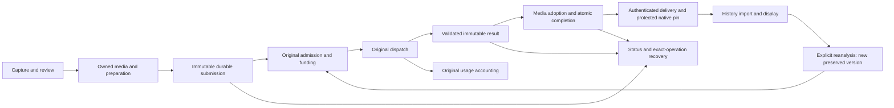

## November 12 — normal OAuth testing entry point

Use the `HistoryTesting` configuration for the primary 1.1.0 app with normal
OAuth and the complete existing History composition. See the
[build, preservation and activation boundaries](24-identification-history-device-review.md#november-12--history-with-normal-oauth).
Main-app Release now prepares the same normal-OAuth capability; Debug and the
older scoped-Auth qualification mode retain their own gates. The Release
configuration excludes local History diagnostic logging. This local source
preparation is not signed/distributed qualification. A built/installed client
does not establish backend activation or all-media acceptance.

Current beta activation is recorded in the
[November12 status](24-identification-history-device-review.md#november-12--beta-history-activation-and-simulator-recovery).
For a newly saved reanalysis, recovery first reads the exact child. A verified
PostgREST `P0002` / `analysis_history_not_found` response permits the existing
first-dispatch path; generic404 or missing-RPC responses do not. Edge missing-
function classification applies only to `/functions/v1/`, because database RPCs
share gateway headers without Edge execution IDs. Completion410 passed focused
tests and resumed the same saved request through this read into photo upload.
The upload exposed a separate live header merge defect: authentication replaced
the endpoint's binary Content-Type with JSON. Completion411 preserves explicit
endpoint encoding while applying current credentials; header-less requests keep
the JSON default. Binary bytes, backend MIME validation and saved request
identities remain unchanged. Completion411 passed79 focused tests in nine
suites, zero failures/skips, and the optimized simulator build. The same saved
photo reanalysis then completed; History displays two preserved versions with
the original still Current. No duplicate submission or retry-count reset was
needed. This qualifies that photo recovery outcome, not selection/review/Undo,
audio/video or cumulative full-scope acceptance.

## Initial audio/video completion UI candidate

The Debug-only `-seedInitialMediaHistory` fixture exercises ordinary initial
audio and video, each with and without optional text, through the existing
submission, terminal completion and explicit History enrollment owners. It
retains one private disposable store across clean process relaunch.
Queue-adopted media and exact submitted text/order are frozen before completion;
video original clip, prepared playback, inference frames and extracted audio
remain distinct.

The real terminal owner must preserve its original account/generation proof,
publish exactly once and release its account lease before the fixture is ready.
The actual Insight sheet opens from the captured queue context after its queue
row retires. Explicit enrollment uses a synthetic V3 imported baseline derived
from the immutable completion proof; original provider/media evidence remains
unavailable in that History baseline. Relaunch opens the persisted result and
History without resubmission or reenrollment. The four UI selectors are in
`InitialMediaHistoryUITests`. Native29205 passes all four audio/video
optional-text journeys and all fourteen lifecycle-provider tests. Engine
directly verified the XCResult and 4,253 unchanged inputs. The batch remains
red: 30 methods passed, two architecture checks failed, zero skipped, two
structured QoS warnings. Seventeen coordinator methods passed in the interrupted
prior run and remain separate reused evidence.

Earlier failures are retained: the result-title oracle (HQ-315), controlled weak
AVAsset lifetime reproduction/correction (HQ-316), synthetic funding state lost
during initial Auth cleanup (HQ-317), and a cancelled-stream test-helper hang
(HQ-318). The corrected Debug join observes actual initial handler exit before
one-time synthetic setup and rejects superseded work. All four scoped fixes are
independently verified. The interrupted run is not a green batch or evidence of
a production deadlock. The exact transport inventory correction (HQ-320) passed
its single-method native29207 check with independent verification; the Auth
aggregate budget (HQ-319) remains open pending an explicit decision on the
separately reviewed, unapplied Debug-only allowance. No existing architecture
limit has been changed.

The synthetic account, entitlement override, running-state transition and server
response do not qualify live Auth, paid dispatch/server admission, upload,
uncertain legacy recovery, abrupt crash, resource bounds, phone installation or
cumulative acceptance. Existing reanalysis review/Undo evidence remains
separate. Shared test seams are restored; fixture-owned retained media and
evidence remain available after the run. Production installation/activation
holds are unchanged.

## Successful persisted reanalysis UI candidate

The additional Debug-only `-seedReanalysisRecoverySuccess` mode supplies an
independent durable synthetic-server ledger to the existing reanalysis restart
fixture. It is unavailable without the existing explicit fixture opt-in. The
three new selectors exhaust the real persisted 30-second checking allowance,
close, make only the synthetic original result available, relaunch, then request
one explicit exact recovery. No new provider dispatch is permitted.

Photo and video use their current completion stores. Audio uses the existing
recovery-only claim/service owner and joins its actual exit; read, upload,
authorize and analyze boundaries fail if invoked. The canonical result binds the
original saved request. Existing History session, selection and review owners
write application records; the separate server ledger validates exact request
identity, revisions and operation replay before returning receipts.

The candidate checks three preserved immutable versions, explicit selection,
rejection/review Undo, a fresh selection Undo, and terminal process relaunch.
After completion, the original fingerprint is retained as a witness; separate
checks verify actual terminal records, selection, review receipts and unchanged
submitted media. Real pending erasure receipts are required, but cleanup is
intent-only: this fixture does not delete media or qualify filesystem cleanup.
Terminal charge is the independent exhausted-budget witness, not a live sidecar
after completion. Native29101 compiled and passed three architecture checks; all
three UI cases failed on an incorrect acknowledgement-message oracle after
review revision invalidation. The source-reviewed test correction requires the
actual stale preview message, explicit Refresh and receipt-backed child
authority/Undo. Corrected native29102 passed all three media UI cases with zero
failures/skips, 4,248 unchanged inputs and independent fix/runtime verification.
Three unchanged architecture01 passes remain applicable: six distinct methods
across the runs. Both01 and02 have a structured QoS priority-inversion warning;
retain both and the original failures. Full iOS tooling01 passed with unchanged
tooling inputs. This qualifies the bounded rendered journey described here.
Synthetic Auth/results, clean restart and local persisted UI do not establish
hosted/phone, abrupt-crash, resource or cumulative functional acceptance.

## Persisted reanalysis recovery UI qualification

A Debug-only local fixture now connects persisted consumed/held photo, audio and
video requests to the existing reanalysis status/saved-request sheets. Each
branch uses its existing durable preparation/execution and presentation-budget
owners, with synthetic account/server boundaries. Reopen performs exact saved
lookup rather than preparation or re-execution. Native29001 compiled and passed
the video clean reader-drained Close/relaunch and retained 30-second-budget
case, including exhaustion, plus three architecture methods. Audio setup and
photo action-isolation failures remain retained. Corrected native29002 passed
audio/photo and three architecture methods with independent fix verification;
the unchanged video01 pass remains applicable and its QoS warning is retained.
Current preview/selection evidence is reused separately. See the
[runtime methodology](18-ios-runtime-quality-and-benchmarking.md).

## November 9 — observation and original recovery composition

The local `check-scan-status` candidate separates explicit observation from
original recovery before legacy parsing. `observe-v1` reports literal row/job
state and always leaves the original result unconfirmed. Held ordinary queue
reads preserve their saved job, media, text and funding identity; they do not
repair, import or repeat analysis. Missing legacy immutable proof remains held.

For genuinely IC-1-admitted operations, `admission-v1` and `completion-v1` use
nested original facts and the existing `initialRecovery.ts` owner. Service-only
wrappers delegate to the existing immutable readers. Native requests contain no
legacy top-level scan ID; old handlers therefore reject before repair. The
canonical acknowledgement excludes private assignment data. Found completion
retains original proof; pending grants no new work. The existing native
pin/apply/enrollment owners remain responsible for durable History continuation.

Local database catalogs, SQL-response-to-HTTP checks, the complete Edge suite
and focused native transport tests pass. Six audio/video queue cases also pass
after a new disk-backed ModelContainer loads persisted state: explicit absent,
processing or complete observations preserve the authority snapshot and trigger
no retry, scheduler, event or result import. This covers the queue presentation
model and synthetic native transport, not rendered UI or a process restart. This
is not hosted activation or the complete cold-restart recovery-to-History
journey. The separate dedicated audio/video UI restart check below now passes.
The bounded literal SQL-to-native join below now passes; remaining
S0/RUX/cumulative qualification stays open. See the
[API contract](../backend-and-data/05-api-contracts.md) and
[status owner](../../services/supabase/functions/check-scan-status/README.md).

The extended native original continuation test now passes through the actual
native transport with synthetic wire bytes: client acknowledgement loss causes
one read and no pin, pending grants no application, and found completion enters
the existing durable pin/apply/enrollment sequence. A new-container continuation
and terminal replay preserve the seeded later selection and notes. This is not a
literal SQL-to-native fixture, server-commit loss proof, process death, live
enrollment transport or a valid selection-owner transition. Its initial test
oracle failure is retained; the corrected focused run passed and was
independently verified. The dedicated held audio/video UI process-relaunch
selector passed native28504 and independent review: eight explicit rendered
status checks, unchanged persisted authority, new process/reopened store and
zero automatic reads at the asserted checkpoints. Synthetic Auth/send, inert
scheduling and filename-only media limit that evidence; it does not establish
live backend recovery or playback. Prior fixture failures remain retained. See
the [runtime methodology](18-ios-runtime-quality-and-benchmarking.md). Wider
HQ-287/S0/RUX acceptance remains open.

The later literal native/SQL join uses the native-created two-photo candidate,
retained synthetic acquisition inputs and owner-read prepared images in the
existing disposable SQL lifecycle. Actual public allocation, acknowledgement and
status response bytes then enter the strict native transport and existing
durable pin/apply/new-container/enrollment-helper/replay owners. Its armed exact
test passed one case with no failures/skips and independent verification; all
four wire hashes and the candidate identity match the database records. The SQL
side records one original dispatch/result/linked usage and exact completion
replay. Six ordered roles contain two distinct synthetic byte digests. Earlier
failed compilation and fixture-identity runs remain retained.

SQL states are captured before native recovery replays their literal replies;
this is not simultaneous live status. Auth, provider, transfer/retention
configuration and enrollment remain synthetic. Native upload/R2, real
enrollment, process death and physical-device qualification are separate
obligations. The opt-in test's ordinary-suite skip is not passing coverage. See
the [runtime methodology](18-ios-runtime-quality-and-benchmarking.md).

The remaining native-photo visible restart branch now has a Debug fixture using
the real recovery sheet and persistent native owners. Its pause/reopen/relaunch
selector and three owning architecture methods passed, with independent exact
source/runtime verification. The test preserves immutable prepared/received
record bytes and charged checking time across a new process, and requires
explicit checks at the asserted checkpoints. Failed compilation and startup
fixtures remain retained. Synthetic account/status send and direct sheet
mounting remain limits; this is no raw-media reread, abrupt in-flight crash,
normal-navigation, History import, phone or performance qualification. See the
[fixture owner](../../apps/ios/Merian/App/README.md).

The Debug positive Add-to-History and Open-result controls now pass native28902
and independent verification through the actual completion/enrollment owners:
one explicit enrollment and a separate exact route request, preserving prepared
bytes and selection. Existing owner postconditions preserve the receiving row.
The one passing02 method plus four unchanged01 passes provide scoped five-method
coverage; full iOS CI tooling passed. Failed01's immediate enabled assertion is
retained; corrected02 waits for action readiness after observation. Synthetic
server/account boundaries, ordinary result-screen navigation, positive process
death, hosted/phone and resource qualification remain explicit limits.

## November 9 — explicit observation-only recovery status

The qualification source uses a closed `observe-v1` request on the existing
`check-scan-status` endpoint. It has no legacy top-level scan ID, so older
handlers reject it before their repair path. The response reports only literal
owner-row presence and last recorded job status. It explicitly supplies no
original-result evidence; a complete job does not authorize result import,
History selection, funding settlement, replacement or another AI execution.

The native receiving owner retains its existing account/physical operation
checks. Ordinary queued photo/audio/video checks use a fresh queue/job snapshot
through `OfflineQueueDurableAuthorityReader`, positive account-bound funding
metadata, the existing account-work lease and exact post-await identity checks.
A malformed or coexisting release marker refuses the read. The Content service
owns live composition; its model captures a visible presentation ticket at the
tap before scheduling work. Closing, backgrounding, account change or navigation
invalidates pending taps and discards late results. Observation performs no
retry, scheduler write, event publication or completion import. Known consent
and plan actions retain their existing owners.

The isolated backend commit `ee7ebf8b` passed 4,384 Edge tests/1,164 steps, zero
failures/skips, against an owned exact 515-migration replay. All 125 entrypoints
typechecked; whole-tree lint/format passed. The earlier wrong-local- catalog run
remains recorded as HQ-292. Native source fixes for strict funding metadata and
pre-start presentation lifetime (HQ-293/HQ-294) received independent review;
native compilation/runtime remain pending at this checkpoint. No publication,
deployment or installation is implied.

HQ-287 remains open for exact original initial-result recovery. Legacy absence
stays held, and IC-1 admission/completion serving still requires its existing S0
acceptance; observation cannot reconstruct missing immutable proof.

## November 9 — native pending original-photo preview candidate

The pending-submission view can request one indexed original-photo raster
through the existing native receiving locks and accounting owner. The complete
frozen original cohort is hashed and sealed before the selected image is
downsampled to 2048 pixels; no original URL or raw bytes reach the feature. A
fresh local scope check reuses the physical seals without decoding or hashing
again. Closing, backgrounding, refreshing or changing account discards the image
and drains pending reads before releasing presentation lifetime. This adds no
preparation, retry, admission, funding, History selection or legacy-proof
backfill.

Completion279 native02 passed 46 methods/109 expanded cases, zero
failures/skips, with 4,183 unchanged inputs. Engine independently verified
source and runtime; the first lint failure remains retained. Legacy absence
remains unavailable. This is local synthetic receiving/readback/presentation
evidence; Vision quality, measured timing/memory budgets,
physical-device/accessibility and whole-candidate acceptance remain open.

## November 9 — remaining exact initial recovery and saved-audio preview

At the earlier completion276 checkpoint, HQ-287 recorded an initial ordinary
audio/video recovery gap: the queued screen offered generic retry, while the
legacy status handler could repair a stranded attempt even without
`recovery_scan`. Historical rows and Identify’s completed replay are mutable
projections, not the original immutable result proof. The proposed client-only
status adapter was removed before testing or use. Prepared IC-1 has immutable
result/completion storage, but its original admission is required; it cannot
backfill missing legacy proof. Preserve held legacy operations and later
selections while this integration is completed.

The saved reanalysis audio preview candidate reads the selected child’s exact
bounded WAV through the existing strict resume and file owners. The shared
player accepts verified memory bytes without a temporary file or export. It
loads silently, validates scope before audible playback, and stops/releases on
closure, background or scope loss. Native27602 passed36 methods/59 expanded
cases, zero skips, with4,176 unchanged inputs and independent source/runtime
verification. The prior initializer compile failure remains retained. This does
not qualify physical playback, other media previews or resolve HQ-287. Evidence:
`completion276-initial-recovery-gap01.json` in the native-app handoff directory.

# Trace a scan from Capture to History

## November 9 — CI515 failure retained

The independently reviewed four-file fixture correction is published as
`172f59b736be8838c60408072e8d9ab6f8bb01a0` on
`codex/history-backend-counter-window-20261109`.
[CI516](https://github.com/emreerdener/merian/actions/runs/42611716623) passed
on that exact candidate: 4,377 Edge tests/1,164 steps, 10,360 executed SQL
assertions with two declared skips, the separate 18-suite C1 artifact and
22-suite/1,043-check handoff artifact. Engine verified source pins and owned
disposal; see `completion277-ci516-handoff-reconciled01.json`. Final local
both-order contention, all ten recorded checks, ten deterministic timing tests
and owned disposal passed; Engine verified 532 source pins and all 515
migrations. The forced rollover and intermediate probe/unit failures remain
retained. This is a test-fixture correction; the original CI515 cause remains
unproven. CI516 is complete; see `completion273-ci-run01.json` and
`completion273-source-review01.json`.

CI515 on backend `516f5c9c41ee4adeca50c5dce64ced847585adb9` failed in
`counter-order`, second admission before contention, with fixture assertion
`ZX601`. The first order passed and no deadlocks were reported. HQ-284 remains
open: the retained evidence does not distinguish counter-image mismatch from
remaining staging. A quota-window boundary is a source-level oracle risk, not a
proven cause of this failure. No unchanged retry is authorized as remediation.
The full Edge suite passed 4,377 tests/1,164 steps, including all nine guarded
V5 completion/action cohorts; their earlier helper skips remain recorded. Eight
C1 suites completed; the failed ninth and all later unrun suites remain
distinct. Private-handoff suites did not run. The owned CI database was stopped,
and the handoff ownership snapshot was absent. See
`completion273-ci515-reconciliation01.json` in the native-app handoff evidence.
The unsigned native272 build and six bounded integration cases remain applicable
within their recorded scope. HQ-283 durable saved-reanalysis recovery, HQ-243
failure causality, cumulative review and real-app qualification remain open.
Phone connection is deferred; this is not the final manual-testing checkpoint.

This is the contributor entry point for initial analysis, preserved reanalysis
and recovery. Follow the linked owners for normative contracts. A private
implementation or local synthetic test is not an installed app journey.

## Current integration boundary

HQ-283 implementation is in progress.
`ObservationReanalysisRecoveryPresentationStore` uses the existing V68 queue
sidecar and the shared 30-second/60-transition value. It compares exact sidecar
predecessors within the existing parent/source/account and deletion transaction,
records a fixed 512-byte liability on the dedicated reanalysis job, and leaves
execution metadata and timestamps unchanged. The first reservation also uses the
existing best-effort local disk admission policy; this is not a global storage
ledger. Completion removes the sidecar with its existing child/job transaction.
Only a live acknowledged reservation can refund unused visible time; an
ambiguous reserve save remains spent. The store passed 18 focused methods/49
expanded cases with no skips and all 4,169 inputs unchanged
(`completion274-native-summary02.json`). Saved-request screen integration is
implemented and compiled: the shared `AnalysisRecoveryCheckingModel` reserves
before showing a visible clock and retains an accepted check through
close/background. Audio/video use consumed-only recovery and capture the exact
existing queue task through lease exit; a fresh immutable result read
establishes success. Task exit alone does not. An open backgrounded screen
retains a completion signal for one foreground refresh; closed screens never
reopen. Fresh parent validation suppresses feedback after deletion. The
corrected native27404 integration passed five methods/11 expanded cases, zero
skips, using the actual photo status and audio/video saved-request models,
retained owners and atomic local completion with synthetic result transport.
Engine independently verified the exact inputs and HQ-285/286 fixes.
Native27403's other 124 passing cases remain scoped evidence; its three photo
fixture failures and native27402's compilation failure are retained. See
`completion274-native-reconciled03.json` and
`completion274-native-reconciled04.json` under the native-app handoff directory.
Verified saved-original viewing, UI/accessibility, process restart and whole RUX
acceptance remain open. The recovery sheets explain that result checks require
connectivity and background completion is not guaranteed. Native27501 passed six
integration architecture checks and both real audio submission/saved-request UI
tests (eight methods, zero skips; all 4,174 inputs unchanged). Engine verified
source and actual runtime evidence. Two consumed-outcome checks preserve one
initial start/authorization and the same identity even when its owned WAV is
absent; audio connectivity copy is asserted. Photo/video recovery UI,
VoiceOver/Dynamic Type/focus and original-media viewing remain unqualified.
Prior native272 evidence does not qualify these changes.

November 9 completion271/272 candidate: reader11 action support implements
completed V5 video selection, review and Undo (HQ-282), preserving existing
receipt, revision, account and deletion ownership. V5 publication, selected chat
and historical-source reuse remain unavailable. The updated unsigned primary-app
qualification build passed with all 4,165 inputs matching (651.955 seconds); its
main executable SHA-256 begins `97d05a3ffe996dedd`. Version 1.0.3/build 275
alone does not identify this artifact: use
`completion272-qualification-build01-verification.json` under the retained
handoff directory. Private approval fields remain empty; no installation or
launch occurred.

Focused native evidence covers 66 current method identities; nine guarded V5
backend cohorts pass on the shared 517-migration snapshot. The isolated
515-migration candidate `516f5c9` passed local catalog/lint and complete
reconciled tooling gates;
[CI515](https://github.com/emreerdener/merian/actions/runs/42602830770) is
failed as recorded above; its nine guarded V5 runtime cohorts passed, while
remaining C1/private-handoff gates did not. CI516 is the current successor. A
separate 927-assertion namespace-peer run passed without skips and independent
review; CI514's historical two skips remain recorded. The extended actual
Capture terminal harness passes three methods/six media-and-optional-text cases
across native03/04, with independent runtime and exact audio applicability
verification. It joins terminal completion, enrollment
acknowledgement/state-read interruption, reanalysis recovery, selected-child
review, explicit selection and Undo while retaining immutable versions and
pending cleanup authority. Original compile, media-path, submission-proof and
stale-cache fixture failures remain retained. Actual erasure, restart,
UI/accessibility and installed/hosted qualification are outside these six cases;
they do not close whole RUX6 or cumulative acceptance.

November 9 backend checkpoint: the reviewed validation-CPU correction `23ef723`
passed [CI514](https://github.com/emreerdener/merian/actions/runs/42585351088).
Engine independently verified 18 C1 suites/301 checks and 22 handoff
suites/1,043 checks, exact source/514-migration hashes and owned disposal.
HQ-281 is fixed in that local/CI scope; its earlier unacknowledged transfer
remains retained. The full Edge suite passed 4,377 tests/1,164 steps; all 102
earlier shared-helper ignored cases were matched to full-suite passes. The SQL
catalog retains two known namespace-peer skips (10,359 executed assertions).
Cumulative native/backend evidence reconciliation is in progress; no
whole-candidate, beta deployment or device acceptance is implied.

The November 8 CST primary-app qualification revision reuses the ordinary
bundle, shared library/media locations and existing Google registration. Its
compiled qualification scope and separate internal Auth journal remain.
Sign-out, Auth-failure cleanup and explicit store replacement are blocked to
preserve existing data. See the
[device-review revision](24-identification-history-device-review.md#november-8-cst--primary-app-qualification-revision)
for evidence and pending populated-store/install-over requirements; historical
separate-bundle receipts do not qualify the revised build.

Initial analysis, preserved reanalysis and exact-operation recovery have local
native/backend implementations and scoped synthetic journey evidence for photo,
audio and video. Protected native result pinning and History import have local
implementation and focused validation; their installed all-media behavior is
still unverified. The linked sections below distinguish each journey's evidence
and remaining acceptance.

Ordinary builds keep the new native History composition inactive. The separate
`HistoryQualification` configuration permits the existing composition only with
a compiled, validated private target/account scope. Its public default packet is
empty and inactive. Native250 qualified the inactive controls and unsigned
app/watch/widget/Messages build. Native251's conditional connection passed 41
methods / 61 expanded cases and independent source review; its combined
qualification-branch compiled successfully in native253 for all four unsigned
products (551.024s, 4,163 matching pins). Native252 passed 133 methods / 337
expanded cases; seven previously skipped iOS27 parser methods also passed. The
first run retained a documentation-only pin mismatch, with executable-input
applicability reconciled separately. Its passing runtime evidence does not
qualify the changed API document. Native253 retained 385 unique warning headers;
the closure-parenthesization correction passed refreshed native254 compilation
(524.523s, all 4,163 pins matching). The corrected diagnostic is absent; 383
unique warning headers remain, including five unchanged predecessor diagnostics
in touched files. No warning-free build is claimed. No qualification app has
been installed or launched against the beta backend.

Provider exchange remains refused. The authorized November 8 read-only beta
inspection found signup enabled and required History functions absent; anonymous
sign-in remains unverified. The authorized migration inspection ultimately
succeeded through PR147's public-CA fix, merged as `24094e3`, with certificate
and hostname checks retained. Run42525137324 recorded 372 migration versions at
21:25:46 UTC on November 8. Inspector main has 36 unapplied versions; the shared
History inventory has 141 and is not an immutable release candidate. The eight
out-of-order gaps match the existing digest-pinned recovery, verified offline
without network or environment access. The earlier generic and certificate
failures remain retained. Existing Production secrets stayed in GitHub Actions;
no local password setup, temporary role, secret change or backend deployment
occurred. Version presence alone does not qualify backend compatibility.
Native260 corrects rejected-replacement publication locally: final callback and
architecture validation passed 30 methods, with 35 unchanged provider/workflow
methods retaining earlier passes. Original inventory/budget failures remain
retained; all limits stay unchanged. A separately authorized read-only check
verified the selected existing Google account mapping at 22:30:24 UTC on
November 8. Fingerprints/provenance remain private outside the repository.
Server-side signup/linking containment and mapping freshness at exchange remain
unverified; Google sign-in is not authorized. The isolated backend source
snapshot `9f0deff` matches completion220's 511 migrations and 1,523
function-source pins, with generated completion-contract companions matching
native260. It excludes the separate web changes and remains a preparation
candidate. Under explicit user authorization it is published to its own branch;
validation-only Actions run42534204389 failed on a missing native golden-test
source companion (HQ269): 4,367 Edge tests passed, one failed, and database
catalogs passed 7,953 assertions. Later lint/contention/private-handoff checks
were skipped. The original failure is retained for a local assembly correction.
The five-file successor `064735e9` now uses a shared synthetic fixture while
preserving every backend rejection check. Its companion native byte-parity test
passed within 13 methods / 52 expanded cases, with zero failures/skips.
Independent review accepted the correction. Its authorized validation-only
run42537146587 subsequently failed database lint (HQ271). The repair passed
strict lint and all 8,188 catalog assertions in CI510; that run exposed the
preparation-contention fixture mismatch (HQ272). CI511 verified its correction
and then exposed the C1 dispatched-cancellation fixture mismatch (HQ273). Each
failure remains retained with its causal fix. The five-file test/docs successor
`cdab286f` passed 17 local C1 suites / 279 recorded checks on 512 identical
migrations; Engine independently verified its three affected suites. Authorized
validation-only run42552573543 (CI512) completed on that exact SHA: all 18 C1
suites passed 301 checks, then private-handoff state failed a stale snapshot
inventory assertion (HQ274). The corrected exact inventory passed all 266 local
state checks with independent fix verification. Owners passed 89 checks. A
second stale shared cancellation-catalog expectation (HQ276) was corrected; both
transfer/C1 orders passed all 21 checks and independent verification. The
original failures remain retained. Completion269 additionally repaired a stale
cancellation-stage fixture, the private decoder's current 22-column legacy row
contract, a renamed corruption-test constraint and explicit failed-fixture
teardown. All 22 local handoff suites passed 1,043 recorded checks, plus
separate bridge/coordinator subtests. Engine verified each fix and the complete
local source/replay/result/disposal evidence. The three all-media resource
cohorts passed with maximum SQL calls of 3.786, 3.631 and 4.043 seconds under
the unchanged five-second limit. These are synthetic transport/storage
observations, not installed-device or physical-backend qualification. Clean
isolated successor `5dd70023f3c3aaa255d516dd40c1f837333e79ca` was published
under explicit approval; its one
[validation-only CI run513](https://github.com/emreerdener/merian/actions/runs/42566671974)
failed resource qualification after all earlier gates and 17 handoff suites
passed. The maximum photo/audio transfer missed its unchanged five-second
acknowledgement deadline and recovered unresolved (HQ-281); four later handoff
suites did not run. The failure is retained for causal profiling and a reviewed
fix, not a timing waiver or automatic retry. It is not merged, deployed or
release-qualified. Its historical remote comparison has 140 unapplied
migrations; the shared 513-migration inventory's 141-version gap above is a
different scope. Neither snapshot is deployed. Local tests do not qualify
provider execution, actual SDK/account transitions, installed recovery or
resource limits. The local identity-evidence validator binds
approval/target/provider/account and evidence validity. Completion265 implements
the inactive Google consumer, exact-subject checks, durable pending storage
fence and exact-attempt acceptance receipt. Empty public inputs still deny
presentation and exchange. Its native05 gate passed 106 tests; focused native06
passed 31, with zero failures/skips and 4,165 matching input pins. The inactive
unsigned 1.0.3 (275) qualification build passed in 567.575 seconds with matching
inputs and no touched-source compiler diagnostics. It has not been installed.
Current private mapping/server-refusal evidence and explicit operation
authorization remain prerequisites for live use. Host-Swift checks pass under
ordinary and qualification markers. An independently suspected newline defect
was disproved with unchanged-source LF/CRLF regressions and withdrawn; no
speculative fix was applied. The complete iOS tooling gate also passes. Required
all-media qualification, cumulative whole-candidate review and the user's final
walkthrough remain open. Individual-version deletion, original-media export and
the approved redesign follow that acceptance boundary; replacement retains its
[separate contract](../rfcs/unresolved-analysis-recovery-and-replacement-2026-10-18.md).

The arrows describe the intended integrated journey; they do not assert that
every route is installed. In particular, initial completion and reanalysis use
their distinct existing owners and funding rules.

Start with the [journey diagram](#current-integration-boundary), then find the
[owner for the interrupted step](#owners-and-identities). For an initial photo,
saving the draft and freezing its allocation do not mean identification has
started. The inactive
[Capture submit caller](../../apps/ios/Merian/Features/Capture/Submission/README.md#fresh-initial-photo-first-original-upload)
sent the original once in each local simulator case. Capture checked the
original attempt and reopened three outcomes. It retained the verified receipt,
held an open write, or held the closed attempt after a lost confirmation reply.
The
[transfer owner](../../apps/ios/Merian/Core/Data/SharedMediaStorage/README.md#initial-photo-checking-progress-for-one-uploaded-role)
distinguishes an attempted upload, authenticated observation of the original
bytes, and eligibility to transfer another role. The local
[ordered roster candidate](../../apps/ios/Merian/Core/Data/SharedMediaStorage/README.md#continuing-the-assigned-photo-roles)
uses the original caller and fresh storage confirmation before each following
file. Full-cohort admission must succeed before the first analysis. For a photo
already in History, the
[retained-photo journey](#retained-initial-photo-display-candidate) covers a
different outcome: explicitly submitting a child, recovering its result after a
lost reply, selecting it and undoing that selection. Its local simulator
evidence does not qualify fresh submission, audio or video.

The simulator completed one-photo and two-photo rosters in their assigned order.
A freshly sealed roster requested admission once. Capture recovered a lost reply
by reading the original receipt, held on a negative answer, and checked consent
again before saving. See the
[inactive facade](../../services/supabase/functions/initial-photo-transfer/README.md).

A joined one-photo case used the same Capture submission after reopening the
store. With a synthetic initial result, History retained the submitted AI image
and exact supporting descriptions. An explicit child submission lost its
simulated inference reply, recovered its result without repeating inference, and
preserved both versions. Selecting the child and using Undo restored the
original. The initial provider execution and its charge still need qualification
against the saved configuration and verified image bytes.

The existing explicit audio host also accepts that completed photo baseline.
Native221 verifies a newly supplied WAV with ordered optional text, one
persisted child, recovery of its lost reply and selection/Undo with both
versions retained. Its two focused methods passed with matching source inputs
and independent review. This local synthetic join covers fresh child audio.
Initial-audio capture, retained original-audio reuse, installed routing and
provider execution retain their own qualification requirements.

For server preparation, the
[CPM photo request owner](../../services/supabase/functions/_shared/initialAnalysis/cpmPhotoExecutionRequest.ts)
matches the original admission and assigned AI-role object IDs before it
constructs provider parameters. It checks dimensions, JPEG structure and hash on
the exact bytes it encodes. The private English Gemini vision profile sends the
images in photo order, followed by one JSON array of supporting descriptions.
The [disposable photo journey](../../services/supabase/README.md) verified one
committed original reservation, one usage event, exact result recovery, six
terminal reads, and replay of the same two-photo completion. Provider execution
and usage in that run were synthetic. The original server still needs to bind
the installed executable and actual prepared snapshot before issuing a dispatch
grant.

Completion recovery has three observable states. Before original dispatch the
completion reader refuses access; use original admission recovery. After
dispatch it returns `pending`, even if the result has been stored but completion
has yet to commit. After completion it returns `found` with the same canonical
result and original invocation. Each explicit read makes one status request.
None of these responses grants permission to run inference.

## Settled status tracking and initial completion candidate

The204 source candidate permits strict identity-bound settled presentation bytes
through initial admission/completion pins and application, including exhausted
checking time. Active reservations still hold completion. Ordinary allocation
stays nil-only. The validated initial-pin witness now participates in explicit
pending-status projection and first reservation; it grants no execution right.

New application receipts use `nativeInitialApplicationV2`, committing the exact
optional queue-side presentation presence, byte count and domain-separated
digest before atomic queue deletion. V1 receipts remain canonically readable and
mean no presentation bytes. Pinning preserves the exact bytes; the full 512-byte
liability remains charged through the predecessor. Measured cohort metadata
includes the new commitment, and History acknowledgement preserves it. No cold
replay recreates a reservation or visible allowance. Native204 passed3methods/
4cases with no failures/skips and independent scoped evidence verification.

The205 candidate connects app status access to the existing native owner while
installation remains false. Owner-epoch registrations track exact live
intervals; settlement quiesces one exact token after the model freezes time.
Undelivered intervals are quiesced before an outer error escapes, and owner
shutdown cannot succeed while one remains live. Cold retirement requires no live
interval, rechecks that condition immediately before save, and keeps the full
charged time and512-byte liability. It clears the active ID and advances once,
with exact uncertain-successor readback. Cold bytes never grant visible
allowance.

The owner retains every attempted reservation, renewal, retirement and
settlement before outer fences can fail. Uncertainty reconciles the exact
attempt or remains held without a clock; an explicit identity-checked status
read remains separate. An exactly recovered active reservation can only forfeit
its charge, never regain unused time. Engine found and independently verified
the source fix for initially discarded attempts. Focused205 validation
passed9methods/16cases with no failures, skips or structured runtime warnings
and independent scoped verification. Actual SQLite save faults, crashes, device
journeys and cumulative acceptance remain open.

The206 source caps retained attempts at the existing four-package limit before
any new transition. Owner dispatch serializes admission across awaits. Capacity
holds the clock while explicit status remains available; uncertainty is never
evicted. Verified application or exact replay removes only the same attempt
captured before awaiting, with no live interval and matching Prepared, original
cohort and receipt presentation commitment. Removal follows all outer account
and lock fences and changes no durable budget or inventory revision. A lost
application reply retains the entry until verified replay. Focused206 validation
passed two methods/three cases with independent scoped verification. Its long
runtime remains measured evidence, not performance acceptance.

The207 repair restores the private raw receiving-lock wrapper and replaces
generic recovery callbacks with closed, one-use actions minted only beside the
recovery owner. The action derives both lock identities and execution target
from one fresh candidate or opaque interval; exact candidate validation repeats
inside the locks. Verified application proof is minted after the existing outer
fences and binds its owner, writer epoch and preparation before registry
cleanup. Engine source review and seven-method/nine-case native validation
passed with independent scoped verification. The original visibility regression
remains recorded as HQ187, closed at this repaired boundary.

## Retained initial photo display candidate

The subsequent retained-photo reanalysis candidate uses a separate `.ai` read
through the same native owner. Its typed local origin survives selection and
editing until the existing child preparation transaction takes ownership.
Current selection may advance while the opened historical source remains fixed.
See the
[frozen refinement source contract](../../apps/ios/Merian/Core/Data/AnalysisHistory/README.md#frozen-refinement-source)
for exact identities, copied-byte retry ownership and fences. Local simulator
tests verified explicit selection of retained AI photos, edits and durable child
preparation (34 methods, 43 cases). The integrated lost-reply test recovered the
child, preserved both result versions and then failed when selecting the child:
the original had no acknowledged review envelope (HQ206). With the first-import
correction, the simulator reached selection and Undo, preserved both versions,
then refused to reopen the original media because the completed selection
receipt shared the ingestion job's observation ID (HQ207). See the
[storage handoff contract](../../apps/ios/Merian/Core/Data/SharedMediaStorage/README.md)
for the scoped correction. After both fixes, the simulator recovered the child
without another analysis, selected it, undid the selection and reopened the
original media. Both immutable versions remained available. This fixture begins
at a saved photo allocation and uses synthetic replies. Fresh Capture through
first analysis, installed operation and all-media qualification remain open.

The208 source joins both the native Capture scan route and
`LocalScanInsightLoader` to `Shell/Services/NativeInitialInsightMedia`. The
existing native owner reads only the verified `.display` cohort. A closed
`retainedInitial` query resolves the exact observation/binding through the full
Applied witness; it returns descriptive preparation, never a file or execution
grant. The composition rechecks account, session, container, presentation
generation and binding around awaits. After file I/O, a synchronous fresh
Applied query rejects queued deletion even when the binding survives, then
publishes without another suspension. No managed record crosses I/O and no
transaction is held over engine hydration. This final fence corrects source
finding HQ189.

Historical loading still projects the fresh selected identification result. Only
transient media is supplied separately: retained display photos and exact
immutable initial supporting contexts. Selection changes result-centric display,
not the parent capture's submitted text. No paths are written into legacy media
snapshots and no automatic AI execution occurs.

`MediaItem.retainedDisplayImage` is presentation-only. Inline/fullscreen
galleries and original-capture review views render it; upload inputs and Field
Chat exclude it. Download and sharing remain unavailable for this candidate
until the separate original-media export work is qualified. The installation
guard remains false. Source review, compilation and focused native validation
passed with independent verification:79methods across the original run and
focused hydration rerun. The original failed assertion is retained; it
overconstrained reference hydration, while submitted items remained unchanged.
This does not qualify an installed app journey.

## Explicit initial History continuation candidate

The existing Capture recovery composition now joins exact local continuation,
saved-result recovery, initial application, `ObservationHistoryEnrollmentOwner`
and native History acknowledgement. Its closed targeted query binds the full
received candidate: account/store profile, package, draft, operation, revision,
prepared hash and received hash. Retained library size is not constrained by the
pending-package cap. A retained initial result skips application, an exact
baseline association skips enrollment, and acknowledged History skips network
and saves. Unknown enrollment outcomes retain their existing durable hold. A
subsequent explicit action first validates the native metadata and exact
existing intent through the enrollment owner, before opening native media
authority. That proof is rechecked before dispatch/import and cannot stage a
replacement intent. Shared enrollment uses account/container authority
independent of presentation.

The model's explicit action has separate duplicate-tap, presentation,
cancellation and drain fences. Closing or hiding it cannot restore late state;
status/discovery never starts completion. The202 inactive composition adds
explicit restart discovery through the closed `initialHandoffPage` query and
`ObservationHistoryEnrollmentService.nativeRecoveryPage`. Both use128 inspected
keys, bind cursor kind/profile/inventory and bootstrap header, and replace
rather than accumulate pages. Pending discovery retains its separate
four-package cap. Full candidate selection revalidates the original operation
and content.

An unresolved enrollment intent deliberately blocks ordinary native media and
retained-page reads. The metadata-only enrollment page remains reachable when
pending discovery fails; it restores the existing intent without opening media
authority. Only this page and a proven `enrollmentHeld` selection may proceed
when a native lifetime is absent. Sealed or stale registrations still fail;
completed native work must attach its ordinary lifetime before displaying a
saved outcome. The203 candidate adds a separate explicit Open result action
after acknowledgement; installation remains inactive. Source review and
preflight passed;202 native02 passed13methods/30cases with no failures/skips.
Native203-02 passed13methods/29cases for the positive-after-skipped-page handoff
and explicit routing. Native203-03 separately passed the corrected XCTest
scan-route selector; all scoped evidence received independent review. The201
composition passed source preflight, independent boundary review and focused
native201-04 qualification:19methods/29expanded cases, zero failures/skips. This
includes explicit continuation/reopen, acknowledgement replay without network or
save, exact-intent enrollment recovery and presentation drains. Earlier compile
failures remain retained. Full functional qualification remains open.

The Open result action uses the existing `AppRouteCoordinator` scan route with
an internal user-action envelope and the observation ID only. It checks the
captured account, auth generation, exact container and library-access fences;
the existing route coordinator also rejects stale queued envelopes. Completion
itself never navigates. Opening reads the current saved scan without selecting
the acknowledgement's baseline analysis or writing history state. Closing the
recovery presentation prevents duplicate taps. This is an inactive candidate,
not installed UI or complete functional qualification.

## Owners and identities

| Boundary                                            | Owning source and contract                                                                                                                                                       | Identity that must survive interruption                                                                                                                         |
| --------------------------------------------------- | -------------------------------------------------------------------------------------------------------------------------------------------------------------------------------- | --------------------------------------------------------------------------------------------------------------------------------------------------------------- |
| Capture selection, optional text and submit         | [Capture Submission](../../apps/ios/Merian/Features/Capture/Submission/README.md)                                                                                                | Original receiving owner and frozen submitted media/text; later visible selection is independent                                                                |
| Original bytes, preparation, references and cleanup | [SharedMediaStorage](../../apps/ios/Merian/Core/Data/SharedMediaStorage/README.md)                                                                                               | Package, original reference, owned file and preparation revision; never a guessed temporary path                                                                |
| Durable native work and transport                   | [Scan ingestion and recovery](../backend-and-data/16-scan-ingestion-reliability-and-recovery.md)                                                                                 | Original operation and saved request/assignment, account and container generation                                                                               |
| Initial admission, dispatch, result and accounting  | [Initial-analysis implementation](../../services/supabase/functions/_shared/initialAnalysis/README.md)                                                                           | Scan/owner, submission/configuration/funding/media digests, original admission receipt, original reservation/attempt and invocation                             |
| Native result validation and protected pin          | [Network](../../apps/ios/Merian/Core/Network/README.md) and [SharedMediaStorage](../../apps/ios/Merian/Core/Data/SharedMediaStorage/README.md)                                   | Frozen result/provenance, exact receipt and saved admission; validator parity and protected pin checks passed; serving and retained application remain inactive |
| Completion and first history import                 | [IC-1](../rfcs/initial-completion-history-interface-2026-10-11.md)                                                                                                               | Original result evidence UUID/digest and immutable completion receipt/projection; locally implemented/validated, installed all-media acceptance remains open    |
| Reanalysis, selection, review and Undo              | [AnalysisHistory](../../apps/ios/Merian/Core/Data/AnalysisHistory/README.md) and [reversible reanalysis](../rfcs/reversible-reanalysis-and-identification-history-2026-10-02.md) | Observation, preserved analysis version, selection/review revisions and matching Undo receipt                                                                   |

An operation identifies requested work; an invocation identifies the one
authorized provider attempt. A result is immutable evidence, while a selection
chooses which preserved version is displayed. A completion settles and delivers
the original work; it must not overwrite later selection, review, notes or text.
An entitlement snapshot retained for response-loss recovery is historical
evidence, not permission to spend again.

## Exact submitted content and media differences

- Photos retain their original source. The client-prepared photo branch also
  binds distinct source/AI/display roles to their exact immutable identities and
  ordered optional contexts. Its private terminal adoption keeps those objects
  in place; an expiring private display ticket cannot become a permanent public
  `captured_media` URL.
- Audio preserves its original container and optional text. Preparation and
  provider upload must use the saved format/profile and verified bytes; a WAV
  source cannot be silently relabelled as M4A or replaced with a later
  recording.
- Video and mixed media preserve the original ordered cohort and the saved
  frame/audio preparation contract. Passing photo tests does not qualify these
  paths, resource envelopes or installed media delivery.
- Historical server-prepared operations retain their exact legacy assignment,
  format and recovery owner. The newer photo branch is not a fallback decoder.
  Fresh text-only identification is outside this work.

Ordinary initial audio enters `OfflineQueueManager.enqueueNonVisualCapture`.
`OfflineCaptureFileStore.persistFiles` copies the WAV into queue-owned storage
before acceptance and records its ordered audio reference in
`OfflineQueuedScan.capturedMediaJSON`. Finalization carries that same descriptor
through `ExtractedScanData` and `BackgroundDatabaseActor` into the completed
`LocalScanRecord`. Cleanup preserves the adopted audio path. Normal
`ObservationHistoryEnrollmentService.enroll` then associates the original V3
baseline with that observation. The V3 snapshot has no audio evidence field, so
its snapshot digest does not attest the retained WAV bytes. The scan identity
and captured-media descriptor own that association. The native photo baseline
proof applies to its separate photo path. Native222 locally verifies ordinary
Capture audio with and without optional text through durable completion and
Insight binding. It preserves exact WAV bytes and ordered media values after
caller-side replacement and terminal replay. Native223 also verifies normal V3
enrollment, interruption of its first state read, exact baseline recovery and
selected History preview for that completed audio scan. The next joined
child-selection check exposed HQ217. Completion226 adds the durable original
completion proof described below; native226-02 passes both optional-text audio
cases through explicit reanalysis access, child lost-reply recovery and
selection/Undo while retaining the legacy-Undo guard.

The [schema contract](../backend-and-data/04-database-schema.md),
[API contract](../backend-and-data/05-api-contracts.md) and owner READMEs link
the executable codecs and generated DTO boundaries. Extend those authorities; do
not create another interpretation of stored JSON.

The inactive
[terminal retention preparation](../../services/supabase/functions/_shared/initialAnalysis/README.md#cpm-terminal-retention-preparation-inactive)
now supplies a separate immutable policy catalog, original post-dispatch role
snapshot and bounded fresh-byte verification. No policy is installed; the
adoption transaction and cleanup guards are implemented privately. The local
two-photo journey completed adoption with six distinct verified objects and
recovered the original completion status. Hosted delivery remains separately
gated. Preparation checks do not qualify a completed CPM journey.

## Dispatch, retention and fences

Private original dispatch locks the existing owner/scan scope and validates the
live original admission. It requires reserved original funding, the pending
lifecycle and no existing invocation for either scan or reservation. Existing
writers derive the invocation identity/price and quota timestamp once. The
transaction witness consumes exact quota, counter-link, invocation and lifecycle
images, with immediate and deferred checks. Committed or uncertain outcomes
never become an automatic fresh execution grant.

Original result/read authority retains the submitted identities and original
invocation. Late results do not renew an execution lease or reprice unknown
accounting. Recovery reads existing evidence or explicit absence; absence does
not authorize another inference. Follow the
[dispatch contract](../rfcs/initial-dispatch-fence-interface-2026-10-13.md) for
current phases and the required installed-runtime/same-buffer media checks.

Account replacement, scan/account deletion, cancellation and restart all fence
later delivery. Existing cancellation and erasure owners retire authority before
private evidence disappears. Permanent object/operation fences prevent rebinding
erased keys. Shared media reference counts, retained capacity and physical
cleanup remain with their original owners; neither timeout nor an empty lookup
is cleanup permission. Terminal adoption must preserve these rules before it is
enabled.

## Validate and diagnose

Use the [testing strategy](08-testing-strategy.md) for local checkpoints,
complete affected gates, build storage and evidence retention. The
[device guide](24-identification-history-device-review.md) owns qualification
builds and the exact target/operation authorization packet. Ordinary tracked app
defaults point to production; they are not a local test environment.

For private SQL dispatch, `services/supabase/scripts/test_initial_dispatch.py`
requires an explicit fresh disposable container and its exact migration replay
manifest. `--media-vector 0` uses the guarded client-prepared photo fixture; 1–6
select the existing guarded legacy vectors. `--funding-mode` chooses the
fixture's original funding; `--journey` adds synthetic result/accounting/read
and cancellation checks after real SQL dispatch. The separate
`test_initial_dispatch_races.py` targets both committed dispatch/C1 orders.
These commands neither contact providers nor establish device qualification.

When interrupted, first identify the last durable boundary, then read its saved
operation through the existing recovery owner. Distinguish admission absence,
unknown dispatch, retained result and completed receipt. Preserve the original
request and any later user selection. Inspect metadata-only error/phase
evidence; never copy leases, credentials, raw coordinates or provider bodies
into logs. Do not reset the account, discard a pending package or repeat AI
execution to make an unknown outcome disappear.

The existing `check-scan-status` response is a lifecycle probe, not an immutable
completion receipt. Its legacy missing-scan path can repair ingestion; the new
original-completion recovery branch must not fall through to that behavior.
`NativeReceivedStatusTransport` retains its 4 KiB response ceiling and account
fences. Delivery of larger completion documents needs a separately bounded
contract plus a durable saved admission/result binding before History import.

Current candidate hashes, executed variants, failures, review receipts and
remaining outcomes live in the History continuation and findings records under
`.artifacts/`. Historical passing receipts apply only to their recorded source,
dependencies and environment. The
[cumulative agreement](../rfcs/identification-history-alpha-readiness-2026-10-11.md)
defines functional acceptance; a focused SQL pass cannot waive it.

## Extending the journey

Add a media/profile or lifecycle transition through the existing owner and
versioned contract. Account for submitted-byte identity, bounded preparation,
funding/duplicate protection, old-operation recovery, deletion/cancellation
ordering, immutable result delivery and cleanup. Add corresponding meaningful
tests and update the owner README in the same change. New completion fields must
be derived from original evidence and atomically retained, never reconstructed
from mutable current scan or entitlement rows on replay.

The next authenticated recovery boundary is prepared in
`completionStatusRequest.ts`: admission accepts only the native saved candidate,
digests and backend binding; completion accepts the pinned admission. The
private saved-admission reader resolves the server assignment under existing
locks and returns only the validated acknowledgement through `resultStore.ts`.
These helpers remain inactive. The native authenticated transport-to-pin
connection passed focused synthetic transport-to-pin qualification with
independent verification; live status serving remains inactive. The local
application, V3 enrollment and recovery joins described below have focused
qualification; installed end-to-end acceptance remains open. See the
[API contract](../backend-and-data/05-api-contracts.md) for closed phases,
bounds and the prohibition on legacy repair fallback.

The prepared frozen-result mapper now uses the existing local-record factory,
including original reasoning and candidate/pet baseline compatibility. It
creates no durable scan or media ownership by itself. The internal receiving
application entry now connects it to the bounded retained receipt, measured
capacity and atomic queue-to-scan transfer; existing V3 enrollment follows
separately. The bounded receipt, separate applied cohort and explicit retained
ownership reader are prepared. The reader preserves later notes/review/selection
and rejects partial or conflicting ownership; it grants no application or file
authority. Paged discovery and reverse identity checks passed focused native
tests. A separate locked native read owner returns bounded AI/display derivative
bytes and checks saved ownership around awaited file reads; both roles and a
suspended ownership change passed focused validation. Legacy deletion and
non-biological cleanup now hold native ownership, including stale caller/payload
cases, with focused tests and independent review.

The inactive applied envelope also preserves a separate pending History handoff
obligation. Its prepared native acknowledgement records the authoritative V3
baseline association without moving media from the LocalScan consumer. The
accounting delta and dedicated retained cancellation/account-transition tests
passed focused native validation. Conservative two-stage capacity checks also
passed focused validation. The private scan-construction and exact mutation-set
descriptor passed its focused fixture test. An inactive internal application
entry now connects original-result reacquisition to the existing
receiving/account owner and a private synchronous save transaction. It reads
exact persisted successors after uncertain saves and preserves later
display/selection on replay. Native198 passed2methods/4cases for the internal
save/replay path, including capacity/deletion holds, account/cancellation fences
and later selection. Actual SQLite-save faults and process crashes remain
unqualified. Subsequent native200–207 evidence below covers integrated V3
acknowledgement and the inactive recovery composition. Retained-display routing
is locally verified by native208 as described above; see the
[data owner guide](../../apps/ios/Merian/Core/Data/README.md#scan-finalization-persistence).

Future V3 enrollment now prepares a separate durable original-baseline
association in the same local import save. It binds the validated server
baseline ID and exact V3 snapshot-byte digest, independently of later selection.
Native199 passed26methods/28cases with independent evidence verification. The
prepared acknowledgement joins that association to the original application
receipt, changes only consumer/inventory and preserves later selections. Engine
accepted the corrected200 retained-capacity boundary; native200-04
passed2methods/5cases for integrated application/enrollment/acknowledgement and
interruption fences. Five applicable native200-02 regression methods also
passed. Candidate209 now recovers missing legacy associations through an
authenticated read of the exact existing ordinal-one V3 baseline. The existing
enrollment owner compares its bytes with the unique local imported baseline and
saves only version-two `serverRecovery` provenance, without inventing an old
intent or changing later selection. Native acknowledgement remains separate.
Native209 passed28methods/40cases, including old association compatibility,
before/after-save uncertainty, suspension fences, shared-owner drains and both
native acknowledgement variants. Its six local concurrency schedules passed
against legacy deletion refusal, actual account tombstoning and successful Ghost
merge; destination recovery preserves the complete baseline response except
owner identity. This does not qualify exhaustive owner-ID ordering, SQLite/crash
faults or installed operation. Missing or mismatched local baseline bytes still
hold. Candidate210 implements first-import reconciliation when the server has
selected a newer B: one locked response binds original A and current B; one
local save imports both, preserves A's display/association and projects B
through the existing owner. Ordinary Undo guards and separate native
acknowledgement remain unchanged. Applicable native qualification
covers61methods/ 82cases, including photo/audio/video imports and
acknowledgement with later selection preserved. Two repaired fixture methods
passed a focused rerun; their original failures remain recorded. Both actual
selector/read orderings and corrected access checks pass on a fresh local
replay. Complete media journeys, installed qualification and cumulative
acceptance remain open. See the
[pair contract](../backend-and-data/05-api-contracts.md#prepared-originalcurrent-enrollment-pair).
The creation-capable enrollment RPC must never be a read-only fallback. See the
[enrollment owner](../../apps/ios/Merian/Core/Data/AnalysisHistory/README.md#prepared-native-enrollment).

## November 12 — ordinary display import recovery

Live enrollment exposed two existing representation differences: the local
species dictionary UUID is distinct from the server taxonomy UUID, and ordinary
inference maps ordered wire candidates into the local candidate model. Strict v1
saved-display capture continues to require exact evidence equality.

Only first-enrollment admission with a retained, revalidated same-owner original
completion proof may create the v2 `ordinary_completion_local_projection`
envelope. It checks the exact existing candidate mapping and unchanged scalar,
primary, provenance and pet fields, while retaining both species identities. The
final transaction still checks account/container/deletion, native proof,
unchanged baseline and review authority. Missing or changed proof cannot enable
this adapter. Immutable server result bytes are never rewritten.

The bounded local envelope binds the imported result's exact SHA256 and analysis
identity; reopening validates those bindings without requiring perpetual
retention of a completed ingestion job. `original_completion_sha256` is retained
local provenance, not a signature or reconstruction of a missing original
response. Existing v1 caches remain readable through the unchanged strict
comparison. `OrdinaryInferenceCompletionTests` and
`SavedIdentificationDisplayBaselineTests` own the focused proof, mapping,
mismatch and reopening regressions.

The four reader/enrollment gates are active on the existing beta backend after
Completion405. The selected scan has one server baseline and a pending local
recovery intent. The native correction is under validation; no full-flow
acceptance or release of remaining execution/media gates is claimed yet.

## November 5 — ordinary completion proof candidate

HQ217 exposed a missing first-enrollment review bridge in the ordinary
initial-audio journey. The candidate now freezes a bounded original response
digest and the saved-result comparison fields at the existing decode boundary.
Foreground completion retains the original authenticated request's account
lease; background completion borrows the terminal owner's lease and requires
ownership that existed before legacy adoption. Only actual first insertion may
save version-one proof in the existing ingestion job metadata, atomically with
the scan. Replay, legacy rows and damaged or missing identity cannot acquire new
proof. Existing proof-bearing records are preserved on exact original replay;
conflicting replacement is rejected so it cannot reset a later review.

First enrollment compares that retained proof before network work and again in
its final transaction. Only the authenticated original V3 result and
same-selection revision-zero clear can acknowledge the pristine tuple. No user
confirmation, rejection or Undo is invented. Notes, media paths and later
dictionary enrichment are outside the immutable result comparison. Existing
selection guards and already-enrolled recovery holds remain.

Native226-02 passes both original audio reproductions and the proof/replay,
account-lifetime and scoped-401 checks. Engine independently verified the
accounting/lifetime and replay corrections; the native reviewer accepted the
selected runtime evidence. The explicit reanalysis access ticket carries the
same proof through its narrow pristine-clear comparison. The run retains one
separate factory architecture failure (HQ220). Its same-owner split passed all
four selected architecture/application/acknowledgement checks in native226-03
with independent verification. HQ217–219 are closed only in this selected local
synthetic scope. Installed/provider-backed journeys and cumulative functional
acceptance remain open. Source, counts and preserved failures are in
`completion226` under the retained local handoff artifacts.

## November 5 — initial video integration candidate

The `CaptureTerminalAcceptanceTests` video method composes actual H264/AAC
fixture media through the existing video preparer, staged-video mapping and
visual submission. It asserts ordered frame descriptors and bytes in the queue,
retained playback/extracted audio and optional text through completion, Insight
and original V3 enrollment, then a fresh video child through the existing
cohort, reservation/upload and execution owners. Synthetic cloud receipts and a
lost analysis reply exercise outcome-only recovery and both History versions.
Current V5 action limits remain explicit: preview is supported; selection and
review are refused. Native227-02 passed both optional-text cases after the
retained HQ221 fixture corrections; independent review verified the outcome.
This local composition does not qualify recording hardware, hosted/provider
execution or installed restart.

### Prepared current-video input (November 5)

`ObservationReanalysisLocalVideoInput` offers explicit current local video
attachment choices only after source/account/legacy-descriptor validation. A
choice is new input, never proof of an original historical clip. Freezing copies
it through `FileIOActor` into separately owned bounded temporary storage and
rechecks descriptor, account, deletion and immutable source after the await.
Ordered new descriptions and one child identity stay fixed. Existing cohort and
preparation owners handle transformation and held persistence; retries retain
the exact in-memory cohort and preparation through the existing producer,
without regenerating either. Once ready, existing-only recovery checks the
complete durable cohort. Later attachment/selection changes do not rewrite
already frozen input. The composition is uninstalled; completion228
passed7methods/27cases with independent verification after retry-ownership and
recursive-lock defects were corrected. Failed evidence is retained.
Completion229 passed the joined initial-video to child-recovery/History
composition (two methods, seven cases), including explicit choice of the saved
parent's current local attachment. Completion231 independently verified the
subsequent account-fixture, delegation, test-detector and temporary SQLite
cleanup corrections (171 methods, 282 cases); seven separately run iOS 27
Foundation mapping methods also passed. Native230's original full-suite failures
and skips remain retained, so these focused results do not establish cumulative
acceptance. The prepared video UI route, dismissal drain and status integration
remain pending. V5 remains read-only.

Completion232 implements the prepared reservation-to-upload-to-execution queue
handoff using the existing three retained owners. A next phase is admitted only
after actual prior lease/slot exit and a normal durable return. Unknown replies
and throwing phase saves stop advancement. Explicit ready binding can retry
consent without reupload; consumed execution remains outcome-only. The
installation gate remains false. Engine accepted the source correction for
HQ229. Native232-01 passed all29 methods/93expanded cases across six suites,
including the11new handoff cases, with no failures/skips and removed isolated
cache. All native/build/test pins matched; one unrelated public-web document
changed during the run, so the whole4,007input hash gate failed
with4,006matches. Preserve that drift; focused runtime evidence does not
establish whole-candidate acceptance. UI hosting, dismissal drain/cleanup and
saved-video discovery/status remain pending.

Completion233 adds existing-only video phase reconstruction and advisory status
pages. The same preparation owner retains explicit resume reads, and the
existing bounded status owner shares capacity and Auth draining across media.
Metadata/source checks surround detached verification; no read creates a claim,
repairs a candidate or dispatches AI. Source review found no concrete defect;
runtime qualification is pending. UI hosting and actual resume actions remain
uninstalled and are the next integration work.

Completion234 connects explicit saved-video resume and its prepared chooser to
the existing queue owners and live transport factories. Complete-cohort recovery
cannot generate replacement media; unknown attempts stay held and consumed
execution only reads the original outcome. Independent source review accepted
the new packet. Native233 stopped before runtime on two missing inner `try`
expressions in test helpers. HQ-231 is corrected; native234-02 subsequently ran
all 12 required saved-video/regression suites, with 52 passing methods and one
paging-fixture failure. That fixture correction passed in native235-02. Original
failures and unrelated documentation-drift reconciliation failures remain
retained. Fresh-video temporary-copy durability (HQ-230), installation and
cumulative qualification remain open.

### Prepared current-video host and cleanup lifetime

`CaptureVideoReanalysisAccess`, `CaptureVideoReanalysisSession`,
`CaptureVideoReanalysisHost` and `CaptureVideoReanalysisSheet` provide explicit
current-attachment choice and optional text. Discovery never selects a video.
The final tap freezes one child identity, the exact choice and ordered text
before asynchronous copying. Dismissal cancels only presentation work and keeps
the same candidate. An interrupted copy that already transferred its ownership
token can be retried only after checking the original choice and exact snapshot;
it is never silently recopied. A completed freeze remains independent of later
current attachment changes. Once preparation is durable, explicit continuation
uses the existing saved-phase reader and retained queue owners.

The existing four-slot `CaptureAudioReanalysisHostOwner` now shares capacity
across fresh audio and video hosts. It never evicts a candidate.
`AppDIContainer` retains this owner; explicit fresh-video opening arms it
against the exact Auth manager instance before copying. The manager awaits this
lifetime after closing admission and before its existing native/photo/final
account-work drain. Before arming, that check is inert. Account invalidation
cancels and awaits actual host work, then attempts only token-bound
temporary-copy cleanup. A failed cleanup keeps the closed host, token and
capacity retained and stops the account transition; it never deletes a
replacement by filename. Overlapping drains join the same retained cleanup task.

This lifetime is terminal after invalidation; it cannot become admission
authority for a later account. Later-account availability, partial-copy failure
before token transfer and restart cleanup remain unqualified. Durable child and
cohort erasure still require their existing receipt owners. The composition and
sheet remain prepared and ordinary installation remains false. Native235-02
passed 86 methods / 120 expanded cases across all 14 selected boundaries, with
zero failures/skips. Engine independently verified interrupted-freeze retry,
exact input/text retention, overlapping drains and the corrected paging fixture.
All native inputs matched; unrelated public-web documentation drift remains a
whole-input reconciliation failure. Earlier compiler failures are retained.
HQ-233 through HQ-235 are corrected for this focused candidate; HQ-230 remains
open because pre-token failure and restart require durable input-only ownership
through the existing preparation/FileStore/erasure lifecycle. Component runtime
evidence does not qualify installed UI, device behavior or cumulative
acceptance.

### Read-only inspection performance checkpoint

Completion236 qualified the restricted database-read checkpoints for app
inspection with both 13-case fault matrices and affected regressions (26
methods, 72 expanded cases, zero failures/skips). The matching Debug
terminal-history cold-open sample decreased from 196.746 to 43.794 seconds. The
[scan recovery contract](../backend-and-data/16-scan-ingestion-reliability-and-recovery.md#november-7--read-only-app-inspection-checkpoint-candidate)
explains the preserved full boundaries, instrumentation and evidence limits.
Unrelated documentation drift remains a whole-input verification failure. This
focused checkpoint does not qualify Release/device responsiveness, installed
journeys, durable pre-token input cleanup or cumulative acceptance.

### Bounded input ownership implementation checkpoint

The input metadata layer now separates four active slots from immutable
completed replay records. Native237-02 passed 26 methods / 41 expanded cases,
including rollback, corrupt-graph rejection, stale completion after reuse and
save uncertainty across store reopen. All native inputs matched; unrelated
public-web document drift still fails the whole-input assertion.

Native238-06 independently qualified the affected physical input components: 51
methods / 64 expanded cases, no failures/skips, all 4,157 pins matched. The
repeated-directory proof now opens a fresh cursor anchored to the held
directory; original locks and identity checks remain intact. Native05 retains
its failed input setup evidence and applicable unaffected inventory/startup
passes. Whole-library purge still requires its existing row-first journal.

The next inactive integration candidate connects
`ObservationReanalysisLocalVideoInput` to the four-slot ledger through the
existing preparation and FileStore owners. `CaptureVideoReanalysisSession`
retains the immutable child/choice/text before bootstrap or copy.
`CaptureVideoReanalysisAccess.Configuration` receives the original
exact-container startup admission from AppDI; the input retains its store fence
through consumption. A failed copy attempt can only recover its matching copied
receipt, never repeat copying. Cleanup is independent of the old account/source,
and failed cleanup can release the exact runtime lease after consumer exit
without claiming storage absence. Focused runtime validation is pending. HQ241
destructive-transition authority, bounded cold discovery, both-order
account/purge races and remaining resource checks stay open. See the
[local ownership guide](../../apps/ios/Merian/Core/Data/AnalysisHistory/README.md#november-8--bounded-input-ledger-candidate).
Neither this checkpoint nor the metadata source review closes HQ-230 or enables
ordinary app installation.

## Historical integration checkpoints

The following notes preserve the implementation and qualification state at their
respective checkpoints. Current status is above; pending work recorded here is
not automatically a current blocker or a completed requirement.

## November 8 — inactive qualification controls verified; real composition next

Native250 qualifies the inactive `HistoryQualification` controls: 161 distinct
methods have applicable passing evidence across the retained runs. The original
native01 aggregate-budget failure remains recorded; native02 passed all 94
methods / 104 expanded cases with zero failures/skips. HQ255 ancillary-service
containment and HQ256 budget fixes were independently verified without raising
limits. The unsigned qualification build passed for app/watch/widget/Messages
(534.437s); all 4,163 source pins matched. Its marker is compiled, Debug is
excluded, approval inputs are empty, and no private approval file exists.
Independent final review accepted this bounded component. No launch,
installation, real-app startup or cumulative acceptance is implied. Build
warnings remain retained; full lint is not claimed.

Ordinary Debug/Release and the current default qualification artifact still have
no installed History composition. Native251 now connects the existing gate only
to a compiled, validated qualification scope. Its 41 methods / 61 expanded cases
passed without failures/skips; independent source review passed. The
qualification-branch compile will verify the combined native252 integration.
Existing Auth provider exchange remains refused until a reviewed mapping and
verified server-side new-user refusal are available; those external operations
are not authorized by local preparation. The device-review guide owns this
configuration and its eventual exact operation packet. Live SDK/all-media
acceptance, resources, cumulative review and the final user walkthrough remain
open.

## November 8 — current focused qualification

Shared startup-fence borrowing passed native241: 55 methods / 118 expanded
cases, including both durable-input/native opening orders. Bounded cold input
cleanup and actual-exit joins passed native242: 63 methods / 127 cases, followed
by the strengthened populated foreign-container method's four passing cases.
Every run matched 4,157 source pins with zero failures/skips. Independent Engine
review verified the combined evidence. Cleanup preserves foreign receipt/file
length; the foreign fixture does not claim byte-for-byte equality.

Native243 qualified exact journal progression (54 methods). Native244 qualified
scoped library-sign-out runtime drain and complete-purge acknowledgement: 100
methods / 129 expanded cases, followed by 18 methods / 21 cases for the reviewed
repository-completion race fix and affected regressions. Passing runs had zero
failures/skips; the failed compilation and the review-discovered race remain in
the findings record with verified fixes. Independent Engine review confirmed the
combined evidence. This is component qualification; full live SDK composition
remains unverified.

Native245/246 qualified local cleanup sequencing and exact marker/proof
continuity. Native247 carries typed deletion authority through nested drains,
verified sign-out and original-container purge validators, then acknowledges
terminal held storage only after full success. Its first run passed 142 of 143
methods (151 expanded cases); the failed source-test anchor is retained. The
corrected candidate passed all 52 affected rerun methods. Independent Engine
review verified the six-file correction, applicable combined evidence and
HQ252/HQ253 closure. All 4,158 current pins matched. This is component evidence,
not live SDK or cumulative acceptance.

HQ241 live composition, pre-stable-Auth cold startup and explicit later-lifetime
renewal remain open. Installation stays false. All-media, device and cumulative
acceptance remain incomplete. Earlier dated candidate notes below record their
historical checkpoint state.

## November 8 — bounded cold input recovery candidate

`ObservationReanalysisErasureOwner` now uses the original App startup lifetime
through a separate local cleanup registration. It visits only the control
ledger's four referenced input receipts and never reconstructs missing authority
or depends on the former account/source. Existing slot locks hold live inputs.
The owner retains direct cleanup tasks; lifetime shutdown and whole-library
suspension join actual exit. App composition denies new cleanup during Auth
transition or pending destructive cleanup. Empty ownership stays inert.

This candidate awaits focused tests and independent review. Native241 already
qualified the shared fence borrowing prerequisite (55 methods / 118 cases, 4,157
matching pins). Exact destructive-journal continuation and explicit
startup-lifetime renewal after Auth remain open, including startup recovery
preceding stable Auth. Installation stays false; no real-app acceptance is
claimed.

## November 8 — shared startup-fence borrowing candidate

The existing `SharedMediaNativeOriginalDrain` now retains the original startup
fence for bounded local consumers and native discovery. Prepared input remains
bound to its exact account runtime; local erasure has a separate registration
without former-account authority. Registered consumers must join actual work
before shutdown releases the fence. Sealing denies new work while permitting
already-owned cleanup. The video composition injects this borrow through access,
session and durable input; native discovery consumes the same fence and retains
its existing profile checks. No profile or native operation grant is exposed to
local consumers. Both-order integration and shutdown/failure tests are pending.
Cold erasure routing and exact destructive-journal Auth handling remain open;
installation remains false.

## November 8 — focused durable-input integration verified

Native239-03 passed 69 methods / 115 expanded cases, zero failures/skips, all 11
selected suites/methods and all 4,157 source pins. Independent Engine review
verified the four requested failure/concurrency/text regressions and the exact
review delta. Retain the two preceding test-compilation failures. This qualifies
the focused local integration, including real startup admission and
optional-text initial audio/video-to-History fixtures.

Combined lifetime acceptance remains blocked by HQ247: native dispatch retains
the exclusive startup fence, while video input independently acquires it. Both
orderings require validated borrowing at the existing App lifetime, with
actual-consumer registration and joined shutdown. No native profile adoption,
weakened locks or terminal-owner restart merely to switch features is permitted.
HQ241 exact destructive-journal handling and bounded cold recovery remain open.
The host owner now distinguishes cleaned storage, runtime-quiescent retained
storage and blocked work; ordinary Boolean drain still requires cleaned storage.
Audio input preparation is joined through actual cleanup even without an account
lease. Combined native240-01/02 evidence independently qualifies this focused
drain change: 50 unchanged passing methods plus the corrected fixture method,
zero skips and 4,157 matching pins per run. The original fixture failure remains
retained. Installation remains false; manual/device/cumulative acceptance is not
claimed.

### Earlier integration-boundary evidence

The new native submission and history routes remain inactive. Private SQL now
composes original dispatch, immutable result, original accounting and read-only
recovery. Local guarded photo/audio/video fixtures exercise those owners; they
do not call a provider. Private legacy completion now composes the original
transfer, funding settlement, scan and immutable receipt/projection, with exact
replay preserving later choices. Private CPM completion now binds fresh
retention proof to atomic in-place adoption and preserves originals against
ordinary cleanup. Local one-photo synthetic checks cover atomic rollback,
erasure orders and concurrent exact replay. The closed Deno completion decoder
passed local checks across CPM and legacy photo/audio/video SQL output. Its
inactive native counterpart passed 19 selected methods without skips and
unsigned local device Release compilation; shared SQL parity passed 31
vectors/157 checks. Private completion reads passed local CPM/photo/audio/video
fence checks and source review; saved-request transport binding passed actual
SQL-to-transport checks for all four cases, with independent evidence
verification. A separate private first-acquisition reader now resolves the
original result from a closed saved admission, with independent source review.
Its pending outcome never authorizes repeated execution. A separate private CPM
admission acknowledgement matches saved candidate/assignment/backend facts and
returns original admission bytes before dispatch and after completion; its
bounded transport is inactive. The native original-admission byte decoder now
uses shared generated rules and passed focused validation and independent
review. The V69 storage guards and migration foundation also passed scoped
verification; the staged admission/completion reader and accounting passed
focused runtime checks. Native authenticated acquisition and durable first
pinning are implemented and locally validated through the inactive transport.
The
[staged pin accounting](../backend-and-data/04-database-schema.md#planned-staged-native-pin-accounting)
keeps completion as a retained hold until application has its own accounting.
Its byte representation passed scoped native validation and source review. The
existing allocation owner now contains an inactive admission-only save
composition with a complete-row seal and exact ambiguous-save readback; writer
focused runtime checks and independent fix verification passed. No app-facing
activation is installed. Frozen result parity passed all37vectors; focused
completion-save and authenticated status-connection tests passed. Protected
native delivery and available History import remain unfinished. Full
initial/reanalysis/history/Undo/RUX qualification and the cumulative functional
audit remain open. Individual version deletion, original-media export and the
approved redesign follow that acceptance boundary. Replacement has its
[separate contract](../rfcs/unresolved-analysis-recovery-and-replacement-2026-10-18.md).
